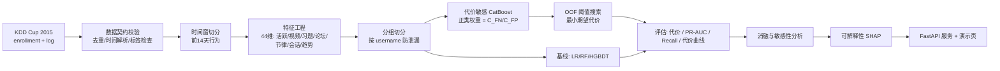
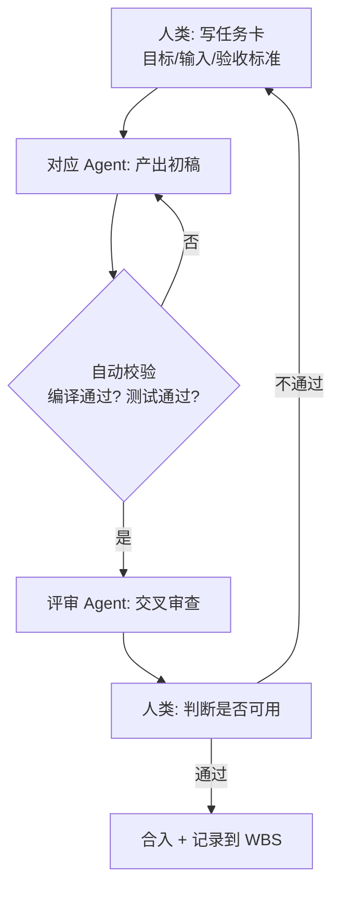

# 01 · 项目计划书

**课题**：基于代价敏感 CatBoost 的 MOOC 辍学风险预测研究
**类型**：本科毕业设计（应用研究 + 原型系统）
**周期**：2026-10-20 ~ 2027-01-11（12 周）
**首个检查节点**：2026-10-23（周五）

---

## 1. 选题背景

MOOC 的核心矛盾是「注册量巨大、完成率极低」。KDD Cup 2015 由学堂在线（XuetangX）提供真实学习行为数据，包含约 12 万条选课记录与近 2000 万条行为日志，是该方向最常用的公开基准。

但现有研究普遍存在三个问题：

1. **只报 AUC/Accuracy**：在不平衡数据上，Accuracy 会偏向多数类，AUC 高也不代表漏报少；
2. **把「代价敏感」简化为 `scale_pos_weight`**：缺少代价矩阵的业务标定、缺少阈值决策、缺少代价维度的评估；
3. **忽视数据穿越**：用整门课程的行为预测「是否辍学」，实际上已经看到了结果。

本课题针对这三点做工作：**代价矩阵显式建模 + 训练与决策双层代价敏感 + 严格时间窗特征 + 代价导向评估**。

## 2. 研究问题

| 编号 | 研究问题 | 对应实验 |
|---|---|---|
| RQ1 | 在 MOOC 辍学预测中，CatBoost 相比 LR/RF/GBDT 是否有稳定优势？ | E1 基线对比 |
| RQ2 | 代价敏感加权能否在可接受的误报增加下显著降低漏报与期望代价？ | E2 消融 |
| RQ3 | 代价最优阈值相比默认 0.5 能带来多少代价下降？代价比 ρ 变化时结论是否稳健？ | E3 阈值消融 + E4 敏感性 |
| RQ4 | 时序衰减与趋势特征对预测有多少贡献？ | E5 特征消融 |

## 3. 研究目标（可度量）

| 目标 | 度量口径 | 目标值（待正式实验校准） |
|---|---|---|
| G1 预测能力 | 测试集 PR-AUC | ≥ 0.55，且优于 3 个基线 |
| G2 少数类识别 | 代价最优阈值下 Recall | ≥ 0.75 |
| G3 决策代价 | 人均期望代价 | 比 0.5 阈值下降 ≥ 30% |
| G4 可解释性 | 输出 top-5 因子且方向合理 | 100% 请求可返回 |
| G5 工程可复现 | 一条命令训练 + 一条命令测试 | 全部通过 |

## 4. 技术路线

## 5. 创新点与差异

| # | 创新点 | 与已有工作的差异 | 可验证方式 |
|---|---|---|---|
| 1 | 业务口径的代价矩阵标定（流失损失 vs 干预成本），并做 ρ 敏感性分析 | 多数工作直接设 `pos_weight=10` 而不解释来源 | E4：ρ∈{1,2,5,10,20} 的曲线 |
| 2 | 训练层（加权）+ 决策层（阈值）双层代价敏感，并给出二者等价性证明 | 只做加权或只调阈值，未说明关系 | 第 4 章推导 + E2/E3 对比 |
| 3 | 代价导向的模型选择与调参目标（期望代价替代 AUC） | 调参目标与业务目标脱节 | E1/E2 中以 cost_per_student 排序 |

## 6. 交付物清单

| 类别 | 交付物 | 路径 | 状态 |
|---|---|---|---|
| 文档 | 项目总览 | `docs/00` | ✅ |
| 文档 | 项目计划书 | `docs/01` | ✅ |
| 文档 | 需求规格说明书 | `docs/02` | ✅ |
| 文档 | 系统设计说明书 | `docs/03` | ✅ |
| 文档 | 数据与特征说明 | `docs/04` | ✅ |
| 文档 | 算法设计说明 | `docs/05` | ✅ |
| 文档 | 实验方案与评估协议 | `docs/06` | ✅ |
| 文档 | WBS 与周检清单 | `docs/07` | ✅ |
| 文档 | 测试计划与用例 | `docs/08` | ✅ |
| 文档 | 风险登记册与答辩 QA | `docs/09` | ✅ |
| 文档 | 论文大纲与图表清单 | `docs/10` | ✅ |
| 代码 | 特征/模型/评估/服务 | `src/mooc_dropout/` | ✅ |
| 代码 | 自动化测试 | `tests/` | ✅ |
| 代码 | 训练与实验脚本 | `scripts/` | ✅ |
| 实验 | 指标与实验台账 | `reports/` | ✅ 合成与真实两套数据均已完成 |
| 论文 | 正文 + 图表 | `docs/论文初稿…` | ✅ 初稿 88 页（待答辩 PPT 与查重） |

## 7. 进度计划

| 周次 | 日期 | 主要任务 | 里程碑 |
|---|---|---|---|
| W1 | 10/20-10/26 | 调研、技术选型、框架搭建、测试代码 | **10/23 周五检查** |
| W2 | 10/27-11/02 | 真实数据接入、数据清洗、特征定稿 | 数据说明 v1.0 |
| W3 | 11/03-11/09 | 基线模型训练、首轮正式实验 | 中期材料 |
| W4 | 11/10-11/16 | 代价敏感两条路线实现（加权 / 自定义损失） | 算法模块 freeze |
| W5 | 11/17-11/23 | 阈值决策、代价曲线、评估体系 | 实验协议 freeze |
| W6 | 11/24-11/30 | 消融实验、代价比敏感性、统计检验 | 结果表 v1 |
| W7 | 12/01-12/07 | SHAP 可解释性、典型个案分析 | 图表 v1 |
| W8 | 12/08-12/14 | 原型系统完善（批量名单、导出） | 系统 v0.2 |
| W9 | 12/15-12/21 | 论文第 1-3 章 | 初稿 50% |
| W10 | 12/22-12/28 | 论文第 4-5 章 | 初稿 85% |
| W11 | 12/29-01/04 | 论文第 6-7 章、查重、格式 | 全文初稿 |
| W12 | 01/05-01/11 | 定稿、答辩 PPT、复现实验 | 提交 |

## 8. AI + Agentic 智能体团队协作机制

本课题按「1 名人类负责人 + 6 个职能 Agent」组织，Agent 负责产出初稿，人类负责判断与验收。

### 8.1 角色分工

| 角色 | 职责 | 主要产出 | 验收方式 |
|---|---|---|---|
| 人类负责人（本人） | 选题决策、方向判断、结果解释、答辩 | 论文、答辩稿 | 导师评审 |
| 调研 Agent | 文献检索、SOTA 对比、数据集调研 | 相关工作综述、数据集对比表 | 每篇文献可溯源 |
| 数据 Agent | 数据字典、清洗规则、特征口径 | `docs/04`、数据校验代码 | 契约测试通过 |
| 算法 Agent | 模型实现、消融设计、指标计算 | `models/`、`evaluation/` | 单测 + 复现 |
| 工程 Agent | 分层架构、API、配置、日志 | `api/`、`service/`、`config.py` | 接口测试通过 |
| 测试 Agent | 用例设计、边界与异常覆盖 | `tests/`、测试报告 | `pytest` 全绿 |
| 评审 Agent | 代码审查、反方提问、逻辑挑错 | 评审意见清单 | 问题闭环 |

### 8.2 协作流程

### 8.3 使用 AI 的边界（学术诚信）

- AI 用于：资料检索、代码草稿、文档润色、测试用例补全、反方提问演练；
- AI 不用于：伪造实验数据、代写核心论证、生成无法解释的结论；
- 论文附录需声明 AI 工具使用范围（如「代码框架与文档初稿在 AI 辅助下完成，实验设计与结果分析由本人完成」）；
- **底线**：任何一行代码、任何一个指标，答辩时都必须能解释清楚「为什么这样做」。

## 9. 资源与环境

| 项目 | 说明 |
|---|---|
| 硬件 | 普通笔记本（CPU 训练即可，CatBoost 600 轮 × 12 万样本约 1-3 分钟） |
| 语言/框架 | Python 3.10+、CatBoost、scikit-learn、FastAPI、pandas |
| 数据 | KDD Cup 2015 公开数据（约 800MB）；无数据时用同构合成数据兜底 |
| 版本管理 | Git，按 `feat/`、`docs/`、`exp/` 分支组织 |

## 10. 风险

见 `docs/09-风险登记册与答辩QA.md`，其中最高风险为「代价比缺乏业务依据」与「实验结论不稳定」，已分别用敏感性分析与多随机种子重复实验应对。
