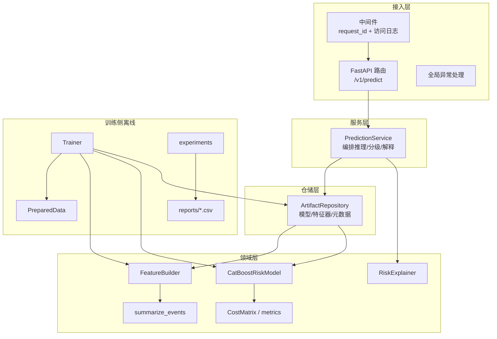
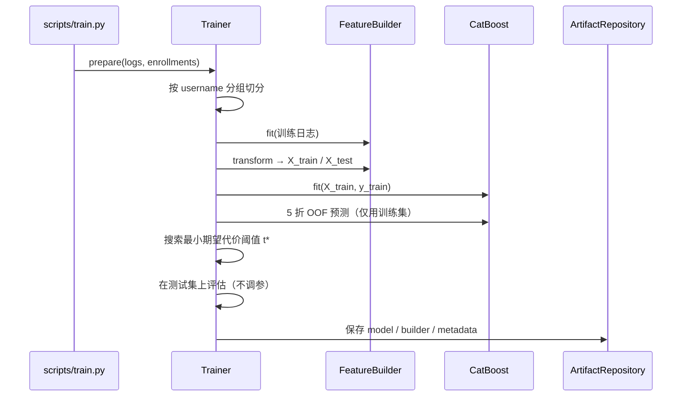
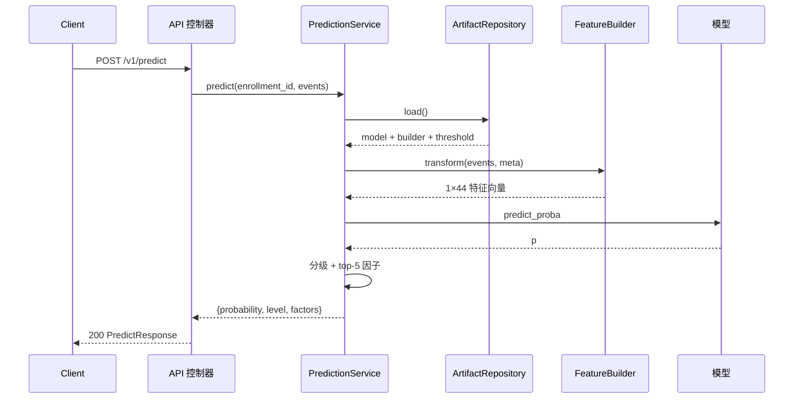

# 03 · 系统设计说明书

**版本**：v1.0 ｜ 对应代码：`src/mooc_dropout/`

---

## 1. 设计目标与约束

| 目标 | 约束 |
|---|---|
| 训练与推理共用同一套特征代码 | 特征逻辑只能有一份实现，禁止「训练用 A、线上用 B」 |
| 分层清晰、可单测 | 控制器不写业务逻辑；服务层不出现 `Request`/`Response` |
| 配置零硬编码 | 全部走环境变量并在启动时校验 |
| 故障可诊断 | 统一错误结构 + 结构化日志 + request_id |
| 无模型也能启动 | 支持「代码先上、模型后补」的部署顺序 |

## 2. 总体架构



**依赖方向**：接入层 → 服务层 → 仓储层 → 领域层。**领域层不反向依赖任何上层**，因此可被脚本直接调用（`scripts/train.py` 就是这么做）。

## 3. 分层职责

### 3.1 控制器（`api/routers/`）

只做三件事：解析请求体、调用服务、返回响应模型。

```python
@router.post("/predict", response_model=PredictResponse)
def predict(payload: PredictRequest, service: PredictionService = Depends(get_service)):
    result = service.predict(
        enrollment_id=payload.enrollment_id,
        course_id=payload.course_id,
        username=payload.username,
        events=[event.model_dump() for event in payload.events],
        top_k=5,
    )
    return PredictResponse(**result)
```

### 3.2 服务层（`service/prediction_service.py`）

承载业务规则：事件 → 特征 → 概率 → 风险分级 → 因子解释 → 批量汇总。**不导入 fastapi**。

### 3.3 仓储层（`repository/artifact_repository.py`）

模型产物的唯一读写入口，负责：
- 检查三个产物是否齐全；
- 反序列化 model / feature_builder / metadata；
- 构造 `RiskExplainer`；
- 内存缓存 + `invalidate()`（重训后可热更新）。

### 3.4 领域层

| 模块 | 职责 | 关键文件 |
|---|---|---|
| `data` | 数据契约、加载、切分 | `schema.py`、`loader.py`、`split.py` |
| `features` | 特征聚合、特征字典、构建器 | `behavior.py`、`builder.py`、`registry.py` |
| `models` | 模型抽象、CatBoost、基线 | `base.py`、`catboost_model.py`、`baseline.py` |
| `evaluation` | 代价矩阵、精确阈值、指标、平凡基线、容量分析 | `cost.py`、`metrics.py`、`capacity.py` |
| `training` | 训练编排、实验矩阵 | `trainer.py`、`experiments.py` |
| `explain` | 单样本归因 | `explainer.py` |

## 4. 关键流程

### 4.1 训练流程



### 4.2 推理流程



## 5. 模块与文件清单

```
src/mooc_dropout/
├── config.py                 Settings：环境变量 + 校验 + 路径解析
├── errors.py                 AppError 及 6 个子类
├── logging_config.py         JsonFormatter / configure_logging
├── schemas.py                Pydantic 请求响应模型
├── data/
│   ├── schema.py             COLUMNS 常量、validate_*、positive_rate
│   ├── loader.py             load_kdd_cup / generate_synthetic_dataset
│   └── split.py              group_train_test_split / oof_group_splits
├── features/
│   ├── registry.py           44 条 FeatureSpec（名称/分组/业务含义）
│   ├── behavior.py           summarize_events（向量化 groupby）
│   └── builder.py            FeatureBuilder（fit/transform/save/load）
├── models/
│   ├── base.py               BaseRiskModel 抽象
│   ├── catboost_model.py     CatBoostRiskModel（加权/无加权）
│   ├── calibration.py        ProbabilityCalibrator（Platt / 保序回归，可序列化）
│   ├── cost_sensitive_loss.py 代价敏感自定义目标
│   ├── baseline.py           LR / RF / HGBDT
│   └── registry.py           build_model 工厂
├── evaluation/
│   ├── cost.py               CostMatrix / expected_cost / 精确阈值搜索 / 代价曲线
│   ├── capacity.py           capacity_curve / best_capacity / capacity_for_recall（top-K）
│   └── metrics.py            classification_metrics（含平凡基线）/ risk_level
├── training/
│   ├── trainer.py            PreparedData / TrainConfig / Trainer
│   └── experiments.py        对比、敏感性、特征消融、Markdown 台账
├── explain/explainer.py      CatBoost 原生 SHAP + 降级策略
├── repository/artifact_repository.py
├── service/prediction_service.py
└── api/
    ├── app.py                create_app 工厂 + lifespan
    ├── middleware.py         request_id / 访问日志
    ├── errors_handler.py     4 类异常统一出口
    ├── dependencies.py       get_service / get_app_settings
    ├── routers/{health,predict,model}.py
    └── static/index.html     演示页
```

## 6. API 契约

### 6.1 POST /v1/predict

请求（`extra="forbid"`，多余字段直接 422）：

```json
{
  "enrollment_id": "E1000001",
  "course_id": "C01",
  "username": "u000001",
  "events": [
    {"time": "2014-03-01T20:00:00", "source": "video", "event": "play_video", "object": "video_C01_1"}
  ]
}
```

| 字段 | 类型 | 约束 |
|---|---|---|
| `enrollment_id` | string | 1-64 字符，必填 |
| `course_id` | string | ≤128，默认 `unknown` |
| `username` | string | ≤128，默认 `unknown` |
| `events` | array | 1-50000 条；`source` 必须属于 7 类事件 |

响应：

| 字段 | 说明 |
|---|---|
| `risk_probability` | 4 位小数，[0,1] |
| `risk_level` | `high`（≥t*）/ `medium`（≥t*/2）/ `low` |
| `decision_threshold` | 代价最优阈值 t* |
| `top_factors` | 5 条，含 `contribution` 与 `direction` |
| `model_name` / `model_version` | 追溯用 |

### 6.2 错误码

| HTTP | code | 触发条件 |
|---|---|---|
| 422 | `validation_error` | 字段缺失/类型错/source 非法/events 为空 |
| 422 | `data_quality_error` | 数据缺列、时间不可解析、标签非 0/1 |
| 404 | `not_found` | 路径不存在 |
| 500 | `internal_error` | 未预期异常（不返回堆栈） |
| 503 | `model_not_ready` | 模型产物缺失 |

统一结构：

```json
{"error": {"code": "validation_error", "message": "请求参数不合法",
           "details": {"errors": [{"loc": "body.events.0.source", "msg": "...", "type": "value_error"}]},
           "request_id": "a1b2c3d4"}}
```

## 7. 数据模型

### 7.1 特征矩阵

- 索引：`enrollment_id`
- 列：42 个 `float64` 数值特征 + 2 个 `object` 类别特征
- 顺序由 `features/registry.py` 固定，训练与推理共用 `ALL_FEATURES`

### 7.2 模型元数据（`artifacts/model/metadata.json`）

```json
{
  "model_version": "20261022T150000Z",
  "model_name": "catboost",
  "threshold": 0.0909,
  "threshold_strategy": "oof_cost",
  "cost_matrix": {"c_fn": 1000.0, "c_fp": 100.0, "ratio": 10.0, "elkan_threshold": 0.0909},
  "feature_names": ["total_events", "..."],
  "categorical_features": ["course_id", "username"],
  "n_train": 480, "n_test": 120,
  "metrics_test": {"roc_auc": 0.9, "recall": 0.8, "cost_per_student": 12.3},
  "metrics_test_at_0_5": {"...": "..."},
  "top_features": [{"feature": "active_days", "importance": 9.1}]
}
```

## 8. 配置项

| 环境变量 | 默认 | 说明 |
|---|---|---|
| `MOOC_ENV` | dev | dev/test/prod；prod 禁止通配 CORS |
| `MOOC_API_HOST/PORT` | 127.0.0.1:8000 | 监听地址 |
| `MOOC_CORS_ORIGINS` | localhost | 逗号分隔白名单 |
| `MOOC_COST_FN` / `MOOC_COST_FP` | 1000 / 100 | 代价矩阵（元） |
| `MOOC_FEATURE_WINDOW_DAYS` | 14 | 观察窗长度 |
| `MOOC_DECAY_LAMBDA` | 0.15 | 时间衰减系数 |
| `MOOC_SESSION_GAP_MINUTES` | 30 | 会话切分阈值 |
| `MOOC_ARTIFACTS_DIR` | artifacts | 产物目录 |

## 9. 设计决策记录（ADR）

| 编号 | 决策 | 理由 | 代价 |
|---|---|---|---|
| ADR-1 | 选 CatBoost 而非 XGBoost/LightGBM | 原生支持高基数类别特征，无需 One-Hot；Ordered Boosting 缓解小样本偏移 | 训练速度略慢于 LightGBM |
| ADR-2 | 按 `username` 分组切分 | 同一用户多条选课高度相关，随机切分会虚高指标 | 测试集用户与训练集不重叠，指标更保守 |
| ADR-3 | 阈值在 OOF 上选，不在测试集上调 | 避免「用测试集调参」的乐观偏差 | 训练耗时增加 K 倍 |
| ADR-4 | 不引入 shap 包 | CatBoost 原生 `ShapValues` 已够用，且支持类别特征 | 无法直接复用 shap 的绘图 API |
| ADR-5 | 模型缺失时服务仍启动 | 支持「先部署、后补模型」，便于演示与灰度 | 需额外 `/ready` 探针区分状态 |
| ADR-6 | 校准器独立落盘，而非塞进模型对象 | 仓储层按文件存在与否自动启用，未校准时行为完全不变；便于 A/B 与回滚 | 多一个产物文件，需在重训时清理旧文件 |
| ADR-7 | 名单导出走独立端点而非给批量接口加参数 | CSV 是「给人看」的产物，排序语义（按风险降序 + 优先级）与 JSON 的语义不同；独立端点便于加 `only_flagged` 等业务筛选 | 接口数量增加一个 |

## 10. 部署与运行

```bash
# 开发
python scripts/serve.py --reload

# 生产（单进程多 worker 示例）
uvicorn mooc_dropout.api.app:app --host 0.0.0.0 --port 8000 --workers 2
```

上线前检查清单：`/ready` 返回 200、CORS 为显式域名、日志为 JSON、`X-Request-ID` 透传、限流与 HTTPS 由网关层负责。
