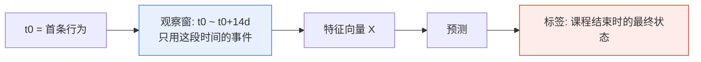

# 04 · 数据说明与特征工程

---

## 1. 数据集

**主数据集**：KDD Cup 2015（XuetangX / 学堂在线）

| 文件 | 内容 | 规模 |
|---|---|---|
| `enrollment_train.csv` | 选课记录与标签 | 约 12 万行 |
| `log_train.csv` | 学习行为日志 | 约 1900 万行 |
| `truth_train.csv` | 标签（备用） | 与选课表一致 |

字段：

| 列 | 含义 | 示例 |
|---|---|---|
| `enrollment_id` | 选课唯一 ID | `1` |
| `username` | 学习者 ID（脱敏） | `9Uee` |
| `course_id` | 课程 ID | `course_1` |
| `dropout` | 是否辍学（0/1） | `1` |
| `time` | 行为时间 | `2014-06-14 04:00:00` |
| `source` | 事件类型 | `video` |
| `event` | 具体动作 | `play_video` |
| `object` | 操作对象 | `H2K4gTQ...` |

七类事件：`access`、`discussion`、`navigate`、`page_close`、`problem`、`video`、`wiki`。

**兜底方案**：无网络/无数据时，`scripts/make_demo_data.py` 生成字段完全同构的合成数据（默认 4000 条选课、辍学率 18%），仅用于联调与演示，**不作为论文实验结论来源**。

## 2. 标签定义与不平衡

### 2.1 口径

- 正类（1）= 该选课最终辍学；
- 负类（0）= 完成课程 / 获得证书。

必须说明的一点：KDD Cup 2015 不同课程的 dropout 率差异很大（部分课程超过 60%），**若正类比例过高，就失去「少数类识别」的研究意义**。此时采用「早期辍学」口径：

> 在课程前 30% 时长内不再产生任何学习行为，定义为早期辍学。

该口径需在论文中明确写出，并与原口径做对比说明。

### 2.2 不平衡处理策略

| 层面 | 手段 | 说明 |
|---|---|---|
| 数据层 | 不做欠采样 | 会丢失大量负类信息，且破坏代价语义 |
| 算法层 | 类别加权 `w₁ = C_FN/C_FP` | 与阈值决策同源，可证明等价 |
| 决策层 | 代价最优阈值（通常 ≪ 0.5） | 直接优化期望代价 |
| 评估层 | PR-AUC、Recall、期望代价 | 不用 Accuracy 作为主指标 |

## 3. 防数据穿越设计（关键）



三条硬规则：

1. **只用窗口内事件**：`time <= t0 + window_days`，`tests/test_features.py::test_no_leakage_beyond_observation_window` 专门验证；
2. **不用未来统计量**：不做全量标准化、不用全量目标编码（CatBoost 的有序目标统计在训练内部完成，本身即防泄漏）；
3. **按用户分组切分**：同一 `username` 不跨集。

## 4. 数据清洗规则

| 规则 | 处理 | 代码位置 |
|---|---|---|
| 必需列缺失 | 抛 `DataQualityError`，列出缺失列 | `data/schema.py` |
| `enrollment_id` 重复 | 抛错（选课表唯一） | `validate_enrollments` |
| 时间不可解析 | 抛错并给出行号 | `validate_logs` |
| 未知 `source` | 抛错，列出允许值 | `validate_logs` |
| 标签非 0/1 | 抛错 | `validate_enrollments` |
| 某选课无任何日志 | 保留但不参与训练（特征全 0 无法区分），需在论文中标注样本量 | `Trainer.prepare` |
| 事件在窗口外 | 直接丢弃 | `summarize_events` |

> 设计取向：**编译期（数据入口）严格，运行期宽容**。宁可训练前报错，也不让脏数据悄悄进模型。

## 5. 特征体系（44 维 / 9 组）

### 5.1 基础活跃（9）

| 特征 | 含义 |
|---|---|
| `total_events` | 窗口内事件总数 |
| `active_days` | 有行为的去重天数 |
| `unique_objects` | 触及的去重学习对象数 |
| `span_days` | 首末行为的时间跨度 |
| `days_since_last_event` | 距窗口结束的天数（越大越早沉默） |
| `events_per_active_day` | 活跃日均事件数 |
| `events_per_day` | 按窗口折算的日均事件数 |
| `active_day_ratio` | `active_days / window_days` |
| `span_ratio` | `span_days / window_days` |

### 5.2 分类型行为（11）

`n_video`、`n_problem`、`n_discussion`、`n_navigate`、`n_page_close`、`n_access`、`n_wiki`，以及 `video_ratio`、`problem_ratio`、`discussion_ratio`、`navigate_ratio`。

> 教育解释：主动学习行为（video/problem）占比高通常对应低风险；纯导航/关闭页占比高往往是「刷页面」而非学习。

### 5.3 行为深度（5）

| 特征 | 公式 | 含义 |
|---|---|---|
| `video_unique_objects` | `nunique(object), source=video` | 看了多少不同视频 |
| `video_replay_ratio` | `n_video / video_unique` | 重复观看强度（可能代表难度大） |
| `problem_unique_objects` | — | 做了多少不同题 |
| `problem_repeat_ratio` | `n_problem / problem_unique` | 反复尝试强度 |
| `discussion_unique_objects` | — | 参与讨论的广度 |

### 5.4 时间节律（3）

- `night_event_ratio`：22:00-06:00 事件占比；
- `weekend_event_ratio`：周末事件占比；
- `hour_entropy`：小时分布的香农熵 $H=-\sum_h p_h \log p_h$，熵越低说明学习时间越集中/越规律。

### 5.5 会话结构（6）

按 30 分钟无操作切分会话：

- `n_sessions`、`mean_session_events`、`max_session_events`；
- `mean_gap_hours`、`gap_std_hours`、`max_gap_days`（最长中断）。

> `max_gap_days` 是最具业务解释力的特征之一：连续多日不出现，往往先于正式辍学。

### 5.6 趋势与衰减（8）

指数衰减加权活动量：

$$S=\sum_{t} \exp\big(-\lambda \cdot (T_{\text{end}}-t)\big)\cdot x_t,\quad \lambda=0.15$$

| 特征 | 含义 |
|---|---|
| `decayed_events` | 衰减加权事件量，越近的行为权重越高 |
| `decayed_active_days` | 衰减加权活跃天数 |
| `early_events` / `late_events` | 窗口前后半段事件数 |
| `late_event_ratio` | `late / (early + late)` |
| `activity_trend` | `(late - early) / (late + early + 1)` ∈ [-1,1] |
| `first_3day_events` | 冷启动 3 天事件数（「首周效应」） |
| `last_3day_events` | 窗口末 3 天事件数 |

### 5.7 类别标识（2）

`course_id`、`username` 作为 CatBoost 原生类别特征：高基数、免 One-Hot、内部用有序目标统计编码。

### 5.8 特征工程小结

| 组 | 数量 | 对应论文表格 |
|---|---|---|
| 基础活跃 | 9 | 表 4-2 |
| 分类型行为 | 11 | 表 4-3 |
| 行为深度 | 5 | 表 4-4 |
| 时间节律 | 3 | 表 4-5 |
| 会话结构 | 6 | 表 4-6 |
| 趋势衰减 | 8 | 表 4-7 |
| 类别标识 | 2 | 表 4-8 |
| **合计** | **44** | — |

## 6. 特征计算示例

某学生窗口内共 120 条事件，分布在 8 个不同日期，首末事件相隔 12.5 天，窗口 14 天：

```
active_days        = 8
active_day_ratio   = 8 / 14 = 0.571
total_events       = 120
events_per_active_day = 120 / 8 = 15.0
days_since_last_event = 1.2   （最后一次学习在 1.2 天前）
early_events = 78, late_events = 42
late_event_ratio = 42 / 120 = 0.35
activity_trend   = (42-78)/121 = -0.298   ← 学习强度明显下滑
```

`activity_trend = -0.298` 与 `days_since_last_event` 偏大，是该学生被判高风险的主要依据。

## 7. 特征质量检查（实验前必做）

| 检查 | 方法 | 处理 |
|---|---|---|
| 缺失率 | `X.isna().mean()` | 构建器已将 NaN 填 0，但需确认缺失语义合理 |
| 常量化 | `nunique() == 1` | 删除常数特征（不参与建模） |
| 极端偏态 | 偏度 > 5 | 论文中说明；树模型对单调变换不敏感，可不处理 |
| 高相关 | `|r| > 0.95` 的特征对 | 保留可解释性更好的那个 |
| 重要性 | CatBoost `feature_importance` | 写入 `artifacts/model/feature_importance.csv` |

## 8. 已知局限

1. **无课程内容元数据**：难度、时长、教师风格未纳入，跨课程泛化受限；
2. **无人口学信息**：KDD 数据不含年龄、学历、地域，无法讨论教育公平性；
3. **观察窗固定 14 天**：不同课程节奏不同，可做窗口长度敏感性分析（可作为后续工作）；
4. **单次事件频率不代表学习质量**：无法区分「挂机播放」与「认真观看」。
