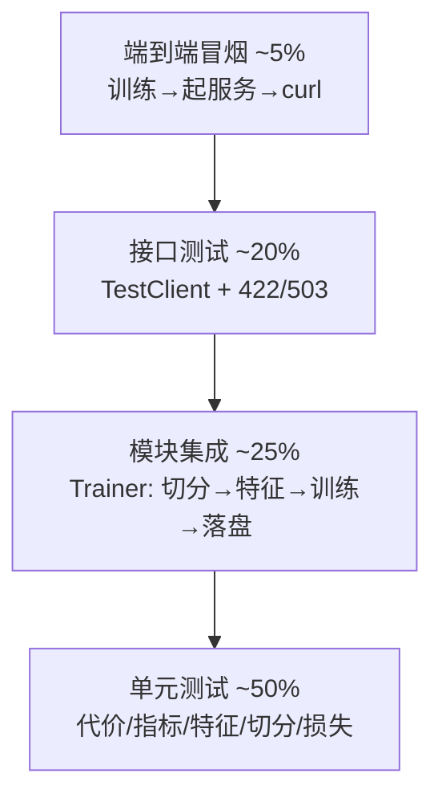

# 08 · 测试计划与用例

---

## 1. 测试策略



| 层级 | 目标 | 手段 | 运行时间 |
|---|---|---|---|
| 单元测试 | 纯函数与领域逻辑正确 | pytest + 合成小数据 | < 20s |
| 集成测试 | 模块协作与产物落盘 | 训练一个小模型（HGBDT 60 轮） | < 60s |
| 接口测试 | HTTP 契约、错误结构 | `fastapi.testclient` | < 30s |
| 冒烟测试 | 真实链路可用 | 命令行脚本 + curl | 手工 |

## 2. 测试环境

| 项 | 值 |
|---|---|
| Python | 3.10+（CI 建议 3.11） |
| 依赖 | `requirements-dev.txt`（含 pytest / httpx） |
| 数据 | 会话级合成数据（600 条选课，辍学率 25%） |
| 隔离 | 每个测试用 `tmp_path` 存放产物，不污染 `artifacts/` |
| 随机性 | 固定 `seed=7`，结果可复现 |

执行：

```bash
pytest -q                                   # 全量
pytest tests/test_cost.py -v                # 单文件
pytest -q -m "not slow"                     # 跳过慢用例
pytest --cov=mooc_dropout --cov-report=term-missing
```

## 3. 测试用例

### 3.1 代价与决策（`tests/test_cost.py`）

| 编号 | 场景 | 预期 | 对应函数 |
|---|---|---|---|
| TC-C01 | 默认代价比 10:1 | t* = 100/1100 ≈ 0.0909 | `test_elkan_threshold_matches_closed_form` |
| TC-C02 | 加入 C_TP 后阈值变化 | 阈值上升（更谨慎） | `test_threshold_shifts_when_intervention_cost_added` |
| TC-C03 | 非法代价（0 或负数） | 抛 `CostMatrixError` | `test_invalid_cost_matrix_raises` |
| TC-C04 | 代价非对称性 | FN 代价 1000、FP 代价 100 | `test_cost_of_is_asymmetric` |
| TC-C05 | 总额与人均代价 | 1100 / 275 | `test_total_and_per_student_cost` |
| TC-C06 | 最优阈值不劣于 0.5 | `cost(t*) ≤ cost(0.5)` | `test_optimal_threshold_beats_default_on_expected_cost` |
| TC-C07 | 代价曲线结构 | 6 列、21 行、TP 单调不增 | `test_cost_curve_columns_and_argmin` |
| TC-C08 | 网格点过少 | 抛 `ValueError` | `test_cost_curve_rejects_too_few_points` |

### 3.2 指标与分级（`tests/test_metrics.py`）

| 编号 | 场景 | 预期 |
|---|---|---|
| TC-M01 | 完美预测 | Recall=1、Precision=1、代价=0 |
| TC-M02 | 阈值降低 | FN 不增、Recall 不降 |
| TC-M03 | FN 更贵的矩阵 | 总代价更高 |
| TC-M04 | 单一类别标签 | ROC-AUC 为 NaN（不崩溃） |
| TC-M05 | 分级边界 | p≥t 高、t/2≤p<t 中、其余低 |
| TC-M06 | 阈值 ≤ 0 | 抛 `ValueError` |
| TC-M07 | 长度不一致 | 抛 `ValueError` |

### 3.3 特征工程（`tests/test_features.py`）

| 编号 | 场景 | 预期 |
|---|---|---|
| TC-F01 | 特征字典一致性 | 计算的列 == 登记的 44 项 |
| TC-F02 | 事件计数 | `total_events` 等于窗口内事件数 |
| TC-F03 | **防穿越** | 追加 60 天后的事件不改变特征 |
| TC-F04 | 数值合法性 | 无 NaN/Inf、计数非负 |
| TC-F05 | 比率边界 | 各类 ratio ∈ [0,1] |
| TC-F06 | 未 fit 直接 transform | 抛 `ValidationFailure` |
| TC-F07 | 缺列 | 抛 `DataQualityError` |
| TC-F08 | 非法事件类型 | 抛 `DataQualityError` |
| TC-F09 | 未见过的课程/用户 | 走 `unknown` 分支不报错 |
| TC-F10 | **单条 vs 批量一致性** | 特征值逐列相等 |
| TC-F11 | 空日志 | 抛 `ValueError` |

### 3.4 切分（`tests/test_split.py`）

| 编号 | 场景 | 预期 |
|---|---|---|
| TC-S01 | 分组切分 | 用户集合无交集 |
| TC-S02 | 切分比例 | 测试集占比 10%~35% |
| TC-S03 | 两侧类别 | 均含正负类 |
| TC-S04 | 非法 test_size | 抛 `ValueError` |
| TC-S05 | OOF 覆盖 | 每行恰好验证一次，且训练/验证用户不重叠 |

### 3.5 模型（`tests/test_model.py`）

| 编号 | 场景 | 预期 |
|---|---|---|
| TC-P01 | LR/RF/HGBDT 概率 | shape 正确、∈[0,1]、重要性降序 |
| TC-P02 | 代价加权效果 | 加权后预警率 ≥ 未加权 |
| TC-P03 | 未知模型名 | 抛 `ValueError` |
| TC-P04 | 保存/加载 | 预测结果完全一致 |
| TC-P05 | 单一类别训练 | 抛 `ValueError` |
| TC-P06 | CatBoost 训练（条件跳过） | 概率合法、重要性列数对齐 |
| TC-P07 | CatBoost 无加权模式 | 可正常训练 |
| TC-P08 | 非法 weighting | 抛 `ValueError` |

### 3.6 代价敏感损失（`tests/test_cost_sensitive_loss.py`）

| 编号 | 场景 | 预期 |
|---|---|---|
| TC-L01 | 样本代价系数 | 正类 10、负类 1（按 C_FP 归一） |
| TC-L02 | 梯度符号 | p=0.5 时正类梯度为负 |
| TC-L03 | 代价比缩放 | 正类梯度绝对值是负类的 ρ 倍 |
| TC-L04 | 代价中立且类别均衡 | 梯度之和为 0 |
| TC-L05 | CatBoost 符号约定 | der1 = -grad、der2 = -hess |
| TC-L06 | 极端 logit | 导数有限、hessian ≥ 0 |
| TC-L07 | 非法代价 | 抛 `ValueError` |

### 3.7 训练流水线（`tests/test_trainer.py`）

| 编号 | 场景 | 预期 |
|---|---|---|
| TC-T01 | 切分分组性 | 训练/测试用户不重叠 |
| TC-T02 | 产物落盘 | 3 个模型文件 + metrics.json 均存在 |
| TC-T03 | 元数据完整性 | 9 个必需字段齐全 |
| TC-T04 | 阈值策略 | Elkan 策略下阈值等于解析解 |
| TC-T05 | 指标完整性 | 分级人数之和 == 样本数 |
| TC-T06 | OOF 阈值流程 | 阈值 ∈ (0,1)，OOF 指标存在 |

### 3.8 接口（`tests/test_api.py`）

| 编号 | 场景 | 预期 |
|---|---|---|
| TC-A01 | GET /health | 200，含 version/env |
| TC-A02 | request_id 透传 | 响应头回显自定义 ID |
| TC-A03 | GET /ready | 200，model_ready=true |
| TC-A04 | POST /v1/predict | 200，概率/等级/因子齐全 |
| TC-A05 | 非法 source | 422，code=validation_error |
| TC-A06 | 空 events | 422 |
| TC-A07 | 多余字段 | 422（extra=forbid） |
| TC-A08 | 批量预测 | 条数一致、汇总人数一致 |
| TC-A09 | GET /v1/model/info | 特征数 ≥ 40、阈值 > 0 |
| TC-A10 | GET /v1/model/features | 每项含 group |
| TC-A11 | 演示页 | 200 且含标题 |
| TC-A12 | 模型缺失 | /ready 503、预测 503（model_not_ready） |
| TC-A13 | 干预名单 CSV | 200、text/csv、表头正确、`X-Total-Count` == 行数 |
| TC-A14 | 名单按等级筛选 | `min_level=high` 时仅返回 high |

### 3.9 概率校准（`tests/test_calibration.py`）

| 编号 | 场景 | 预期 |
|---|---|---|
| TC-CAL01 | `method=none` | 恒等变换（截断到 [0,1]） |
| TC-CAL02 | 单一类别拟合 | 抛 `ValueError` |
| TC-CAL03 | 未拟合直接 transform | 抛 `ModelNotReadyError` |
| TC-CAL04 | Platt / 保序单调性 | 输出单调不减、值域 ∈ [0,1] |
| TC-CAL05 | Platt 保序性 | 校准前后 ROC-AUC 完全一致 |
| TC-CAL06 | 保存 / 加载 | 变换结果逐元素相等 |
| TC-CAL07 | 元数据 | 记录方法、拟合样本数、正例率 |
| TC-CAL08 | 训练集成（保序） | 产物含 `calibrator.joblib`、阈值已重选、留档未校准指标 |
| TC-CAL09 | 重新加载 | 仓储层 `is_calibrated=True` |
| TC-CAL10 | 关闭校准重训 | 旧校准器被删除，避免尺度错配 |

### 3.10 仓储与配置（`tests/test_repository.py`）

| 编号 | 场景 | 预期 |
|---|---|---|
| TC-R01 | 产物缺失 | 抛 `ModelNotReadyError`，含 missing 明细 |
| TC-R02 | 正常加载 + 缓存 | 两次 load 返回同一对象 |
| TC-R03 | 非法日志级别 | pydantic 校验失败 |
| TC-R04 | 生产环境通配 CORS | 校验失败 |
| TC-R05 | 相对路径解析 | 落到项目根目录 |

### 3.11 真实数据接入（`tests/test_loader_truth.py`）

| 编号 | 场景 | 预期 |
|---|---|---|
| TC-D01 | truth 无表头合并 | 首条记录不被当成列名，样本数不丢 |
| TC-D02 | truth 有表头合并 | 标签正确对齐 |
| TC-D03 | 选课表已含 dropout | 无需 truth 文件即可加载 |
| TC-D04 | 既无标签又无 truth | 抛 `DataQualityError`，提示放 truth |
| TC-D05 | truth 部分覆盖 | 抛错而非静默产生 NaN 标签 |

### 3.12 阈值精确搜索与平凡基线（`tests/test_cost.py`、`tests/test_metrics.py`）

| 用例 | 场景 | 期望 |
|---|---|---|
| TC-TH01 | 最优阈值落在 0.01 以下 | 精确搜索能取到，网格搜索取不到（回归：真实数据上的「阈值恒为 0.01」） |
| TC-TH02 | 单类标签 | `total_cost` 仍可计算，AUC 为 NaN |
| TC-BL01 | 正类占 80% 且模型全报警 | `baseline_cost_trivial` == 全报警代价，`cost_reduction_vs_trivial` == 0 |
| TC-BL02 | 正类占 20% 且模型全放行 | 平凡基线取两条策略的较小者 |
| TC-BL03 | 完美模型 | 相对下降 == 1.0 |
| TC-BL04 | 键存在性 | 四个基线字段不得因重构消失 |

### 3.13 容量分析（`tests/test_capacity.py`）

| 用例 | 场景 | 期望 |
|---|---|---|
| TC-CAP01 | 完美排序、K = 基率 | 召回 1.0、精确率 1.0、代价 0 |
| TC-CAP02 | K = 100% | 精确率退化为基率、lift == 1、代价 == 全报警基线 |
| TC-CAP03 | lift 随 K 变化 | K 增大 lift 单调趋近 1；召回单调不减 |
| TC-CAP04 | attrs | 带 n / n_pos / base_rate / 两条平凡基线 |
| TC-CAP05 | `best_capacity` | 取人均代价最小行 |
| TC-CAP06 | `capacity_for_recall(0.8)` | 返回满足召回的最小名单 |
| TC-CAP07 | 参数校验 | 容量越界、长度不一致、含 NaN 均抛 `ValueError` |
| TC-CAP08 | 目标召回越界 | 抛 `ValueError` |
| TC-CAP09 | 高基率退化场景 | 阈值退化为全报警，但 top-10% 的 lift 仍 > 1（阈值失效 ≠ 模型无用） |

### 3.14 训练期对齐（`tests/test_trainer.py`）

| 用例 | 场景 | 期望 |
|---|---|---|
| TC-OOF01 | enrollment_id 非等宽补零（字典序 ≠ 行序） | OOF 按 ID 对齐到 `X_train.index`，OOF AUC > 0.6（回归：真实数据上 OOF AUC 0.51 / 测试 0.82 的错位） |

### 3.15 实验编排对齐（`tests/test_experiments.py`）

| 用例 | 场景 | 期望 |
|---|---|---|
| TC-OOF02 | 同一份重映射 ID 上跑完整对比实验（`run_comparison`） | 预警比例 < 0.95、0.02 < 阈值 < 0.9、ROC-AUC > 0.6 |

> TC-OOF02 与 TC-OOF01 针对的是**同一缺陷的两份独立实现**：`trainer.py` 的生产路径与
> `experiments.py` 的实验路径各自按行号回填过 OOF。只修一处、只测一处，另一处仍会在
> 真实数据上静默出错。错位时的特征症状是「阈值塌到边界 + 预警比例 ≈ 1.0」，因此断言
> 落在预警比例上，而不是阈值本身。

## 4. 覆盖率目标与实际

| 模块 | 目标 | 实测 | 说明 |
|---|---|---|---|
| `evaluation/` | ≥ 90% | 96%（capacity 94%、cost 92%） | 决策逻辑，错一点结论就错 |
| `features/` | ≥ 85% | 94%（behavior 100%） | 特征正确性直接决定指标 |
| `models/` | ≥ 80% | 84%~91% | CatBoost 依赖缺失分支可跳过 |
| `service/`、`repository/` | ≥ 80% | 97% / 98% | 推理主链路 |
| `api/` | ≥ 75% | 100%（predict 路由） | 主要端点已覆盖 |
| `training/` | ≥ 75% | 96% / 81% | 集成式，单测成本高 |
| **合计** | — | **93%** | 1786 行语句，未覆盖 122 行 |

当前用例总数 **115**（新增：校准 10、真实数据接入 8、阈值精确搜索 1、平凡基线 4、容量分析 9、OOF 对齐 2）。
明细见 `reports/覆盖率报告.md`；逐行 HTML 明细可用
`pytest --cov=src/mooc_dropout --cov-report=html:reports/coverage` 重新生成（构建产物，不入库）。

## 5. 缺陷分级

| 级别 | 定义 | 示例 | 处理时限 |
|---|---|---|---|
| P0 | 主流程不可用 / 数据泄漏 | 训练报错、窗口外事件进入特征 | 当天 |
| P1 | 结论错误风险 | 阈值来自测试集、代价算错 | 2 天 |
| P2 | 功能缺失但不影响结论 | 干预名单未做筛选条件 | 1 周 |
| P3 | 体验问题 | 演示页样式 | 答辩前 |

## 6. 已知未覆盖项（诚实记录）

| 项 | 原因 | 计划 |
|---|---|---|
| 12 万条真实数据下的性能测试 | 数据未接入 | 数据到位后补 |
| CatBoost 自定义损失的端到端训练 | 已手工验证符号约定（AUC>0.5），尚未纳入自动化测试 | 11/06 前补 |
| 校准器在极端概率区间的稳定性 | 需真实数据的长尾分布才能测 | 数据到位后补 |
| 并发压测 | 毕设规模不需要 | 可选 |
| 浏览器兼容性 | 仅 Chrome 验证 | 可选 |
