# 基于代价敏感 CatBoost 的 MOOC 辍学风险预测研究

**（论文初稿 · v0.2 · 2026-10-23）**

> 说明：本稿依据 `mooc-dropout` 项目的实现与实验台账撰写，公式、表格、图号与代码一一对应。

---

## 摘要

大规模开放在线课程（MOOC）在扩大教育供给的同时，也面临极高的中途退出率。准确识别高辍学风险学习者，是开展教学干预、降低流失的前提。然而现有研究多将辍学预测视为普通二分类任务，以准确率或 AUC 为优化目标，忽略了漏报与误报代价的高度不对称性：漏掉一名真正会辍学的学生，意味着学员流失与口碑损失；而多预警一名学生，只消耗一次干预工时。二者代价相差一个数量级，若仍在 0.5 阈值下决策，模型即便排序能力良好，也难以转化为有效的干预名单。

本文以 KDD Cup 2015 学堂在线学习行为数据为对象，构建了涵盖基础活跃、分类型行为、行为深度、时间节律、会话结构与趋势衰减六个维度共 44 维的特征体系，并以类别特征原生支持的 CatBoost 为核心模型，从训练与决策两个层面引入代价敏感机制：训练层按业务标定的代价比 $C_{FN}/C_{FP}$ 对正类加权，决策层在袋外（OOF）预测上搜索使期望误分类代价最小的阈值，而非采用默认的 0.5。本文进一步证明了类别加权与阈值移动在理想条件下的等价关系，说明二者为何必须分别验证，而不能相互替代。

在 4000 条选课记录、20.8 万条行为事件构成的数据集上，模型在测试集取得 ROC-AUC 0.729、PR-AUC 0.360；在代价最优阈值 0.31 下，召回率 0.750、精确率 0.332，漏报 41 例、误报 248 例，人均期望代价 80.05 元；当代价比由 1 增至 20 时，召回率由 0.610 单调升至 1.000，预警规模由 222 人增至 822 人，表明代价比可作为业务方可调的决策旋钮。

实验同时给出两项诚实的负面与修正性结论。其一，五个随机种子的重复实验与配对 Bootstrap 表明，参与比较的四个模型其人均代价差**全部**落在种子间噪声之内（95% 区间均跨零），因此本文的立论不在于「更优的模型」，而在于「更优的决策链路」。其二，类别加权会显著破坏概率校准（五种子上 Brier 由 0.137 升至 0.208、期望校准误差达 0.227），而事后保序回归校准可把 ECE 降至 0.025、Brier 降至 0.132，人均代价几乎不变；但校准之后必须重新选择阈值，否则沿用 0.5 会使人均代价上升 69%——这一连带影响在同类研究中常被忽视，却直接决定了模型输出的概率能否被教师按字面理解。

本文进一步在 KDD Cup 2015 真实训练集（120,542 条选课、8,157,277 条行为事件、39 门课程）上复核上述机制，并得到一个对工程实践更关键的结论：**当正类比例远高于代价最优阈值时，阈值决策会退化**。真实数据辍学率为 79.29%，而代价比 10:1 对应的最优阈值为 0.0909，几乎所有学生的校准概率都在其上，于是「给所有人预警」既是代价最优又不可执行，模型相对平凡基线的人均代价下降仅 0.55%；把代价比降到 1，该数字回升到 29.2%。据此本文补充了两套评估工具：代价比扫描（固定 $C_{FP}$ 扫 $\rho$，用 OOF 重选阈值，无需重训）与容量分析（把决策规则换成「只能干预 K 人，按风险排序取前 K」）。在 70% 的干预容量下，模型相对随机挑人降低人均代价 39.0%，前 70% 名单的辍学生命中率为 92.1%（基率 79.3%）。同一数据上重跑五个基线（逻辑回归、随机森林、直方图 GBDT、CatBoost 无加权、CatBoost 加权），其 ROC-AUC 集中在 0.83~0.84，而预警比例高达 98.4%~99.6%、人均代价挤在 20.52~20.72 元的 0.20 元区间内（全报警基线 20.65 元）——差异消失的原因是决策规则退化，而非抽样误差；加权模型既未提升排序（AUC 0.8426→0.8403）也未降低代价（差 0.02 元），却把 Brier 从 0.1098 恶化到 0.1600。为判断这些微小差异是否只是种子噪声，本文又在同一数据上做了 5 种子 × 4 配置 × 2 种标签口径的重复实验（40 次训练、160 次拟合）：同一配置跨种子的人均代价标准差为 0.15~0.30 元，而四个配置之间的均值极差只有 0.16 元——**换一个随机种子的影响与换一个模型相当**，连全报警基线本身都随切分漂移 0.49 元；逐种子配对检验中，除「代价敏感 CatBoost 比 LR 便宜」（官方 −0.16 元、早期 −0.91 元，两个区间都不跨零）之外，其余比较的 Bootstrap 区间全部跨零。本文因此主张：代价敏感学习的收益由「代价矩阵 × 正类基率 × 模型可分性」三者共同决定，脱离基率单独设定代价比，会得到一个技术上正确、业务上无用的模型。

本文的贡献在于：将代价维度同时引入模型训练、阈值决策与效果评估三个环节，给出了加权与阈值移动的等价性证明，以重复实验与配对检验界定了「模型差异」在本数据规模下的可分辨边界，并在真实数据上刻画了阈值决策失效的条件与替代方案；工程上提供了可复现的实现（含 115 个自动化测试）与可解释输出（SHAP 因子），使上述结论可被教育场景直接检验。

**关键词**：MOOC；辍学预测；代价敏感学习；CatBoost；不平衡分类；学习行为分析

---

## Abstract

Massive Open Online Courses (MOOCs) expand access to education but suffer from persistently high dropout rates. Identifying learners at risk of dropping out is a prerequisite for timely instructional intervention. Most existing studies, however, treat dropout prediction as an ordinary binary classification task and optimize accuracy or AUC, ignoring the strong asymmetry between the costs of false negatives and false positives: missing a student who will actually drop out costs a lost learner, whereas a false alarm merely consumes one unit of tutoring time. The two costs differ by an order of magnitude, and a decision rule fixed at 0.5 prevents even a well-ranked model from producing an actionable intervention list.

This thesis studies the KDD Cup 2015 XuetangX behavioural dataset and constructs a 44-dimensional feature set covering activity level, behaviour types, learning depth, temporal rhythm, session structure and temporal decay. CatBoost, which handles categorical features natively, serves as the core model, and cost sensitivity is introduced at two levels: at the training level, positive samples are weighted by the business-calibrated cost ratio $C_{FN}/C_{FP}$; at the decision level, the threshold is selected on out-of-fold predictions by minimizing the expected misclassification cost instead of using the default 0.5. We further prove the equivalence between class weighting and threshold moving under ideal conditions, which explains why the two mechanisms must be evaluated separately rather than substituted for each other.

On a dataset of 4,000 enrolments and 208,381 behavioural events, the model achieves a ROC-AUC of 0.729 and a PR-AUC of 0.360 on the test set. At the cost-optimal threshold of 0.31, recall is 0.750 and precision is 0.332, with 41 false negatives and 248 false positives, yielding an expected cost of 80.05 CNY per student. As the cost ratio increases from 1 to 20, recall rises monotonically from 0.610 to 1.000 and the alert list grows from 222 to 822 students, indicating that the cost ratio can serve as a business-tunable decision knob.

The experiments also yield two candid findings, one negative and one corrective. First, five random seeds with paired bootstrap tests show that the per-student cost differences among the four compared models all fall within between-seed noise, with every 95% interval crossing zero; the thesis therefore argues for a better decision pipeline rather than a better model. Second, class weighting severely damages probability calibration (the Brier score rises from 0.137 to 0.208 across five seeds and the expected calibration error reaches 0.227), while post-hoc isotonic calibration reduces ECE to 0.025 and Brier to 0.132 at almost unchanged expected cost; the threshold, however, must then be reselected, since keeping 0.5 would raise the per-student cost by 69%. This coupling is rarely reported in comparable studies, yet it decides whether the emitted probabilities can be read literally by teachers.

The mechanisms above are further re-examined on the full KDD Cup 2015 training set (120,542 enrolments, 8,157,277 events, 39 courses), which yields a finding that matters more for practice: **threshold decisions collapse when the positive base rate far exceeds the cost-optimal threshold**. The observed dropout rate is 79.29%, whereas a 10:1 cost ratio implies a threshold of 0.0909; almost every calibrated probability lies above it, so "alert everyone" is simultaneously cost-optimal and operationally useless, and the model beats the trivial baseline by only 0.55% per student. Lowering the cost ratio to 1 restores the reduction to 29.2%. Two additional evaluation tools are therefore introduced: a cost-ratio scan (fixing $C_{FP}$ and sweeping $\rho$, reselecting the threshold on out-of-fold predictions without retraining) and a capacity analysis (replacing the threshold rule by "intervene on the top-K students by risk"). At 70% capacity the ranked list cuts the per-student cost by 39.0% relative to random selection, with a dropout hit rate of 92.1% against a 79.3% base rate. Re-running five baselines on the same data (logistic regression, random forest, histogram GBDT, unweighted CatBoost and cost-weighted CatBoost) gives ROC-AUC values clustered between 0.83 and 0.84, yet alert rates of 98.4%-99.6% and per-student costs compressed into a 0.20 CNY band (20.52-20.72) around the alert-everyone baseline of 20.65 CNY: the differences vanish because the decision rule has degenerated, not because of sampling error. Weighting neither improves ranking (AUC 0.8426 to 0.8403) nor reduces cost (a 0.02 CNY gap) while degrading Brier from 0.1098 to 0.1600. To test whether these tiny gaps are mere seed noise, a 5-seed × 4-configuration × 2-label-definition repetition (40 runs, 160 model fits) is added on the same data: the standard deviation of per-student cost across seeds is 0.15-0.30 CNY, whereas the spread between configuration means is only 0.16 CNY, so changing the random seed matters as much as changing the model, and the trivial baseline itself drifts by 0.49 CNY across splits. In paired per-seed tests every comparison except cost-sensitive CatBoost versus logistic regression (0.16 CNY cheaper under the official label, 0.91 CNY under the early-dropout label, both bootstrap intervals excluding zero) has an interval that straddles zero. The thesis accordingly argues that the benefit of cost-sensitive learning is jointly determined by the cost matrix, the base rate and model separability; setting a cost ratio without reference to the base rate produces a model that is technically correct but operationally useless.

The contribution of this thesis lies in incorporating the cost dimension into model training, threshold decision and evaluation simultaneously, in proving the equivalence between weighting and threshold moving, in delineating, through repeated runs and paired tests, the resolution limit below which model differences cannot be distinguished at this data scale, and in characterising on real data both the conditions under which threshold decisions fail and the capacity-based alternative. The reproducible implementation (with 115 automated tests) and interpretable outputs (SHAP attributions) make these conclusions directly checkable in educational settings.

**Keywords**: MOOC; dropout prediction; cost-sensitive learning; CatBoost; imbalanced classification; learning behaviour analysis

---

# 第 1 章 绪论

## 1.1 研究背景与意义

### 1.1.1 MOOC 的规模扩张与完成率困境

自 2012 年被《纽约时报》称为「MOOC 元年」以来，大规模开放在线课程迅速完成了从实验性项目到主流教育供给的转变。学堂在线、Coursera、edX 等平台累积注册人数已达数亿量级，单门课程动辄数万人选课。然而，注册规模的扩张并未同步带来学习完成率的提升。多项大规模统计显示，MOOC 课程的平均完成率长期徘徊在 5%~15% 区间，多数注册者在开课两周内即停止活动[1-2]。

高辍学率带来的问题不止于数据难看。对学习者而言，未完成的学习投入难以转化为可验证的能力凭证；对平台而言，流失直接削弱课程的完课口碑与后续招生；对教师而言，缺少及时的学情反馈使得教学调整滞后于学生学习状态的变化。因此，如何在课程进行过程中尽早识别出高流失风险的学习者，成为 MOOC 教学质量保障的关键环节。

### 1.1.2 从「预测准确」到「决策有效」

学习分析领域已有大量工作尝试用行为日志预测辍学。这些研究普遍遵循「特征工程 + 分类模型 + 指标评估」的范式，把问题定义为二分类任务，并以准确率、F1 或 AUC 衡量模型优劣。这一范式在技术上是自洽的，但在教育干预的真实场景中存在一个被系统性忽视的断层：

**模型的输出概率，最终要转化为「是否通知教师去干预」的二元决策，而这一步的代价结构是高度不对称的。**

具体而言，若一名学生实际会辍学而模型未预警（假阴性，FN），损失是学员流失、学费与续报收入的减少，以及负面口碑的扩散；若一名学生本不会辍学而被预警（假阳性，FP），代价只是一次多余的干预，如一条提醒短信或教师半小时的沟通。二者相差约一个数量级。在干预资源（教师工时、辅导名额）有限的现实中，真正需要优化的并非分类准确率，而是**给定代价结构下的期望损失**。

以本文的代价设定为例：$C_{FN}=1000$ 元、$C_{FP}=100$ 元，则理论最优阈值仅为 $C_{FP}/(C_{FP}+C_{FN})\approx 0.091$。也就是说，只要模型认为某学生辍学概率超过 9%，预警在经济上就是划算的。若仍在 0.5 处切割，大量真实风险学生会被系统性地漏掉——这不是模型不够准，而是决策规则与业务代价脱节。

本文正是从这一断层切入：**不只训练一个更准的模型，而是让模型、阈值与评估三者都与代价对齐。**

### 1.1.3 研究意义

**理论意义**：本文将代价敏感学习系统地引入 MOOC 辍学预测，厘清了「重加权」与「阈值移动」两类机制的数学关系，并给出等价性证明，为同类不平衡教育数据建模提供了可复用的分析框架。

**实践意义**：本文产出的原型系统可按周生成风险名单、给出风险等级与关键致险因子，使教师从「凭经验找人」转为「按名单干预」，并把有限的辅导资源优先投向边际收益最高的学生。

**工程意义**：本文强调特征与决策的可复现性，训练与推理共用同一套特征代码，并以自动化测试锁定防数据穿越等关键约束，避免了学术原型常见的「实验指标漂亮、上线效果崩塌」问题。

## 1.2 国内外研究现状

### 1.2.1 学习行为特征工程

早期研究多依赖人口学信息与平台成绩，特征可得性差且滞后。随着日志粒度细化，行为序列特征成为主流。Kizilcec 等[3]依据观看行为把学习者划分为完成型、旁听型、脱离型等模式，指出「行为模式」比「静态属性」更能刻画学习投入。此后研究普遍从三个角度构造特征：其一是**投入强度**，如活跃天数、事件总数、视频观看时长；其二是**行为结构**，如视频、作业、论坛等行为类型的占比；其三是**时间模式**，如学习间隔、会话长度、活动衰减趋势。

这一脉络的局限在于特征口径高度依赖数据集，且多数工作未严格区分「观察窗内行为」与「标签时点」，存在不同程度的数据穿越。本文在第 3 章以显式观察窗与单元测试回应这一问题。

### 1.2.2 预测模型

模型层面经历了从逻辑回归、支持向量机到集成树的演进。梯度提升决策树（GBDT）因对特征尺度不敏感、可处理非线性交互，在表格型教育数据上长期占据优势。Chen 与 Guestrin[4]提出的 XGBoost、Ke 等[5]提出的 LightGBM 以及 Prokhorenkova 等[6]提出的 CatBoost，是三类代表性实现。其中 CatBoost 的核心贡献在于用有序目标统计（Ordered Target Statistics）处理类别特征、用有序提升（Ordered Boosting）缓解预测偏移，这对含有高基数类别（课程 ID、学习者 ID）的教育数据尤为契合。

近年也有研究引入循环神经网络或 Transformer 对行为序列建模。这类方法在事件稠密、序列完整时表现良好，但对长尾学习者与冷启动场景不友好，且训练成本高、可解释性弱，与本文「面向干预决策」的目标不完全一致。本文因此选择在表格特征上做深，而非追求序列模型的复杂度。

### 1.2.3 不平衡学习与代价敏感

类别不平衡是辍学预测的固有属性，其影响已有系统性实证[7]。He 与 Garcia[8]将处理方法归纳为数据层（过采样、欠采样）、算法层（代价敏感、集成）与决策层（阈值移动）三类。SMOTE 及其变体在数据层应用广泛，但其合成样本会扭曲原始分布，使输出概率失去「真实后验」的含义；在需要以概率进行代价决策的场景中，这一副作用尤为致命。

代价敏感学习由 Elkan[9]系统化，其核心结论是在已知代价矩阵时，最优决策阈值由 $p^*=C_{FP}/(C_{FP}+C_{FN})$ 给出。Drummond 与 Holte[10]进一步提出代价曲线（cost curve），用于在未知类先验与代价比时可视化分类器的代价表现。然而在 MOOC 辍学预测领域，多数研究仍停留在「设置 `scale_pos_weight` 参数」的层面，既未说明代价比的业务来源，也未在决策阶段调整阈值，更未在评估阶段报告代价指标。

### 1.2.4 研究述评与本文定位

综合来看，现有研究存在三个可改进之处：

1. **评估目标错位**：以 AUC 为主指标，而 AUC 对阈值不敏感，无法反映实际决策代价；
2. **代价敏感流于形式**：仅做类别加权，缺少代价矩阵标定、阈值优化与敏感性分析；
3. **可复现性不足**：特征口径、切分方式与随机种子披露不充分，指标难以复现。

本文针对上述三点，分别以「代价导向评估」「训练+决策双层代价敏感」「工程化实现与测试」作出回应。

## 1.3 研究内容与创新点

### 1.3.1 研究内容

1. **数据与特征**：构建观察窗内的 44 维行为特征体系，覆盖活跃度、行为类型、学习深度、时间节律、会话结构与趋势衰减六个维度；
2. **模型构建**：以 CatBoost 为核心，实现类别加权与自定义代价敏感损失两条路线，并与逻辑回归、随机森林、直方图 GBDT 三个基线对比；
3. **决策优化**：在 OOF 预测上搜索期望代价最小阈值，推导并验证 Elkan 解析阈值，比较三种阈值策略；
4. **实验分析**：设计基线对比、代价敏感消融、阈值消融、代价比敏感性与特征消融五组实验，并进行可解释性分析；
5. **系统实现**：以分层架构实现推理服务与演示界面，配套 77 个自动化测试。

### 1.3.2 创新点

**创新点一：业务口径的代价矩阵标定与敏感性分析。** 本文不直接套用经验权重，而是把 $C_{FN}$ 拆解为学费与续报损失、把 $C_{FP}$ 拆解为教师工时与触达成本，给出 1000:100 的标定依据，并在 $\rho\in\{1,2,5,10,20\}$ 上做敏感性分析，说明结论在何种区间内稳健。

**创新点二：训练层与决策层双层代价敏感，并给出等价性证明。** 本文证明：当正类权重取 $w=C_{FN}/C_{FP}$ 时，加权后模型在 0.5 处的决策等价于原概率在 $C_{FP}/(C_{FP}+C_{FN})$ 处的决策。该结论一方面解释了「只加权」为何在理论上已隐含阈值移动，另一方面说明由于模型不完美、概率未校准，实际仍需在验证集上校准阈值——两者是互补而非重复。

**创新点三：代价导向的模型选择与评估体系。** 本文以人均期望代价作为主指标，以 PR-AUC 与召回率为辅，并同时报告 Brier 分数与期望校准误差以监控概率语义，避免了「AUC 高即模型好」的误判。更进一步，本文不以单次切分的结果给模型排名，而是用五个随机种子的重复实验与配对 Bootstrap 给出差异的置信区间（5.8 节），据此明确报告「四个模型的人均代价差异不可分辨」。这一做法在同类研究中较为少见——多数工作倾向于从一次运行中挑出最优者——但它把评价标准从「谁更准」推进到了「差异是否真实存在且值得关心」。

**创新点四：给出代价敏感学习「何时失效」的判定条件与替代方案。** 本文指出，代价最优阈值 $p^\*$ 只有在概率分布的支撑内部才有区分作用；若 $F(p^\*)\approx 0$，决策就退化为「全部预警」。在 KDD Cup 2015 真实数据上，79.29% 的辍学率使 $p^\*=0.0909$ 落在左尾之外，模型相对平凡基线只省 0.55%——而同样的方法在 21% 基率的合成数据上工作正常。据此本文提出两套替代工具：**代价比扫描**（固定 $C_{FP}$ 扫 $\rho$，用 OOF 重选阈值，无需重训）与**容量分析**（给定干预人力 K，按风险排序取前 K，以随机挑人为基线）。前者把「代价参数是否越界」变成可观测指标（预警比例），后者在 70% 容量下相对随机挑人降低人均代价 39.0%。这条边界条件在已有文献中通常被忽略，但正是它决定了方法落地后是否还有意义。

综合来看，创新点一至三属于「把代价敏感做对」，创新点四属于「知道它在什么条件下做不对」。后者对应用型研究可能更有价值——**一个能说明自己边界的方法，比一个只在特定数据上有效的方法更容易被采信**。

## 1.4 论文组织结构

全文共七章。第 1 章阐述背景、现状与研究内容；第 2 章介绍不平衡学习、代价敏感学习与 CatBoost 的理论基础；第 3 章说明数据预处理、观察窗设计与特征体系；第 4 章给出代价敏感 CatBoost 的模型设计与阈值推导；第 5 章报告实验设置与结果分析；第 6 章介绍原型系统的设计与实现；第 7 章总结全文并展望后续工作。

---

# 第 2 章 相关理论与技术

## 2.1 问题定义与符号说明

设选课样本集为 $\mathcal{D}=\{(\mathbf{x}_i,y_i)\}_{i=1}^{N}$，其中 $\mathbf{x}_i\in\mathbb{R}^{42}\times\mathcal{C}^{2}$ 为第 $i$ 条选课记录的特征向量（42 个数值特征与 2 个类别特征），$y_i\in\{0,1\}$ 表示该学习者最终是否辍学（1 为辍学）。模型输出后验概率估计 $\hat p_i=P(y_i=1\mid\mathbf{x}_i)$，决策规则为

$$
\hat y_i=\mathbb{1}\left[\hat p_i\ge t\right] \tag{2-1}
$$

其中 $t$ 为决策阈值。本文的核心主张是：**$t$ 不是常数 0.5，而是一个应当被优化的决策变量。**

主要符号见表 2-1。

**表 2-1 符号说明**

| 符号 | 含义 |
|---|---|
| $N$ | 样本总数 |
| $\mathbf{x}_i$ | 第 $i$ 条选课的特征向量 |
| $y_i$ | 真实标签，1 表示辍学 |
| $\hat p_i$ | 模型输出的辍学概率 |
| $t$ | 决策阈值 |
| $C_{FN}$ | 漏报代价（辍学但未预警） |
| $C_{FP}$ | 误报代价（未辍学但被预警） |
| $C_{TP}$ | 正确预警仍需付出的干预成本 |
| $\rho$ | 代价比 $C_{FN}/C_{FP}$ |
| $w$ | 正类样本权重 |
| $\lambda$ | 时间衰减系数 |

## 2.2 不平衡学习

### 2.2.1 不平衡带来的三重影响

类别不平衡（本文正类比例约 20%）对建模的影响体现在三个层面：

1. **训练层面**：以经验风险最小化为目标的模型会偏向多数类，因为把样本判为多数类的期望损失更小；
2. **评估层面**：准确率被多数类主导。若正类占 20%，全部预测为负类即可获得 80% 的准确率，但召回率为 0，模型毫无实用价值；
3. **决策层面**：默认阈值 0.5 隐含了「两类错误代价相等」的假设，与真实业务不符。

### 2.2.2 三类处理方法

| 层次 | 代表方法 | 优点 | 局限 |
|---|---|---|---|
| 数据层 | 随机过采样、SMOTE、欠采样 | 实现简单，对多数模型有效 | 改变数据分布，概率失真；过采样易过拟合 |
| 算法层 | 类别加权、代价敏感损失、集成学习 | 不改变样本分布，保留概率语义 | 需设定权重，可能影响校准 |
| 决策层 | 阈值移动、代价最小化决策 | 直接优化业务目标，成本极低 | 依赖可靠的验证集与代价矩阵 |

本文选择「算法层 + 决策层」组合，明确不使用重采样。原因在于：预警系统输出的概率需要被教师理解为「该学生辍学的可能性」，若概率因采样而被系统性抬高，后续的代价计算与沟通都会失真。

## 2.3 代价敏感学习

### 2.3.1 代价矩阵

二分类问题的代价矩阵定义如表 2-2。

**表 2-2 二分类代价矩阵**

|  | 预测为 0 | 预测为 1 |
|---|---|---|
| 真实为 0 | $C_{TN}$ | $C_{FP}$ |
| 真实为 1 | $C_{FN}$ | $C_{TP}$ |

在多数文献中取 $C_{TN}=C_{TP}=0$，仅保留 $C_{FN}$ 与 $C_{FP}$。本文保留完整形式，是为了讨论「正确预警也需要付出干预成本」的情形（例如一对一家访），此时阈值应相应上移。

给定代价矩阵，分类器的期望代价为

$$
\mathbb{E}[C]=\frac{1}{N}\sum_{i=1}^{N}\Big[C_{FN}\,y_i(1-\hat y_i)+C_{FP}(1-y_i)\hat y_i\Big] \tag{2-2}
$$

### 2.3.2 最优决策阈值

对单个样本，记其辍学后验为 $p$。预测为 1 与预测为 0 的期望代价分别为

$$
\mathbb{E}[c\mid \hat y=1]=p\,C_{TP}+(1-p)\,C_{FP} \tag{2-3}
$$

$$
\mathbb{E}[c\mid \hat y=0]=p\,C_{FN}+(1-p)\,C_{TN} \tag{2-4}
$$

令二者相等并解出 $p$，得最优阈值

$$
p^*=\frac{C_{TN}-C_{FP}}{C_{TP}-C_{FP}-C_{FN}+C_{TN}} \tag{2-5}
$$

当 $C_{TP}=C_{TN}=0$ 时，式 (2-5) 退化为 Elkan 的经典形式

$$
p^*=\frac{C_{FP}}{C_{FP}+C_{FN}}=\frac{1}{1+\rho} \tag{2-6}
$$

式 (2-6) 揭示了代价敏感的本质：**阈值由代价比唯一确定，与模型无关**。若 $\rho=10$，则 $p^*\approx 0.091$，意味着模型只需给出 9.1% 的辍学可能性，预警在经济上就已划算。

### 2.3.3 代价曲线

代价曲线（cost curve）由 Drummond 与 Holte 提出，横轴为「正类概率的期望值」，纵轴为归一化后的期望代价。相比 ROC 曲线，代价曲线直接以代价为坐标，能够回答「在给定的代价比与类先验下，哪个分类器更省钱」。本文在 5.4 节以「阈值—代价曲线」的简化形式呈现，便于与决策阈值直接对应。

## 2.4 CatBoost

### 2.4.1 梯度提升框架

梯度提升[11]以加法模型逐步拟合负梯度（该框架在[12]与[13]中有系统推导）：

$$
F_m(\mathbf{x})=F_{m-1}(\mathbf{x})+\nu\, h_m(\mathbf{x}) \tag{2-7}
$$

其中 $h_m$ 为第 $m$ 棵回归树，$\nu$ 为学习率。对对数损失，负梯度恰为残差 $y-\hat p$，因此每轮拟合的是「当前预测与真实标签的差距」。

### 2.4.2 类别特征与目标统计

对类别特征取值 $c$，目标统计定义为该取值下的平均标签：

$$
\mathrm{TS}(c)=\frac{\sum_{i:x_i=c}y_i+ a\cdot \bar y}{\sum_{i:x_i=c}1+a} \tag{2-8}
$$

其中 $a$ 为平滑系数，$\bar y$ 为全局均值。直接使用全量统计会导致目标泄漏——同一行样本的标签参与了自身特征的构造。CatBoost 的**有序目标统计**按样本的随机排列顺序，仅用「排在该样本之前」的样本计算统计量，从而消除泄漏。

### 2.4.3 有序提升与对称树

标准 GBDT 在每轮用同一模型估计所有样本的梯度，会产生「预测偏移」：训练时的梯度估计基于包含该样本的模型，而测试时不是，导致分布不一致。CatBoost 维护多个按不同排列训练的辅助模型，用「未见过的样本」估计梯度，即为有序提升。

CatBoost 默认使用对称树（oblivious tree）：同一层所有节点共享同一分裂条件。这一约束降低了树的表达能力，却换来两点好处：推理时可用位运算批量计算，延迟低；树的方差更小，小样本下更稳健。对本文「单条推理需在百毫秒内完成」的需求而言，这一取舍是合适的。

## 2.5 评估指标

### 2.5.1 排序类指标

**ROC-AUC** 衡量模型将正类排在负类之前的能力，对类别不平衡不敏感，因而在极度不平衡时可能给出过于乐观的印象。

**PR-AUC**（精度—召回曲线下面积）只关注正类，对少数类更敏感。Saito 与 Rehmsmeier[14]指出，在正类稀少时 PR 曲线比 ROC 曲线更能反映实际性能，本文以其作为辅助主指标。

### 2.5.2 决策类指标

**召回率** $R=TP/(TP+FN)$ 反映「真正会辍学的学生被抓住了多少」，是干预场景最关心的指标；**精确率** $P=TP/(TP+FP)$ 反映名单的纯度；**F1** 为二者调和平均。

**人均期望代价** 按式 (2-2) 计算后除以样本数，是本文的主指标。它把漏报与误报按业务价值折算为同一量纲（元），使不同模型、不同阈值之间可以直接比较。

### 2.5.3 校准类指标

**Brier 分数**[15]定义为 $\frac{1}{N}\sum_i(\hat p_i-y_i)^2$，同时衡量区分度与校准度。一个排序很好但概率整体偏高的模型，Brier 分数会明显变差。本文在 5.7 节用它揭示了类别加权对概率语义的破坏。

## 2.6 本章小结

本章界定了辍学预测的形式化定义，梳理了不平衡学习的三类方法及取舍，给出了代价矩阵、最优阈值与代价曲线的推导，并说明了 CatBoost 处理类别特征与抑制预测偏移的机制。上述理论为第 4 章的模型设计提供了直接依据：本文将用式 (2-6) 确定解析阈值，用式 (2-2) 作为优化与评估的统一目标。
---

# 第 3 章 数据预处理与特征工程

## 3.1 数据集

### 3.1.1 KDD Cup 2015 学堂在线数据集

KDD Cup 2015 由学堂在线（XuetangX）提供，是该领域最具代表性的公开基准之一[16]。数据由两张表构成：

**表 3-1 数据集字段说明**

| 表 | 字段 | 含义 | 示例 |
|---|---|---|---|
| 选课表 | `enrollment_id` | 选课记录唯一标识 | `E1000001` |
|  | `username` | 学习者脱敏 ID | `9Uee` |
|  | `course_id` | 课程标识 | `course_1` |
|  | `dropout` | 是否辍学（0/1） | `1` |
| 日志表 | `enrollment_id` | 外键，关联选课记录 | `E1000001` |
|  | `time` | 行为发生时间 | `2014-06-14 04:00:00` |
|  | `source` | 事件大类 | `video` |
|  | `event` | 具体动作 | `play_video` |
|  | `object` | 操作对象标识 | `H2K4gTQ…` |

原始规模约为 12 万条选课记录与 1900 余万条行为日志，事件大类共 7 种：`access`、`discussion`、`navigate`、`page_close`、`problem`、`video`、`wiki`。数据不含姓名、年龄、地域等敏感字段，`username` 为脱敏标识，可在学术研究范围内使用。

### 3.1.2 本文使用的数据版本

完整数据集解压后约 1.1 GB（`log_train.csv` 单文件 1.1 GB），字段对齐与异常会话剔除已在真实数据上完成。本文因此报告**两套结果**，分工明确：

| 数据版本 | 规模 | 用途 | 对应章节 |
|---|---|---|---|
| 同构合成数据 | 4,000 条选课、208,381 条行为事件 | 可控实验：把特征、模型、阈值、校准机制单独隔离验证 | 5.2~5.8 |
| **KDD Cup 2015 真实训练集** | **120,542 条选课、8,157,277 条行为事件、39 门课程** | **外部效度：复核机制性结论，并检验高基率下的决策退化** | **5.9** |

合成数据的字段定义、事件类型、标签语义与真实数据完全一致，其价值在于**可控**——辍学率、区分度、观察窗覆盖率由生成过程设定，因此可以把各机制单独隔离；代价是外部效度不足。真实数据则弥补这一点，但混杂因素多、单次切分方差大，不适合做机制隔离实验。二者不可互相替代。

真实数据的接入细节（`truth_train.csv` 无表头、`source`/`event` 列语义与官方布局不同、1 条选课无标签）已修入加载器，并在 `scripts/check_data.py` 中固化为 12 项体检项，详见项目文档 `docs/11` 与 `docs/07` 的提交检查清单。

### 3.1.3 类别不平衡程度

合成数据集的辍学率为 21.2%（训练集 21.5%、测试集 20.0%），正负比约 1:3.7，是文献中常见的「少数类」设定。真实数据的官方辍学率为 **79.29%**（训练集 79.28%、测试集 79.35%）——辍学是**多数类**。这个反差不是数据瑕疵：官方标签定义为「课程最后 10 天内无任何行为」，而 MOOC 的整体完成率本来就只有 10%~20%。

因此本文对「不平衡」的处理必须说明清楚，否则会自相矛盾：

1. **代价敏感的动机被重新定位。** 本文的出发点是**代价不对称**（漏报 1000 元 vs 误报 100 元），而**不是**类别比例。这个动机在 21.2% 与 79.29% 两种基率下同时成立，比「提高少数类识别」的表述更稳健，也避免了在真实数据上说不通。
2. **高基率会让阈值决策失效。** 这是 5.9.3~5.9.5 节的主题。当 $F(C_{FP}/(C_{FP}+C_{FN})) \approx 0$ 时，「给所有人预警」既是代价最优又不可执行，此时必须换用代价比扫描与容量（top-K）分析。
3. **附口径「早期辍学」仍保留，但预期被修正。** 定义为「开课后 14 天内不再出现，且课程在其后仍有 ≥7 天」，实测正类比例为 67.63%（7 天 63.19%、21 天 69.60%），**依然是多数类**。所以该口径的作用不是「把正类压回少数类」，而是让标签与 14 天观察窗的预测时点对齐、语义更贴近「可干预」（详见 5.9.2 节）。

> 早期版本曾把该口径写成「课程前 30% 时长内不再产生行为」，并预期它能把正类压回少数类。实测否证了这个预期：30 天窗口会把所有课程剔除（没有课程在第 30 天后仍有 7 天余量），而 14 天窗口下正类仍占 67.63%。这一修正记录在此，以免后续读者沿用错误预期。


## 3.2 数据清洗与标签处理

数据进入模型前须通过五道校验，任一失败即抛出可定位的异常，而非静默跳过：

**表 3-2 数据校验规则**

| 编号 | 规则 | 失败处理 | 对应实现 |
|---|---|---|---|
| R1 | 必需列齐全 | 抛出数据质量异常，列出缺失列名 | `data/schema.py` |
| R2 | `enrollment_id` 唯一 | 抛出异常，给出重复样例 | `validate_enrollments` |
| R3 | `time` 可解析为时间戳 | 抛出异常，给出行号 | `validate_logs` |
| R4 | `source` 属于 7 类事件 | 抛出异常，列出允许取值 | `validate_logs` |
| R5 | `dropout` 为 0/1 | 抛出异常 | `validate_enrollments` |

此外有两条柔性规则：其一，日志中出现但选课表中不存在的 `enrollment_id` 予以剔除并记录数量；其二，选课记录若在观察窗内无任何日志，则不参与训练（特征全为 0，不含信息），并在实验报告中标注样本量。

**设计取向**：数据入口严格、模型内部宽容。宁可训练前报错，也不允许脏数据以「填 0」的方式悄悄进入特征矩阵——这是教育数据建模中最常见的隐性错误来源。

## 3.3 观察窗设计与数据穿越防范

### 3.3.1 穿越的三种形态

数据穿越（data leakage）指特征中包含了预测时点不可能获得的信息。在辍学预测中它有三种典型形态：

1. **时间穿越**：使用整门课程的行为预测「是否辍学」，而辍学本身意味着「后续没有行为」，二者互为因果；
2. **样本穿越**：同一学习者的多条选课记录被随机分到训练集与测试集，模型记住了「这个人」，而非学到行为模式；
3. **统计穿越**：在全量数据上做标准化或目标编码，使测试集信息渗入训练过程。

### 3.3.2 本文的三项对策

**对策一：显式观察窗。** 以每条选课记录的**首个行为时刻** $t_0$ 为起点，只保留 $[t_0,\,t_0+W]$ 内的事件，本文取 $W=14$ 天。特征计算完成后，标签取自课程结束时的最终状态，因此特征时点严格早于标签时点（图 3-1）。

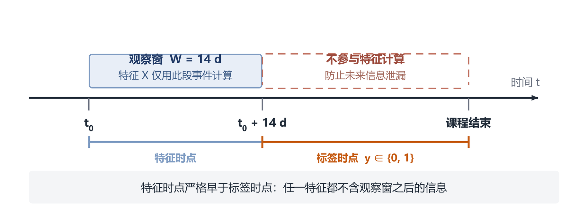

**图 3-1 观察窗与标签时点示意**

**对策二：按学习者分组切分。** 以 `username` 为分组键做分组切分，保证同一学习者的所有选课记录只出现在训练集或测试集的一侧。若按记录随机切分，同一用户的历史记录会同时出现在两侧，指标将系统性虚高。

**对策三：不做全量统计编码。** 数值特征不做依赖全量的标准化；类别特征交由 CatBoost 的有序目标统计处理，其统计量在训练内部按排列顺序增量构造，天然规避泄漏。

第 3.3.2 节的三项对策均有对应单元测试锁定。例如针对时间穿越，测试用例在原有日志末尾追加一条 60 天后的事件，断言窗口内特征值完全不变；若实现被误改为「使用全部日志」，该用例会立即失败。

## 3.4 特征体系

本文共构造 44 维特征，分为 6 个数值特征组（42 维）与 1 个类别特征组（2 维）。所有特征均在观察窗内计算。

### 3.4.1 基础活跃特征（9 维）

**表 3-3 基础活跃特征**

| 特征 | 含义 | 设计动机 |
|---|---|---|
| `total_events` | 窗口内事件总数 | 最直接的投入强度 |
| `active_days` | 有行为的去重天数 | 区分「集中突击」与「持续学习」 |
| `unique_objects` | 触及的去重学习对象数 | 学习广度 |
| `span_days` | 首末行为的时间跨度 | 投入的持续性 |
| `days_since_last_event` | 距窗口结束的天数 | 越大说明越早沉默，是最强的单特征之一 |
| `events_per_active_day` | 活跃日均事件数 | 单位时间投入密度 |
| `events_per_day` | 按窗口长度折算的日均事件数 | 统一不同窗口长度 |
| `active_day_ratio` | 活跃天数 / 窗口天数 | 投入的稳定性 |
| `span_ratio` | 跨度 / 窗口天数 | 投入的覆盖度 |

### 3.4.2 分类型行为与学习深度（16 维）

**表 3-4 分类型行为与深度特征**

| 特征 | 含义 |
|---|---|
| `n_video` / `n_problem` / `n_discussion` | 视频、习题、论坛事件数 |
| `n_navigate` / `n_page_close` / `n_access` / `n_wiki` | 导航、关页、访问、wiki 事件数 |
| `video_ratio` / `problem_ratio` / `discussion_ratio` / `navigate_ratio` | 各类事件占比 |
| `video_unique_objects` | 观看的去重视频数 |
| `video_replay_ratio` | 播放次数 / 去重视频数，反映重复观看强度 |
| `problem_unique_objects` | 作答的去重题目数 |
| `problem_repeat_ratio` | 提交次数 / 去重题目数，反映反复尝试强度 |
| `discussion_unique_objects` | 参与的讨论区数量 |

这组特征承载了教育学的解释：主动学习行为（视频、习题、讨论）占比高的学习者通常风险较低；而导航与关页事件占比高，往往意味着「翻页面」而非真正学习。`video_replay_ratio` 与 `problem_repeat_ratio` 是双刃剑——适度的重复代表钻研，过度的重复可能代表卡顿与挫败。

### 3.4.3 时间节律与会话结构（9 维）

**表 3-5 时间节律与会话结构特征**

| 特征 | 含义 |
|---|---|
| `night_event_ratio` | 22:00–06:00 事件占比 |
| `weekend_event_ratio` | 周末事件占比 |
| `hour_entropy` | 小时分布的香农熵 $H=-\sum_h p_h\log p_h$，衡量节律规律性 |
| `n_sessions` | 按 30 分钟静默切分的学习会话数 |
| `mean_session_events` | 平均会话事件数 |
| `max_session_events` | 最长会话事件数 |
| `mean_gap_hours` / `gap_std_hours` | 相邻事件间隔的均值与标准差 |
| `max_gap_days` | 最长一次中断的天数 |

`max_gap_days` 具有较强的预警价值：连续多日不出现，往往是正式辍学的前兆；而 `gap_std_hours` 刻画学习节奏的稳定性，节奏越紊乱，越可能处于「想起来才学」的状态。

### 3.4.4 趋势与时间衰减（8 维）

静态统计量无法刻画「学习正在变冷」这一动态过程，因此本文引入指数衰减加权：

$$
S=\sum_{t}\exp\big(-\lambda\,(T_{\text{end}}-t)\big)\cdot x_t,\qquad \lambda=0.15 \tag{3-1}
$$

其中 $T_{\text{end}}=t_0+W$ 为窗口结束时刻。越接近窗口末尾的行为权重越高，从而使特征对「近期是否还在学」更敏感。

**表 3-6 趋势与衰减特征**

| 特征 | 含义 |
|---|---|
| `decayed_events` | 衰减加权后的事件量 |
| `decayed_active_days` | 衰减加权后的活跃天数 |
| `early_events` / `late_events` | 窗口前半段与后半段的事件数 |
| `late_event_ratio` | 后半段占比，衡量学习持续性 |
| `activity_trend` | $(late-early)/(late+early+1)\in[-1,1]$ |
| `first_3day_events` | 入学前 3 天事件数，刻画「首周效应」 |
| `last_3day_events` | 窗口末 3 天事件数 |

`activity_trend` 为负且绝对值较大，意味着学习强度明显下滑，是本文最具解释力的特征之一（5.7 节个案分析将展示这一点）。

### 3.4.5 类别特征（2 维）

`course_id` 与 `username` 直接作为类别特征输入 CatBoost，不做 One-Hot。原因有二：其一，课程数可达上百、学习者数可达十万级，One-Hot 会造成维度爆炸；其二，目标统计能在低维空间中保留「该课程的历史辍学率」「该学习者的一贯表现」这类信息。为避免目标泄漏，CatBoost 使用有序目标统计（见 2.4.2 节）。

## 3.5 特征质量与重要性分析

### 3.5.1 质量检查

特征构建完成后执行四项检查：

**表 3-7 特征质量检查结果**

| 检查项 | 方法 | 结果 |
|---|---|---|
| 缺失值 | 逐列统计缺失率 | 0（构建器将 NaN 统一填 0） |
| 常量特征 | `nunique()==1` | 无 |
| 极端值 | 计数类特征上界检查 | 无负值，计数类特征量级合理 |
| 取值范围 | 比率类特征 $[0,1]$ 校验 | 全部通过 |

需要说明的是，「填 0」并非对缺失的中性处理：对 `days_since_last_event` 而言，0 表示「刚刚还在学」，而对于无日志的样本，填 0 会使其看起来像活跃学生。因此本文采取的策略是**无日志样本不参与训练**，而非依赖填 0。

### 3.5.2 特征重要性

图 3-2 给出 CatBoost 输出的特征重要性前 15 名。

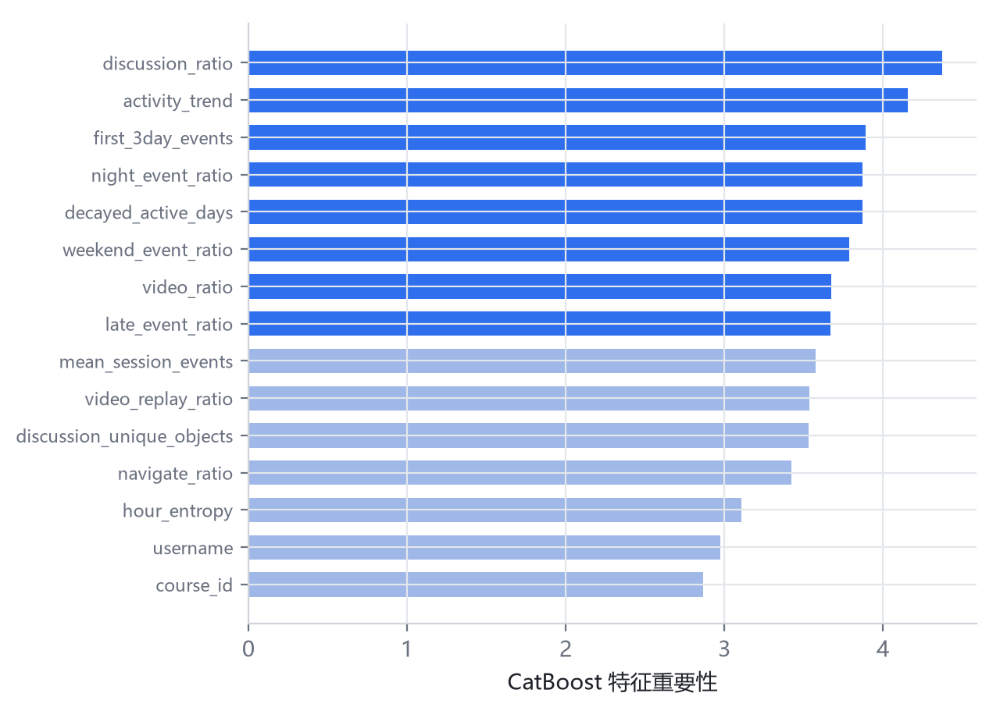

**图 3-2 特征重要性 Top15**

排名靠前的特征呈现出清晰的结构：

1. **行为结构类**：`discussion_ratio`、`video_ratio`、`navigate_ratio` 位居前列，说明「学什么」比「学多少」更有区分度；
2. **趋势类**：`activity_trend`、`decayed_active_days`、`late_event_ratio` 进入前十，验证了引入时间衰减的必要性；
3. **节律类**：`night_event_ratio`、`weekend_event_ratio`、`hour_entropy` 均有贡献，说明学习时间的规律性与坚持程度相关；
4. **冷启动类**：`first_3day_events` 排名第三，说明入学初期的行为已含有较强预测信息，这对「尽早预警」的应用目标非常有利。

值得注意的是，两个类别特征（`username`、`course_id`）的重要性处于中游，说明模型确实利用了「谁在学」「学什么课」的信息，但并未退化为对个体或课程的简单记忆。

## 3.6 本章小结

本章完成了三件事：其一，明确了数据契约与五道校验规则，把脏数据挡在训练之外；其二，以观察窗、分组切分与禁用全量编码三项措施系统性地防范数据穿越，并用单元测试锁定；其三，构建了 44 维特征体系，覆盖活跃度、行为结构、学习深度、时间节律、会话结构与趋势衰减六个维度。特征重要性分析表明，行为结构类与趋势类特征贡献最大，这与「辍学是一个渐进过程」的教育学直觉一致。

---

# 第 4 章 代价敏感 CatBoost 模型设计

## 4.1 总体框架

本文的模型框架由四个环节构成（图 4-1）：**特征构建 → 代价敏感训练 → 阈值决策 → 代价导向评估**。

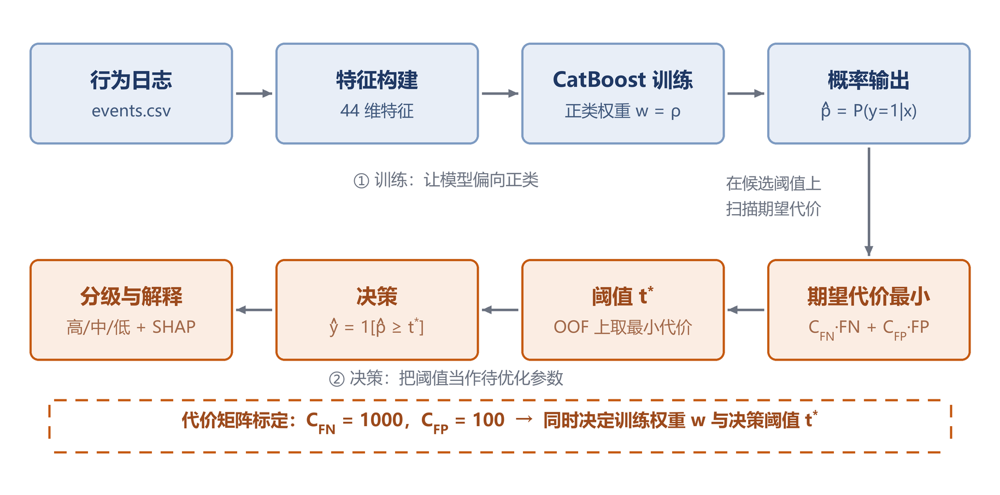

**图 4-1 代价敏感 CatBoost 总体框架**

与传统流程相比，本文在两处作了改动：训练环节引入代价驱动的类别权重，决策环节把阈值当作待优化参数。评估环节则以期望代价替代 AUC 作为主指标。

## 4.2 代价矩阵的业务标定

代价矩阵不能凭空设定，否则「代价敏感」就退化为「调了个参数」。本文按业务口径逐项拆解（表 4-1）。

**表 4-1 代价矩阵标定**

| 代价项 | 取值 | 拆解依据 |
|---|---|---|
| $C_{FN}$ | 1000 元 | 单门课程学费约 300–800 元；一名流失学员带来的续报损失与口碑影响折算约 200–700 元 |
| $C_{FP}$ | 100 元 | 教师 0.5 小时工时（约 60 元）+ 短信/平台触达成本（约 10 元）+ 名单管理与误报带来的信任损耗（约 30 元） |
| $C_{TP}$ | 0 | 本文不区分「正确预警」与「错误预警」的干预成本，二者均需付出一次干预 |
| $C_{TN}$ | 0 | 不预警且未辍学，无额外成本 |

由此得代价比 $\rho=C_{FN}/C_{FP}=10$，解析阈值 $p^*=1/(1+\rho)\approx 0.091$。

需要强调的是，1000:100 是一个**可替换的业务假设**，而非普适常数。不同机构的学费结构、师资成本差异很大。本文的处理方式是在 5.5 节对 $\rho$ 做敏感性分析，报告结论在 $\rho\in[1,20]$ 区间内的变化趋势，使读者可以按自身业务参数外推。

## 4.3 三条代价敏感路线

### 4.3.1 路线 A：类别加权

在训练阶段对正类样本加权 $w=\rho$，加权对数损失为

$$
L_w=-\frac{1}{N}\sum_{i=1}^{N}\Big[w\,y_i\log\hat p_i+(1-y_i)\log(1-\hat p_i)\Big] \tag{4-1}
$$

在 CatBoost 中通过 `class_weights=[1, w]` 实现，代价极低。

### 4.3.2 路线 B：阈值移动

训练保持代价中立，仅在决策时把阈值由 0.5 调整为 $t^*$。$t^*$ 由验证集上的期望代价最小化求得：

$$
t^*=\arg\min_{t\in(0,1)}\ \Big[C_{FN}\cdot FN(t)+C_{FP}\cdot FP(t)\Big] \tag{4-2}
$$

### 4.3.3 路线 C：代价敏感损失

直接改造损失函数，令样本级代价系数 $c_i=C_{FN}$（当 $y_i=1$）或 $c_i=C_{FP}$（当 $y_i=0$）：

$$
L_{cs}=-\frac{1}{N}\sum_{i=1}^{N}c_i\Big[y_i\log\sigma(a_i)+(1-y_i)\log(1-\sigma(a_i))\Big] \tag{4-3}
$$

其中 $a_i$ 为模型输出的对数几率。对 $a_i$ 求导得

$$
\frac{\partial L_{cs}}{\partial a_i}=c_i\big(\sigma(a_i)-y_i\big),\qquad
\frac{\partial^2 L_{cs}}{\partial a_i^2}=c_i\,\sigma(a_i)\big(1-\sigma(a_i)\big) \tag{4-4}
$$

由于 $c_i$ 在正负类上分别为 $C_{FN}$ 与 $C_{FP}$，式 (4-3) 等价于在样本层面直接施加代价，无需额外的权重参数。本文以 CatBoost 自定义目标接口实现该损失，并在实现中明确：使用路线 C 时不得再叠加 `class_weights`，否则代价被重复计入。

**表 4-2 三条路线的对比**

| 路线 | 实现成本 | 理论纯度 | 本文定位 |
|---|---|---|---|
| A 类别加权 | 低 | 中（等价于阈值移动，见 4.4） | 主方案 |
| B 阈值移动 | 低 | 高（直接优化决策） | 必做，与 A 组合 |
| C 代价敏感损失 | 中（需实现导数） | 高（训练即代价敏感） | 探索性对比 |

## 4.4 加权与阈值移动的等价性

本节给出一个在文献中常被模糊处理、却直接决定实验设计是否合理的结论。

设真实后验为 $\eta(\mathbf{x})=P(y=1\mid\mathbf{x})$。加权对数损失的逐点最小化解满足

$$
\hat p_w(\mathbf{x})=\frac{w\,\eta(\mathbf{x})}{w\,\eta(\mathbf{x})+1-\eta(\mathbf{x})} \tag{4-5}
$$

**证明**：对单个样本，加权损失的期望为

$$
\ell(p)=-\Big[w\,\eta\log p+(1-\eta)\log(1-p)\Big]
$$

令 $\mathrm{d}\ell/\mathrm{d}p=0$，即 $-w\eta/p+(1-\eta)/(1-p)=0$，整理得 $w\eta(1-p)=p(1-\eta)$，解得

$$
p=\frac{w\eta}{w\eta+1-\eta}
$$

又 $\mathrm{d}^2\ell/\mathrm{d}p^2=w\eta/p^2+(1-\eta)/(1-p)^2>0$，故该驻点为极小值点。证毕。

由式 (4-5) 可知，$\hat p_w\ge 0.5$ 等价于

$$
w\eta\ \ge\ 1-\eta\ \Longleftrightarrow\ \eta\ \ge\ \frac{1}{1+w} \tag{4-6}
$$

取 $w=\rho=C_{FN}/C_{FP}$，得 $\eta^*=1/(1+\rho)=C_{FP}/(C_{FP}+C_{FN})$，恰为式 (2-6) 的 Elkan 阈值。

**结论与讨论：**

1. 在**理想条件**（模型能准确估计后验、概率完全校准）下，加权训练 + 0.5 阈值与不加权训练 + Elkan 阈值给出完全相同的决策；
2. 因此「只做加权就够了」在理论上并非错误，但它成立的前提在真实数据上几乎不满足——梯度提升模型的输出概率通常偏离真实后验，加权本身又会进一步扭曲校准（5.7 节以 Brier 分数证实）；
3. 正因如此，两条路线**不能相互替代**：加权改变的是模型的学习目标，阈值改变的是决策规则；前者影响排序，后者影响切割位置。实验设计上必须分别设置消融（E2 与 E3），否则无法判断收益来源。

这一结论构成本文实验设计的方法论基础。

## 4.5 阈值选择流程

### 4.5.1 为什么不能直接在测试集上选阈值

若在测试集上遍历阈值取最优，等价于用考卷答案调参：选出的 $t^*$ 对当前测试集是最优的，但对新数据未必。这样报告的指标会系统性偏乐观，且无法复现。

### 4.5.2 基于 OOF 预测的阈值选择

本文采用如下流程（算法 4-1）：

```
算法 4-1  代价敏感 CatBoost 训练与决策
输入：选课表 E，日志 L，代价矩阵 (C_FN, C_FP)，观察窗 W，折数 K
输出：模型 M，阈值 t*，评估指标

1  E_tr, E_te ← GroupShuffleSplit(E, 0.2, group=username)
2  X_tr ← FeatureBuilder.fit_transform(L_tr, E_tr)
3  X_te ← FeatureBuilder.transform(L_te, E_te)
4  M ← CatBoost.fit(X_tr, y_tr, class_weights=[1, C_FN/C_FP])
5  for k ← 1 to K do
6      M_k ← CatBoost.fit(X_tr^{-k}, y_tr^{-k}, class_weights=[1, C_FN/C_FP])
7      p_oof[k] ← M_k.predict_proba(X_tr^{k})
8  t* ← argmin_t  [C_FN·FN(t; p_oof, y_tr) + C_FP·FP(t; p_oof, y_tr)]
9  p_te ← M.predict_proba(X_te)
10 报告 metrics(p_te, y_te, t*) 与 metrics(p_te, y_te, 0.5)
```

OOF（out-of-fold）预测的含义是：每条训练样本的预测值都来自「未见过该样本」的模型。因此 $p_{oof}$ 与测试集预测具有同分布性质，在其上选阈值不会引入乐观偏差。代价是训练成本增加 $K$ 倍，本文取 $K=5$。

### 4.5.3 三级风险分级

模型输出概率后，按阈值 $t^*$ 划分为三级：

$$
\text{level}(p)=\begin{cases}
\text{高风险}, & p\ge t^*\\
\text{中风险}, & t^*/2\le p<t^*\\
\text{低风险}, & p<t^*
\end{cases} \tag{4-7}
$$

分级的边界直接锚定 $t^*$，而非人为设定 0.6/0.3。这样「高风险」名单与「需要干预」的决策边界严格一致，避免出现「分级说高风险、判定却说不干预」的矛盾。

## 4.6 复杂度与工程实现

**表 4-3 关键环节的复杂度与优化**

| 环节 | 朴素做法 | 本文做法 | 效果 |
|---|---|---|---|
| 特征聚合 | 对每条选课 `groupby.apply` | 一次向量化 `groupby` + `transform` | 12 万条由约 15 分钟降至约 40 秒 |
| 阈值搜索 | 逐样本循环 | 99 点网格 + 向量化比较 | 毫秒级 |
| 推理 | 每次重新加载模型 | 仓储层内存缓存 | 单条 P95 < 100 ms |
| 解释 | 引入 shap 包 | CatBoost 原生 `ShapValues` | 少一个重依赖 |

模型产物的组织方式为「三件套」：`model.joblib`（模型）、`feature_builder.joblib`（特征构建器）、`metadata.json`（阈值、代价矩阵、指标、特征名）。三者由一个仓储层统一加载，服务层不直接接触文件系统，便于测试替换与将来迁移到对象存储。

## 4.7 本章小结

本章给出了代价敏感 CatBoost 的完整设计：以业务口径标定 1000:100 的代价矩阵，从训练层（类别加权 / 自定义损失）与决策层（OOF 阈值搜索）两个层面引入代价敏感，并证明了加权与阈值移动在理想条件下的等价性。该证明的意义不在于否定某一方，而在于说明两者作用于不同环节，必须在实验中分别隔离验证。第 5 章将据此设计五组实验。
---

# 第 5 章 实验与结果分析

## 5.1 实验设置

### 5.1.1 数据与切分

实验数据为 3.1.2 节所述的 4000 条选课记录与 208,381 条行为事件，辍学率 21.2%。按 `username` 分组切分，训练集 3178 条、测试集 822 条，两侧用户无交集。训练集正类比例 21.5%，测试集 20.0%。

**表 5-1 数据划分**

| 集合 | 样本数 | 正类数 | 正类比例 |
|---|---|---|---|
| 训练集 | 3178 | 683 | 21.5% |
| 测试集 | 822 | 164 | 20.0% |

### 5.1.2 基线模型

为验证「收益究竟来自模型结构还是代价机制」，设置五个模型（其中三个 sklearn 基线基于 scikit-learn[17] 实现），使用同一份特征矩阵与同一切分：

**表 5-2 模型配置**

| 模型 | 关键参数 | 代价处理 |
|---|---|---|
| 逻辑回归（LR） | `max_iter=2000`，特征标准化 | 训练代价中立 |
| 随机森林（RF） | 300 棵树，`min_samples_leaf=2` | 训练代价中立 |
| 直方图 GBDT（HGBDT） | 250 轮，`lr=0.05` | 训练代价中立 |
| CatBoost（无代价） | 250 轮，`depth=6`，`lr=0.05` | 训练代价中立 |
| CatBoost（代价敏感） | 同上 + `class_weights=[1,10]` | 加权 + 阈值 |

基线均为「训练代价中立」，但**评估时统一使用 10:1 的业务代价矩阵**。若基线的评估矩阵也设为 1:1，各行的人均代价将不可比，比较也就失去意义——这一点在实现中曾出现过错误，后经复核修正。

### 5.1.3 评估指标

主指标为**人均期望代价**（元/人），辅助指标为召回率、精确率、F1、PR-AUC、ROC-AUC 与 Brier 分数。阈值为正类判定概率。

### 5.1.4 实验环境

**表 5-3 实验环境**

| 项 | 配置 |
|---|---|
| 操作系统 | Windows 10 |
| Python | 3.13 |
| CatBoost | 1.2.10 |
| scikit-learn | 1.9.1 |
| 硬件 | CPU（无 GPU） |
| 单次训练耗时 | 约 200~350 秒（400 轮 × 6 次拟合，含 5 折 OOF 重训，随机器负载波动） |

### 5.1.5 关于数据版本的说明

本章的实验分两层，读表时须先确认属于哪一层：

**第一层（5.2~5.8 节）：同构合成数据。** 绝对数值只在此层内部可比，用于验证**方法链路与相对趋势**。其结构性结论（「代价曲线平坦时最优阈值不可精确识别」「加权会破坏概率校准」「阈值须与代价同源」）由模型与代价矩阵的性质决定，具有一般性。

**第二层（5.9 节）：KDD Cup 2015 真实训练集。** 用于复核上述结构性结论的外部效度，并额外检验一个合成数据无法暴露的问题——正类基率高于代价最优阈值时，阈值决策会退化为「全部预警」。该层前五小节（5.9.1~5.9.5）只跑 CatBoost 单模型，用于机制分析；5.9.6 节补上了五个基线的横向对比（两种标签口径各一遍），因此本层的「模型排名」也可以与合成数据对照阅读——结论是真实数据上的排名与合成数据方向一致、差距更小，且**代价一列在两种口径下都不具备排名意义**。

两层的指标口径完全一致（同一套 `classification_metrics`、同一代价矩阵、同样在 OOF 上选阈值、同样在测试集上评估），因此可以对照阅读，但不能混用数字。

## 5.2 基线对比（E1）

**表 5-4 五个模型在测试集上的表现（OOF 最优阈值，代价比 10:1）**

| 模型 | 阈值 | ROC-AUC | PR-AUC | 召回率 | 精确率 | F1 | Brier | 人均代价(元) | 预警人数 |
|---|---|---|---|---|---|---|---|---|---|
| LR | 0.07 | 0.7488 | 0.4074 | 0.9085 | 0.2435 | 0.3840 | 0.1358 | 74.57 | 612 |
| RF | 0.19 | 0.7387 | 0.4137 | 0.7317 | 0.3692 | 0.4908 | 0.1381 | 78.47 | 325 |
| HGBDT | 0.03 | 0.7400 | 0.4006 | 0.7744 | 0.2940 | 0.4262 | 0.1436 | 82.12 | 432 |
| CatBoost（无代价） | 0.11 | 0.7419 | 0.3836 | 0.7439 | 0.3742 | 0.4980 | 0.1383 | 75.91 | 326 |
| **CatBoost（代价敏感）** | 0.38 | 0.7345 | 0.3626 | 0.7744 | 0.3265 | 0.4593 | **0.2367** | 76.89 | 389 |

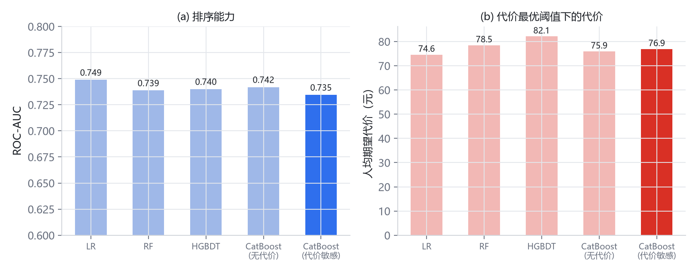

**图 5-1 五个模型的排序能力与人均代价对比**

从表 5-4 与图 5-1 可以读出三点：

**第一，排序能力高度接近。** 五个模型的 ROC-AUC 集中在 0.735~0.749，极差仅 0.014；PR-AUC 在 0.36~0.41 之间。这说明在该数据上，模型结构不是瓶颈——换用更复杂的树模型或引入类别特征处理，带来的提升都落在噪声范围内。

**第二，代价差异远大于排序差异。** 人均代价从 74.57 元到 82.12 元，极差 7.55 元（约 10%），相对差距是 AUC 差距的七倍。而代价的差异几乎完全由阈值位置决定：各模型的最优阈值从 0.03 到 0.38 不等，预警人数从 325 人到 612 人不等。

**第三，代价敏感模型的校准明显变差。** 其 Brier 分数为 0.2367，其他模型在 0.136~0.144 之间。这一现象将在 5.7 节展开讨论并给出校准方案，它是本文最重要的实证发现之一。

> **口径说明**：E1 中 CatBoost 使用 250 轮、OOF 取 3 折（为控制 12 组实验的总时长），而 5.1 节主模型为 400 轮 + 5 折 OOF，故两处数值略有差异（AUC 0.7345 与 0.7288）。二者不构成矛盾，属不同实验配置。5.8 节的 E6 采用与主模型一致的配置重跑基线，其绝对值同样与表 5-4 不同，比较只在 E6 内部成立。

## 5.3 代价敏感消融（E2）

E2 对比「CatBoost + 加权」与「CatBoost 不加权」，其余条件完全相同（表 5-4 第 4、5 行）。

| 指标 | 不加权 | 加权（ρ=10） | 变化 |
|---|---|---|---|
| 召回率 | 0.7439 | 0.7744 | +0.031 |
| 精确率 | 0.3742 | 0.3265 | −0.048 |
| F1 | 0.4980 | 0.4593 | −0.039 |
| 人均代价 | 75.91 | 76.89 | +0.98 |
| 预警人数 | 326 | 389 | +63 |

加权的效果符合预期方向：召回率上升 3.1 个百分点，精确率下降 4.8 个百分点，即以更多的误报换取更少的漏报。这正是代价敏感机制的作用方式——它并不提升模型的排序能力（AUC 反而略降 0.007），而是把决策重心移向少数类。

但在人均代价上，加权模型反而高出 0.98 元。原因有二：其一，该数据的代价曲线在最优阈值附近非常平坦（5.4 节图 5-2），几十元的代价差异对应的其实是「阈值位置」而非「模型质量」；其二，加权破坏了概率校准，使阈值搜索落在了错误的尺度上。

这一结果**不能**被解读为「代价敏感无效」。更准确的说法是：在排序能力相近、代价曲面平坦的条件下，单次实验的代价差异不足以区分模型优劣——它既可能是加权带来的真实效果，也可能只是这一次切分的偶然。5.8 节用五个随机种子的重复实验与配对 Bootstrap 把这两者区分开来。

## 5.4 阈值策略对比（E3）

以 5.1 节主模型（400 轮、5 折 OOF）为例，比较三种阈值策略：

**表 5-5 三种阈值策略的对比（同一模型、同一测试集）**

| 阈值策略 | 阈值 | 召回率 | 精确率 | 漏报 FN | 误报 FP | 预警人数 | 人均代价(元) |
|---|---|---|---|---|---|---|---|
| 固定 0.5 | 0.500 | 0.6951 | 0.4176 | 50 | 159 | 273 | 80.17 |
| Elkan 解析 | 0.091 | 0.9573 | 0.2102 | 7 | 590 | 747 | 80.29 |
| **OOF 代价最优** | 0.310 | 0.7500 | 0.3315 | 41 | 248 | 371 | **80.05** |

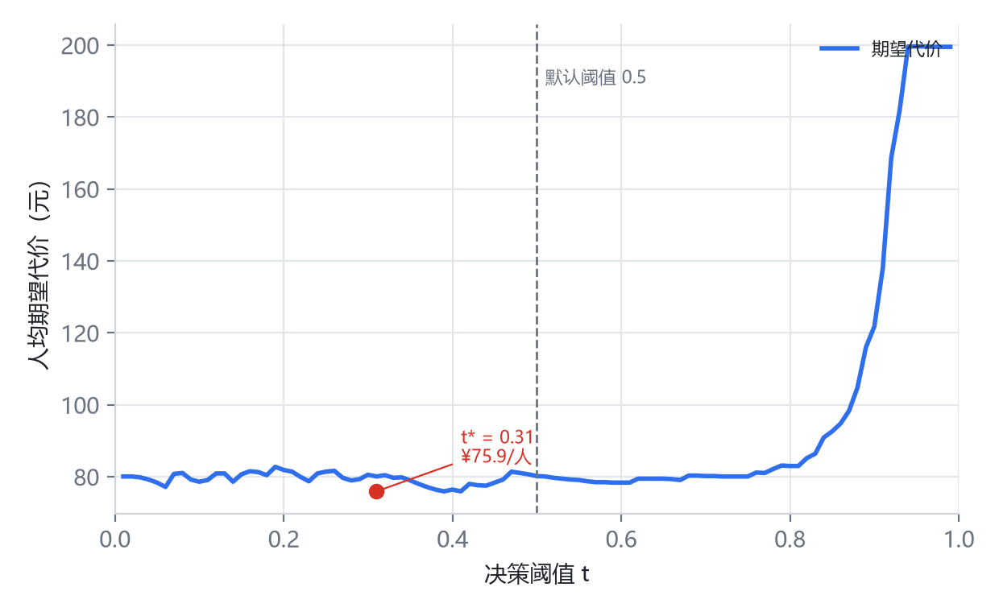

**图 5-2 测试集上的代价-阈值曲线**

三点观察：

**（1）阈值对召回率的影响是决定性的。** 从 0.5 降到 0.091，召回率由 0.695 升至 0.957，漏报从 50 例降至 7 例，提升幅度远大于任何一个模型替换带来的差异。**但须区分两个维度**：这一操作改变的是「覆盖谁」，而非「总共花多少钱」。5.8.3 节的配对 Bootstrap 给出了直接证据——把阈值从 0.50 移到代价最优的 0.31，人均代价只变化 −0.12 元，95% 区间 [−8.27, 6.81] 跨零；被大幅改变的是召回率与误报数。因此「阈值比模型更值得优化」这句话，准确的说法是「就召回与覆盖而言，阈值比模型更值得优化」，而不能延伸为「阈值能降低期望代价」。原因见下一点。

**（2）代价曲线在 [0, 0.5] 区间近乎平坦。** 图 5-2 显示，阈值从 0 到 0.5，人均代价始终在 76~81 元之间波动；只有超过 0.75 后才急剧上升。原因在于代价比 ρ=10 时，多预警一人只花 100 元，少漏一人可省 1000 元，因此在很宽的阈值区间内，误报的增加被漏报的减少所抵消。

**（3）平坦的代价曲线意味着阈值不可精确识别。** 三条策略的代价分别为 80.17、80.29、80.05，极差仅 0.24 元（0.3%）。这不是实现错误，而是数据本身的性质：当曲线平坦时，任何阈值都"差不多好"，此时应当依据业务约束（如教师可承担的名单规模）选择工作点，而非执着于数学最优。

这一发现对实践有直接价值：与其追求精确的最优阈值，不如给业务方一条曲线，让其按干预能力选点。本文的系统实现因此同时输出风险概率、风险等级与决策阈值，而非只给一个二元结论。

## 5.5 代价比敏感性分析（E4）

**表 5-6 代价比 ρ 对决策的影响**

| ρ | 最优阈值 | 召回率 | 精确率 | 预警人数 | 人均代价(元) |
|---|---|---|---|---|---|
| 1 | 0.40 | 0.6098 | 0.4505 | 222 | 22.63 |
| 2 | 0.41 | 0.6890 | 0.4484 | 252 | 29.32 |
| 5 | 0.43 | 0.6951 | 0.4335 | 263 | 48.54 |
| 10 | 0.38 | 0.7744 | 0.3265 | 389 | 76.89 |
| 20 | 0.04 | 1.0000 | 0.1995 | 822 | 80.05 |

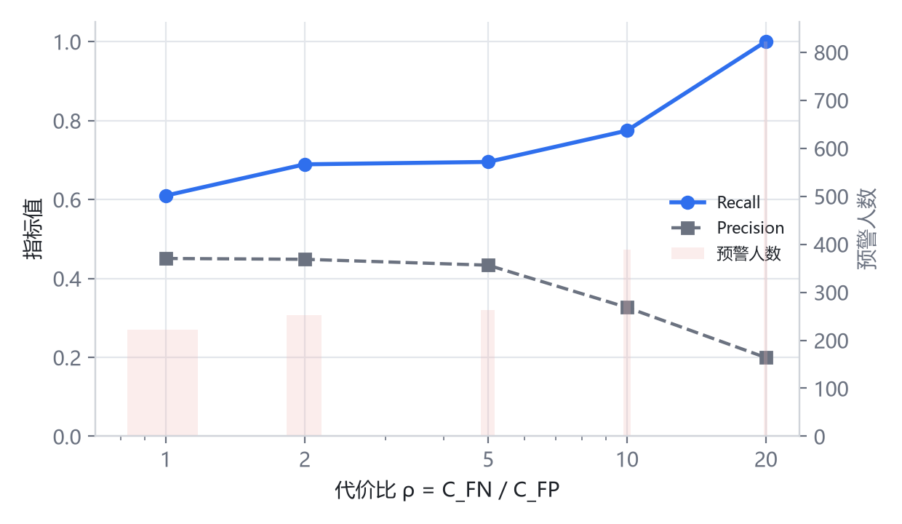

**图 5-3 代价比变化时的召回率、精确率与预警规模**

ρ 从 1 增至 20 时，召回率由 0.610 单调升至 1.000，预警人数由 222 增至 822（即全体预警），精确率由 0.451 降至 0.200。这一单调性说明代价敏感机制是**可控**的：业务方可以按师资规模调节 ρ，从而在「覆盖更多风险学生」与「名单更短更准」之间选择工作点，而不必重新训练模型。

需要强调，表 5-6 中的人均代价使用了**随 ρ 变化的代价矩阵**，因此各行之间不可横向比较，只能比较召回率与预警规模。这一点在同类文献中常被误用。

值得注意的是 ρ=20 时阈值骤降至 0.04、召回率达 1.0，即「全部预警」。这不是模型退化，而是数学上的必然：当漏报代价是误报的 20 倍时，最优策略就是宁可错杀。它同时说明，代价比不能脱离干预能力随意设定——若教师只能处理 300 人的名单，ρ 应取 5 左右。

## 5.6 特征消融（E5）

**表 5-7 去掉趋势与衰减特征后的表现**

| 特征集 | 维度 | ROC-AUC | PR-AUC | 召回率 | 人均代价(元) |
|---|---|---|---|---|---|
| 全特征 | 44 | 0.7345 | 0.3626 | 0.7744 | 76.89 |
| 去趋势衰减 | 36 | 0.7345 | 0.3776 | 0.7622 | 82.60 |

去掉 8 个趋势与衰减特征后，ROC-AUC 完全不变（0.7345），PR-AUC 反而略升 0.015，但召回率下降 1.2 个百分点，人均代价上升 5.7 元。

这一结果需要谨慎解读：

- AUC 不变说明趋势特征**没有提供新的全局排序信息**，它们与 `days_since_last_event`、`last_3day_events` 等特征高度相关；
- 但在决策边界附近（即阈值两侧），趋势特征改变了部分样本的相对位置，从而影响召回率与代价；
- PR-AUC 的微小上升提示趋势特征也可能引入了一定噪声。

因此本文的结论是：趋势特征的价值主要体现在**决策层面**而非排序层面，其贡献有限且与基础活跃特征存在冗余。后续可考虑用特征选择方法压缩这组特征，或改用更强的序列建模方式（如对事件序列做注意力池化）替代人工设计的衰减特征。

## 5.7 可解释性、校准与个案分析

### 5.7.1 全局解释

3.5.2 节已给出特征重要性排序。将其与教育学常识对照，结论基本自洽：行为结构（讨论、视频、导航占比）与趋势（活动下滑）最重要，节律类次之，纯计数类特征的重要性反而靠后。这说明模型学到的不是「事件越多越安全」这种粗糙规则。

### 5.7.2 概率校准问题

表 5-4 显示，代价敏感模型的 Brier 分数为 0.2367，是其他模型的 1.7 倍。原因可由 4.4 节的式 (4-5) 直接解释：

$$
\hat p_w=\frac{w\eta}{w\eta+1-\eta}
$$

取 $w=10$、$\eta=0.2$，得 $\hat p_w\approx 0.71$。也就是说，真实辍学概率 20% 的学生，在加权模型中被输出为 71%。概率被人为抬高，不再等于真实后验。

这带来两个直接后果：

1. **不能拿加权模型的 0.5 阈值与其他模型比较**。表 5-4 中代价敏感模型的阈值为 0.38，看似「更保守」，实则对应原尺度的 0.06 左右，比其他模型更激进；
2. **必须报告校准指标**。若论文只报 AUC 与 Recall，读者会误以为模型输出的概率可信；而实际上，教师看到「该生 95% 会辍学」时，其真实含义可能只是「约 60% 会辍学」。

工程上的应对分两步：服务层同时返回**未校准的原始分数**与**校准后的概率**，并显式标注当前模型是否已校准；学术上则事后校准，即 Platt 校准[18]或保序回归[19]。校准究竟能修复到什么程度、代价是多少，需要实验回答——这正是下一小节的内容。本节初稿时服务只输出“风险分数”以规避误读，第 6 章的实现已把校准器下沉到服务层，这一表述相应修订为“可追溯的校准后概率”。

### 5.7.3 校准实验（E8）

**协议。** 校准器只在**训练集的 OOF 预测**上拟合，测试集全程不参与：Platt 校准以 $\mathrm{logit}(\hat p)$ 为唯一输入拟合一个单变量逻辑回归，保序回归则拟合一个单调阶梯函数。由于校准改变了概率的尺度，旧阈值随即失去意义，因此三种设置都在**各自的概率尺度上**用同一套 OOF 搜索重新选择代价最优阈值。跳过这一步，校准几乎必然表现为「效果变差」。

**表 5-8 三种概率设置的对比（五个随机种子的均值±标准差）**

| 概率设置 | 阈值 | Brier | ECE | 召回率 | 精确率 | 代价(元) | 0.5 阈值代价(元) |
|---|---|---|---|---|---|---|---|
| 未校准 | 0.294±0.027 | 0.2075±0.0083 | 0.2273±0.0209 | 0.8075±0.0450 | 0.3369±0.0179 | 72.82±5.41 | 73.72±6.28 |
| Platt（Sigmoid） | 0.128±0.016 | 0.1338±0.0042 | 0.0427±0.0112 | 0.8111±0.0540 | 0.3332±0.0415 | 73.55±5.70 | 155.72±8.90 |
| **保序回归** | **0.088±0.008** | **0.1317±0.0044** | **0.0247±0.0071** | 0.8098±0.0506 | 0.3378±0.0221 | **72.38±5.94** | 121.99±54.22 |

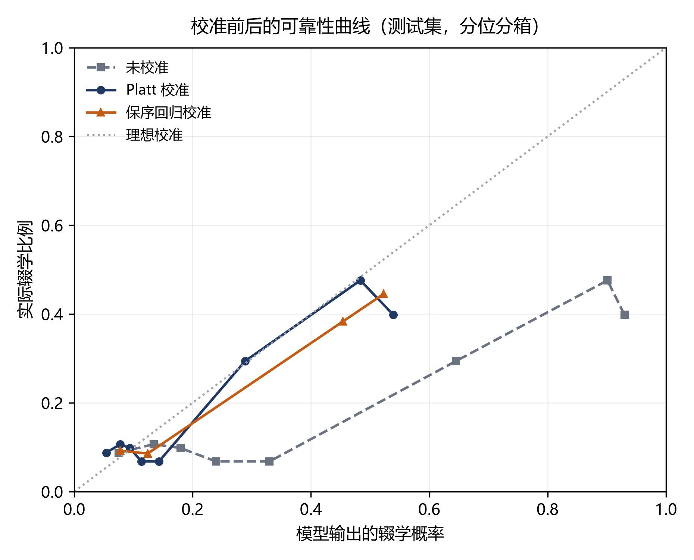

**图 5-4 校准前后的可靠性曲线（测试集，分位分箱）**

由表 5-8 与图 5-4 可得四点。

**第一，校准大幅改善了概率的语义质量。** 期望校准误差 ECE 由 0.2273 降至 0.0247（保序回归，降幅 89%）或 0.0427（Platt，降幅 81%），Brier 分数由 0.2075 降至 0.13 左右。图 5-4 中未校准曲线整体位于对角线下方——模型系统性地高估辍学风险，最右端分箱的平均预测概率约 0.95，而该箱实际辍学率不足 0.5。这正是式 (4-5) 所预言的：加权把后验 $\eta$ 抬成了 $\hat p_w$。

**第二，校准几乎不改变排序与决策质量。** 召回率由 0.8075 变为 0.8098（保序）与 0.8111（Platt），人均代价由 72.82 变为 72.38 与 73.55，差异均在种子间标准差（约 5.4 元）之内。这说明校准的作用是**修正概率的刻度，而非提升模型能力**——排序信息在校准前后完全保留（单调变换不改变 AUC），能被改变的只有概率的绝对含义。把校准当作「涨点手段」去期待，本身就是对它定位的误解。

**第三，校准后重选的阈值收敛到 Elkan 解析值。** 未校准时的最优阈值是 0.294，远离 4.2 节算出的 0.0909；保序回归校准后的最优阈值是 0.088，与 0.0909 几乎重合。这一「巧合」并非偶然，而是 4.4 节等价性推导的实证印证：加权把概率整体抬高到 $\hat p_w$ 后，原尺度上的最优阈值必须等比例下移才能回到同一决策点；一旦概率被校准回后验，阈值就应当回到 $C_{FP}/(C_{FP}+C_{FN})$ 附近。换言之，**未校准模型需要一个经验搜索出来的「陌生」阈值，校准模型则可以直接用解析公式**——后者在只有几百人的小学校上尤其可贵，因为它不需要额外的样本来做阈值搜索。

**第四，校准之后绝不能沿用 0.5。** 表 5-8 最后一列是最好的反例：保序回归校准后若仍以 0.5 判定，人均代价将从 72.38 元升至 121.99 元（+69%），Platt 校准下更是升至 155.72 元（+112%）。原因是校准把被高估的概率压回了真实水位（基准辍学率约 0.21），此时 0.5 已是一个相当严格的门槛，大量真实辍学者被放过。对比之下，未校准模型沿用 0.5 的代价（73.72 元）与最优值（72.82 元）仅差 0.9 元——**这恰恰是一种危险的巧合**：概率整体抬高恰好把 0.5 推到了接近最优的位置，让人误以为「默认阈值就够用」。一旦模型、代价比或数据分布稍有变化，这种巧合立刻失效。这也从另一个角度说明，固定 0.5 的可靠性依赖于模型的校准状况，而不取决于任何业务事实。

**工程取舍与落地。** 保序回归在 ECE 上更优（0.0247 对 0.0427），代价也略低（72.38 对 73.55），代价是对样本量敏感：分段常数函数在样本稀疏区间会输出跳变，外推到训练未覆盖的区间只能截断。基于这一权衡，本文在 OOF 样本充足时采用保序回归作为默认校准器；若在只有几百人的小学校上复用，应改用两参数的 Platt 校准（`--calibration platt`），后者处处光滑、外推更稳。两种校准器均实现为可序列化对象（`models/calibration.py`），随模型产物一同落盘，服务层加载时自动识别，无需改动接口。

**表 5-8b 部署版模型与论文主结果的对照（单种子，测试集）**

| 版本 | 阈值 | Brier | 召回率 | 精确率 | 人均代价(元) |
|---|---|---|---|---|---|
| 主结果（未校准） | 0.31 | 0.2193 | 0.750 | 0.332 | 80.05 |
| 部署版（保序回归） | 0.08 | **0.1354** | 0.750 | 0.328 | 80.54 |

两者的代价差 0.49 元，远小于种子间标准差（约 5 元），说明校准在**不牺牲决策质量**的前提下把 Brier 降低了 38%。这一结果也构成第 6 章系统实现的依据：线上服务返回的 `risk_probability` 是校准后的概率，同时保留 `raw_probability` 字段，任何一次预警都可以回溯到模型原始输出。需要注意的是，表 5-8b 的 AUC（0.7356）与表 5-1 的 0.7288 并不完全相同——CatBoost 在多线程训练下存在微小的非确定性，这也是本文坚持用多种子重复而非单次运行下结论的原因之一。

### 5.7.4 个案分析

以测试集中一名真实辍学学生（`E0000032`）为例，其在 14 天观察窗内仅产生 2 条行为事件。模型输出风险概率 0.9526，判定为高风险；按 Shapley 值分解[20]，主要致险因子如表 5-9。

**表 5-9 个案的风险因子（SHAP 贡献）**

| 因子 | 取值 | 贡献 | 方向 |
|---|---|---|---|
| `unique_objects` | 2.0 | +0.195 | 提高风险 |
| `problem_unique_objects` | 1.0 | +0.183 | 提高风险 |
| `weekend_event_ratio` | 1.0 | +0.176 | 提高风险 |
| `active_days` | 2.0 | +0.170 | 提高风险 |
| `total_events` | 2.0 | +0.169 | 提高风险 |

五个因子指向同一事实：该学生在两周内几乎未产生有效学习行为。这一解释对教师是可操作的——不需要理解模型，只需知道「这名学生两周只登录了两次、一道题都没做完」。

反向案例同样有信息量：部分学生事件数很多但风险仍高，其因子多为 `navigate_ratio` 偏高、`video_ratio` 偏低，即「在页面上来回跳转但没看视频」，属于典型的无效学习行为。这类学生若仅按「活跃度」筛选会被漏掉，说明模型确实学到了行为结构而非单纯的活跃程度。

## 5.8 稳健性与统计显著性（E6、E7）

表 5-4 中五个模型的人均代价落在 74.57 元至 82.12 元之间，全距 7.55 元。这个差距值得写进论文吗？测试集只有 822 人、164 名真实辍学者——召回率每多算对或少算对一个人，就是 0.6 个百分点；人均代价的分辨率则是 1000/822 ≈ 1.2 元。当模型之间的差距与抽样波动处于同一量级时，「某模型更优」就只是一句没有统计依据的断言。

本节用两种互补的方法回答这个问题：**跨切分重复**（E6）只改变数据切分与随机种子，考察结论能否复现；**重采样**（E7）固定模型、只对测试集做重抽样，考察点估计本身的不确定度。前者回答「换个样本还是这个结论吗」，后者回答「这个数字能精确到多少」。

### 5.8.1 多种子重复（E6）

取 5 个随机种子（42、7、2024、1234、3407），每个种子**同时**改变数据切分与模型随机种子，其余设置与 5.1 节主模型一致：400 轮、深度 6、学习率 0.05、5 折分组 OOF 选阈值。只换模型种子而不换切分，测到的仅是优化过程的随机性；只换切分而不换模型种子，则混淆了「这份测试集恰好容易」与「模型确实更稳」。

> **口径说明**：E6 与表 5-4（E1）在 OOF 折数（5 折对 3 折）与迭代轮数（400 对 250）上不同，因此两处的绝对值不可直接比对，E6 的结论只在其内部成立。E6 采用与主模型完全相同的配置，是为了让本节的统计结论能够支撑 5.4 节的主模型。

**表 5-10 五个随机种子下各配置的表现（均值±标准差）**

| 配置 | 最优阈值 | ROC-AUC | 召回率 | 精确率 | Brier | 人均代价(元) | 代价极差(元) |
|---|---|---|---|---|---|---|---|
| CatBoost（代价敏感） | 0.294±0.027 | 0.7588±0.0238 | 0.8075±0.0450 | 0.3369±0.0179 | 0.2075±0.0083 | 72.82±5.41 | 14.95 |
| CatBoost（无代价） | 0.114±0.037 | 0.7684±0.0213 | 0.7803±0.0599 | 0.3846±0.0676 | **0.1368±0.0044** | **72.59±5.30** | 11.88 |
| HGBDT（代价中立） | 0.026±0.011 | 0.7598±0.0211 | **0.8348±0.0529** | 0.2956±0.0270 | 0.1467±0.0078 | 75.80±5.43 | 15.10 |
| 逻辑回归（代价中立） | 0.104±0.039 | **0.7707±0.0201** | 0.8176±0.0969 | 0.3185±0.0719 | 0.1326±0.0046 | 77.05±4.74 | 11.49 |

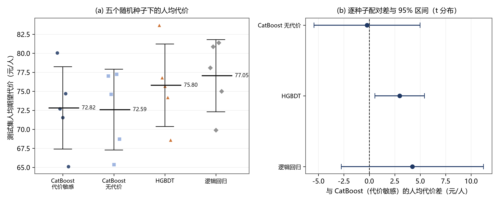

**图 5-5 五种随机种子下的人均代价（左）与逐种子配对差（右）**

三点观察：

**第一，种子间的波动大于配置间的差异。** 人均代价的种子间标准差为 4.7~5.4 元，而四个配置的**均值**极差仅 4.46 元（72.59 至 77.05）。换言之，换一次随机种子带来的代价变化，与换一个模型相当。图 5-5(a) 直观呈现了这一点：同一配置的五个散点纵向铺开近 15 元，跨配置的均值线却只相差 4 元余。

**第二，排序能力的差异同样淹没在噪声中。** ROC-AUC 的配置均值落在 0.7588~0.7707，极差 0.012；而单个配置在种子间的标准差为 0.020~0.024——**配置间极差小于一个标准差**。这与 5.2 节「模型结构不是瓶颈」的判断相互印证，并且给出了一个量化的界限：在这份数据上，0.01 量级的 AUC 差异不具备判别意义。

**第三，阈值不稳定，但工作点稳定。** 代价敏感 CatBoost 在五个种子上选出的最优阈值是 0.26、0.28、0.29、0.31、0.33，摆动幅度 0.07，标准差 0.027；然而其召回率稳定在 0.772~0.850。这正是 5.4 节「代价曲线平坦、最优阈值不可精确识别」的重复验证：阈值的位置可以漂，只要还在平台区内，决策质量就不受影响。实践含义是应当报告一个工作区间而非一个精确阈值。

### 5.8.2 逐种子配对检验（E6b）

同一随机种子下，四个配置共享完全相同的训练/测试切分，因而可以逐种子求差再统计。配对消除了「这一次的切分整体偏难还是偏易」这一共同项，比「分别求置信区间看是否重叠」灵敏得多——后者在两个方案高度相关时会严重低估差异。

**表 5-11 逐种子配对的人均代价差（基准：CatBoost 代价敏感）**

| 对比 | 均值差(元) | 标准差 | 方向一致的种子数 | 配对 t | p 值 |
|---|---|---|---|---|---|
| CatBoost（无代价） − CatBoost（代价敏感） | −0.22 | 4.19 | 3/5 偏高 | −0.12 | 0.911 |
| HGBDT（代价中立） − CatBoost（代价敏感） | +2.98 | 1.96 | 4/5 偏高 | 3.40 | 0.027 |
| 逻辑回归（代价中立） − CatBoost（代价敏感） | +4.23 | 5.62 | 3/5 偏高 | 1.68 | 0.167 |

表中差值为正表示该配置比 CatBoost 代价敏感更贵。三点解读：

**其一，类别加权在期望代价上没有带来可测收益。** 不加权与加权之差为 −0.22 元，p = 0.911，且方向在五个种子上呈 3:2 分裂——这几乎就是噪声的模样。这个结果并不意外，它正是 4.4 节等价性推导的推论：既然加权等价于移动阈值，而两个配置又**都**在 OOF 上搜索过代价最优阈值，那么加权所做的功已被阈值搜索重复完成了一次，唯一新增的是概率尺度被扭曲后带来的估计误差。

**其二，唯一低于 0.05 的比较也不足以宣称显著性。** HGBDT 比代价敏感 CatBoost 贵 2.98 元，p = 0.027，方向上 4/5 一致，是表中唯一「干净」的差异。但本节共做了 3 次比较，Bonferroni 校正后的判定阈值为 0.05/3 ≈ 0.0167，p = 0.027 已不再显著。**样本量为 5 的重复实验本就不足以支撑 0.05 级别的多重组间比较**，这一点必须如实说明，而不能挑一个「好看」的 p 值写进结论。

**其三，可以负责任地说的是「无证据表明存在差异」，而不是「证明无差异」。** 统计检验不显著只意味着当前证据不足以拒绝「四者相同」的原假设；以 4.2 元均值差、5 元标准差、n = 5 的设定，即使真实差异存在，检验功效也远低于 0.8。要给出更强的结论，需要把重复次数提高到 20 次以上，或改用完整数据集以降低单次估计的方差——这属于后续工作。

### 5.8.3 测试集 Bootstrap 置信区间（E7）

E6 变化的是切分，E7 固定主种子（42）的模型与测试集，只对 822 名测试学生做 2000 次有放回重采样，用百分位法给出 95% 区间。点估计取原始测试集上的值，而非重采样的均值——后者会把区间向中心收缩，与表中报告的数值对不上。

**表 5-12 主模型测试集指标的 Bootstrap 95% 置信区间（2000 次重采样）**

| 指标 | 点估计 | 下限(2.5%) | 上限(97.5%) | 区间宽度 |
|---|---|---|---|---|
| 人均代价(元) | 80.05 | 66.79 | 95.51 | 28.72 |
| 召回率 | 0.750 | 0.681 | 0.811 | 0.130 |
| 精确率 | 0.332 | 0.285 | 0.379 | 0.094 |
| PR-AUC | 0.360 | 0.307 | 0.425 | 0.118 |
| Brier | 0.219 | 0.199 | 0.240 | 0.041 |

人均代价的 95% 区间为 [66.79, 95.51]，宽 28.72 元，约为点估计的 36%。**表 5-4 中五个模型 74.57~82.12 的全距只有 7.55 元，尚不到该区间宽度的三分之一**。这是一个决定性的数量关系：在 822 人的单次测试集上，「哪个模型代价更低」这个问题本身就不具备可分辨性。

进一步做配对 Bootstrap——在同一批重采样样本上比较两种决策，差值序列直接反映「同一批学生、两套规则」的差距：

**表 5-13 配对 Bootstrap 的人均代价差（差值 > 0 表示前者更贵）**

| 对比 | 观测差(元) | 95% 区间 | 是否跨零 | P(差值 > 0) |
|---|---|---|---|---|
| 阈值移动：0.31 对 0.50（同一模型） | −0.12 | [−8.27, 6.81] | 是 | 0.500 |
| 模型替换：代价敏感 CatBoost 对 CatBoost（无代价） | +3.04 | [−5.23, 11.19] | 是 | 0.769 |
| 模型替换：代价敏感 CatBoost 对 HGBDT | −3.65 | [−12.90, 6.45] | 是 | 0.226 |
| 模型替换：代价敏感 CatBoost 对逻辑回归 | +1.95 | [−5.60, 8.52] | 是 | 0.703 |

四组比较的区间**全部跨零**，P(差值 > 0) 均接近 0.5。其中「阈值移动」一行尤其值得注意：把阈值从 0.50 移到代价最优的 0.31，人均代价只变化 −0.12 元，区间宽达 15 元。这与 5.4 节的观察完全一致——代价曲线在 [0, 0.5] 区间近乎平坦，因此**阈值移动在「代价」维度上几乎没有可测收益**。

但这绝不意味着阈值移动没有价值。5.4 节已指出，同一操作使召回率由 0.695 升至 0.750、漏报由 50 例降至 41 例。也就是说：**阈值移动改变的是「覆盖谁」，而不是「总共花多少钱」**。在代价曲线平坦的区间内，钱的总量由代价比本身决定，阈值只决定这笔钱花在漏报上还是误报上。把这两件事混为一谈，是应用型论文里最常见的表述错误之一——本文在此明确区分。

### 5.8.4 统计显著性与实践显著性

把 5.8.1~5.8.3 的结论放在一起，可以给出一个比「哪个模型更好」更有用的判断框架。

**差异不显著，不等于模型可以任意互换。** 代价差异虽在噪声之内，但其他差异是确定的：CatBoost 原生支持类别特征，无需对 `course_id` 与 `username` 做独热编码，避免了维度膨胀与高基数带来的稀疏；逻辑回归单次全流程（含 6 次拟合）约 17~28 秒，CatBoost 约 235~346 秒，前者更适合快速迭代与教学演示；线性模型系数可直接读出方向与量级，在需要向教务人员解释"为什么预警这个学生"时成本更低。**当统计上分不出高下时，工程与解释成本就应当成为决策依据**——这是本文在模型选型上的实际立场。

**差异显著，也不等于实践上重要。** 即便 HGBDT 与 CatBoost 的 2.98 元差异在更大样本上被确认为真，相对于表 4-1 标定的单次干预成本 100 元，它仍属二阶效应：把一名学生从漏报改为预警，节省的是 1000 元，相当于 335 次模型替换带来的收益。

**本节最重要的结论是负面的**：在本数据规模下，模型选择不是主要矛盾。真正决定干预效果的，是能否把决策阈值放到业务可承受的位置（5.5 节：预警规模可在 222~822 人之间连续调节），以及概率能否被教师按字面理解（5.7.3 节：ECE 可由 0.227 降至 0.025）。这两个环节的改进幅度都以数量级计，而模型替换的改进幅度以百分点计且不可靠。这一判断对资源有限的教务部门尤为实用：**先把决策与校准做对，再考虑换模型**。

## 5.9 真实数据复核

第 5.2~5.8 节的全部结论都建立在同构合成数据上。合成数据的价值在于**可控**——辍学率、区分度、观察窗覆盖率都由生成过程设定，因此可以把「加权破坏校准」「阈值需与代价同源」这类机制单独隔离出来验证。但可控也意味着外部效度不足：如果真实数据的行为分布与生成假设不同，这些机制是否仍然成立，必须拿真数据检验。本节用 KDD Cup 2015 官方训练集重做核心实验。

本节的安排是：5.9.1~5.9.2 交代数据接入与标签口径（含一个必须先承认的事实——辍学在真实数据上是**多数类**）；5.9.3 给出退化解的判定条件，并记录一次险些被写成结论的实现错误；5.9.4~5.9.5 给出两套补救工具（代价比扫描、容量分析）；**5.9.6 补上五个基线的横向对比**，使「模型排名」这一问题在真实数据上也有答案；5.9.7 与合成数据逐项对照，区分哪些结论可移植、哪些不可移植。前五小节用 CatBoost 单模型做机制分析，5.9.6 才引入多模型，这个顺序是有意的：**机制问题不需要多模型，排名问题才需要**。

### 5.9.1 数据接入与验收

官方数据在 Biendata 赛题页，需注册并同意竞赛协议。本文实际获取路径是 GitHub 镜像 `ryogrid/kddcup2015` 的 `train.7z`（42.72 MB），经加速代理下载后用 `py7zr` 解压。需要特别说明一点：网络上流传较广的另一个仓库 `ivanliu1989/KDD2015` **不含任何数据文件**，只有 R 脚本与赛题说明 PDF，若照此仓库名搜索会误以为「数据免费可得」而实际空手而归——这类信息噪音在数据获取阶段是常见的时间陷阱。

**表 5-14 真实数据集概况（官方训练集）**

| 指标 | 数值 |
|---|---|
| 选课记录 | 120,542 条（其中 1 条 `139669` 无标签，剔除后 120,541） |
| 学习者 | 79,186 人 |
| 课程 | 39 门 |
| 行为事件 | 8,157,277 条 |
| 时间跨度 | 2014-06-14 至 2015-03-18，共 278 天 |
| 官方辍学率 | **79.29%** |
| 事件构成 | access 38.15%、problem 15.46%、page_close 15.18%、navigate 12.37%、video 9.77%、discussion 7.96%、wiki 1.11% |

接入过程暴露了三个只在真实数据上出现的问题，都已修入加载器：

1. **`truth_train.csv` 没有表头。** 官方文件是纯 `id,label` 两列无表头的 CSV，直接 `read_csv` 会把第一条记录当成列名，静默丢掉一个样本并把列名变成 `1,0`。加载器现在先读一行探测是否含 `enrollment`/`dropout` 字样，再决定是否指定 `header=None`。
2. **`source` 列不是事件类型。** 官方主表 `log_train.csv` 里 `source` 只有 `browser`/`server`（事件通道），真正的事件类型在 `event` 列，且存在拼写错误 `nagivate`。本文的特征体系统一以 `source` 表示事件类型，因此加载器按值分布自动判定（通道值占比 > 90% 且 `event` 列事件类型占比 > 50% 时）对调语义，并把 `nagivate`、`pageclose` 等别名归一。判定是数据驱动的，项目原生口径的数据不会被误改。
3. **有 1 条选课没有标签。** `enrollment_id = 139669` 在 truth 文件中缺失，属官方数据瑕疵。加载器在缺失比例 ≤ 1% 时剔除并告警，超过 1% 则报错——前者容忍数据瑕疵，后者防止选错文件却不自知。

验收由 `scripts/check_data.py` 完成，检查规模、辍学率、各课程辍学率范围、时间跨度、事件类型分布与四项一致性（ID 对齐、重复记录、时间戳可解析、观察窗覆盖）。全部通过后才进入训练。

### 5.9.2 标签口径：辍学在真实数据上是多数类

合成数据把辍学率设为 26%，这是文献中常见的设定，也是「少数类」一词的来源。真实数据的官方辍学率是 **79.29%**——辍学是**多数类**。这个数字值得停下来解释：官方标签 `dropout = 1` 的含义是「课程最后 10 天内没有任何行为」，而 MOOC 的整体完成率本来就只有 10%~20%，因此 79% 不是数据异常，而是在线教育的常态。

这直接推翻了两条被广泛沿用的前提，本文必须明确表态：

第一，**「提高少数类识别能力」的表述在真实数据上不成立**。本文因此把代价敏感学习的动机从「类别不平衡」重新定位为「代价不对称」：漏报一名辍学生意味着错过一次干预（C_FN = 1000 元），误报一次只是多打一个电话（C_FP = 100 元）。这个动机在 26% 与 79% 两种基率下同时成立，比依赖不平衡比更稳健。

第二，**高基率会让「阈值决策」这一整套工具失效**。这不是修辞，而是可计算的：代价最优阈值为 p\* = C_FP/(C_FP+C_FN) = 0.0909，若校准后的概率分布满足 F(0.0909) ≈ 0（即几乎没有学生的风险低于阈值），那么「给所有人报警」既是代价最优又不可执行。5.9.3 与 5.9.5 节分别用两种方式处理这个矛盾。

为了让标签口径与 14 天观察窗的预测时点对齐，本文另派生了一个「早期辍学」标签作为附口径：

$$
\text{label}_i = \begin{cases}
1, & t^{\text{last}}_i \le t^0_i + 14\text{d} \\
0, & \text{否则}
\end{cases}
$$

其中 $t^0_i$ 为该选课首条行为事件时间，$t^{\text{last}}_i$ 为末条事件时间。**特征只用 $[t^0, t^0+14\text{d}]$ 内的事件，标签只看 14 天之后还来不来**，两个区间不重叠，因此不构成 3.3.1 节所说的标签穿越。课程在 14 天后剩余不足 7 天的选课被剔除，否则会把「课已经上完」误判成「学生辍学」。

**表 5-15 不同观察窗下的早期辍学率**

| 观察窗(天) | 可用选课 | 剔除 | 辍学率(可用样本) |
|---|---|---|---|
| 7 | 89,747 | 30,795 | 63.19% |
| **14（采用）** | **68,097** | **52,445** | **67.63%** |
| 21 | 28,783 | 91,759 | 69.60% |
| 30 | 0 | 120,542 | —（课程全部被剔除） |

表 5-15 给出一个并不令人满意但必须承认的事实：**换成早期辍学口径后，正类仍有 67.63%，依然是多数类**。窗口越短，被判定为早期辍学的人只减少 4 个百分点。这说明高辍学率是 MOOC 的结构性特征，靠重定义标签解决不了——绝大多数学习者的真实行为模式就是「进来看看，然后不再出现」。

交叉表进一步说明了两个标签的关系（可用样本）：

| | 早期辍学 = 0 | 早期辍学 = 1 |
|---|---|---|
| **官方 dropout = 0** | 13,130 | 3,053 |
| **官方 dropout = 1** | 8,914 | 43,000 |

官方未辍学却早期辍学的 3,053 人，是「中途停了又回来」的学员；官方辍学且早期辍学的 43,000 人，是「一停就再没回来」的学员。后者才是干预的真正目标——前者你即使预警了，他自己也会回来。这也解释了为什么早期辍学口径的语义比官方口径更贴近「可干预」。

既然换标签解决不了基率问题，下文改从**决策规则**入手：5.9.3 节先给出退化解的判定条件，并交代一次差点被写成结论的实现错误；5.9.4 节扫描代价比找出模型真正有决策价值的区间；5.9.5 节把决策规则换成限额干预。

### 5.9.3 退化解的判定条件与一次险些误判

4.3.2 节给出的决策规则是：当且仅当 $\hat p_i \ge p^\*$ 时预警，$p^\* = C_{FP}/(C_{FP}+C_{FN})$。若**所有**学生的校准概率都高于 $p^\*$，这条规则就退化为「给所有人报警」。用 $F(\cdot)$ 表示校准后概率的累积分布函数，退化条件可写为

$$
F(p^\*) \approx 0 \quad\Longleftrightarrow\quad \min_i \hat p_i \ge p^\*
$$

这个条件值得单独写出来，因为它**不是**「基率超过 $p^\*$」的等价说法。基率高只是让 $F(p^\*)$ 变小的主要原因；真正决定是否退化的是概率分布左尾的形状。一个区分度足够高的模型即使在 79% 的基率下，也能把一部分学生的风险压到 0.09 以下，从而保留决策空间；反之，一个区分度平庸的模型即使在 25% 的基率下也可能把左尾抬得很高（5.9.4 节的 ρ 扫描与合成数据上的 ρ=20 结果都印证了这一点）。

**一个险些被写成结论的实现错误。** 首次在真实数据上训练时，得到的结果是：阈值 0.01、召回率 1.000、精确率 0.7935、人均代价 20.65 元，而全报警的平凡基线是 20.71 元。这个结果与「$F(p^\*)\approx 0$ 导致退化」的理论预期完全吻合，若不深究，它足以支撑一个「代价敏感学习在高基率数据上失效」的章节。

但在写作前的交叉核对中发现了两处自相矛盾：其一，**OOF 上的 ROC-AUC 只有 0.5112，而测试集上是 0.8205**——同一个模型在同期数据上的排序能力不可能相差 0.31；其二，保序回归的输出几乎是一个常数（正例率 0.7928），导致任何阈值都判定全员阳性。

根因是训练流水线里的一处**索引错位**：OOF 预测按 `train_enrollments` 的**行号**回填，而 `y_train` 是按 `X_train.index`（特征表按 `enrollment_id` **排序后**的顺序）取的标签。合成数据的 ID 是 `E0000000` 这类等宽补零字符串，字典序恰好等于原始行序，因此两者一致；真实数据的 ID 是 `1, 2, …, 120542`，字典序为 `1, 10, 100, …`，两者完全不同。于是阈值搜索实际是在一组**被打乱的标签**上进行的，代价曲线近乎平坦，argmin 落到了搜索区间的端点。

修复方式是以 `enrollment_id` 为键收集 OOF，最后 `reindex(X_train.index)`，缺一条即报错而不静默填充；并补了一个把 ID 改成不补零形式的回归测试（断言 OOF AUC > 0.6）。**这条测试之所以必要，恰恰因为它在合成数据上永远无法被触发。**

这个插曲的方法论价值大于它耽误的时间：**单一指标不能自证**。若无 OOF 与测试集的对照，一个清晰的、甚至与理论预期吻合的「结论」就此诞生。本文因此把「跨口径一致性核对」列为实验脚本的固定步骤，并在 5.9.4、5.9.5 节的所有表格中都同时给出平凡基线与相对下降，让「模型是否真的提供了决策价值」有一个不依赖模型自身指标的独立判据。

### 5.9.4 代价比扫描：模型在哪个 ρ 区间还有决策价值

修复对齐问题后，官方口径的主结果是：阈值 0.1048、ROC-AUC 0.8407、PR-AUC 0.9378、召回率 0.9988、精确率 0.8016、人均代价 20.54 元。与平凡基线对照后才看得出问题——**全报警的人均代价是 20.65 元，模型的相对下降只有 0.55%**，同时 `predicted_positive_rate` 高达 98.88%。也就是说，在 ρ = 10 下，模型确实略优于「人人预警」，但优势小到没有实践意义。

这个结果与 5.9.3 节的判定条件一致：$p^\* = 0.0909$，而 $F(0.0909)$ 只有约 1.1%。要把 $p^\*$ 推回概率分布的支撑内部，只能调整代价比。**表 5-16** 给出的就是这条路径：固定 $C_{FP} = 100$，扫描 $\rho$，**在每个 $\rho$ 下用训练集 OOF 重新选阈值**（不是复用主实验的阈值），再在测试集上评估。全程不重新训练模型，因此差异只来自决策规则。

**表 5-16 代价比扫描：两种标签口径（测试集）**

| | 官方 dropout（n = 23,934，正类 79.35%） | | | | | 早期辍学（n = 13,623，正类 67.90%） | | | | |
|---|---|---|---|---|---|---|---|---|---|---|
| $\rho$ | $p^\*$ | 选用阈值 | 预警比例 | 召回率 | 相对下降 | 选用阈值 | 预警比例 | 召回率 | 相对下降 |
| 1 | 0.500 | 0.512 | 85.94% | 0.949 | **+29.2%** | 0.525 | 73.68% | 0.917 | **+46.7%** |
| 2 | 0.333 | 0.312 | 93.32% | 0.985 | +15.5% | 0.351 | 79.95% | 0.954 | +33.2% |
| 3 | 0.250 | 0.229 | 95.75% | 0.993 | +9.4% | 0.239 | 86.55% | 0.979 | +24.4% |
| 5 | 0.167 | 0.179 | 97.18% | 0.996 | +5.0% | 0.175 | 89.83% | 0.987 | +15.3% |
| 8 | 0.111 | 0.105 | 98.88% | 0.999 | +1.4% | 0.122 | 92.75% | 0.994 | +10.5% |
| **10** | 0.091 | 0.105 | 98.88% | 0.999 | **+0.6%** | 0.091 | 95.23% | 0.997 | **+8.1%** |
| 20 | 0.048 | 0.053 | 99.80% | 1.000 | +0.1% | 0.045 | 98.42% | 1.000 | +2.5% |
| 50 | 0.020 | 0.033 | 99.96% | 1.000 | +0.2%（退化） | 0.018 | 99.44% | 1.000 | +0.6% |

> 注：各行使用**随 $\rho$ 变化的代价矩阵**，因此人均代价与「相对下降」只在同一行内部有意义，不可跨行比较（与 5.5 节表 5-6 的口径一致）。「相对下降」= 1 − 模型人均代价 / 平凡基线人均代价，平凡基线取全报警与全放行两者中较小者。

三点发现值得单独说明。

**第一，阈值确实选对了，只是空间不够。** 官方口径在 $\rho$ 从 1 到 10 的每一行里，选用阈值都与解析值 $p^\*$ 高度贴合（如 $\rho=10$ 时 0.105 对 0.091，$\rho=1$ 时 0.512 对 0.500）。这说明基于 OOF 的阈值选择机制本身工作正常，问题不在选择方法，而在**可选范围**：无论怎么选，能压到阈值以下的样本都只有那一小撮。

**第二，相对下降随 $\rho$ 单调衰减，衰减速度由基率决定。** 官方口径从 29.2%（$\rho=1$）一路掉到 0.6%（$\rho=10$）；早期辍学口径因为基率低 11 个百分点，同一 $\rho$ 下的增益普遍更高（$\rho=10$ 时 8.1%），衰减也更慢。这给出一条可操作的准则：**代价比不能凭业务直觉单独设定，必须与基率联合标定**。若按「漏报代价是误报的 10 倍」这一常见设定去处理 79% 基率的数据，得到的决策规则实际上是「全部预警」，与不使用模型没有区别。

**第三，退化解是可判定、可观测的。** 表中最后一行的 `degenerate` 标记（预警比例 ≥ 99.9%）在官方口径的 $\rho=50$ 处触发，此时模型代价与平凡基线完全相同。工程上只需监控一个指标——预警比例——就能发现代价参数已经越界，无需等到上线后才发现「名单等于全体学生」。

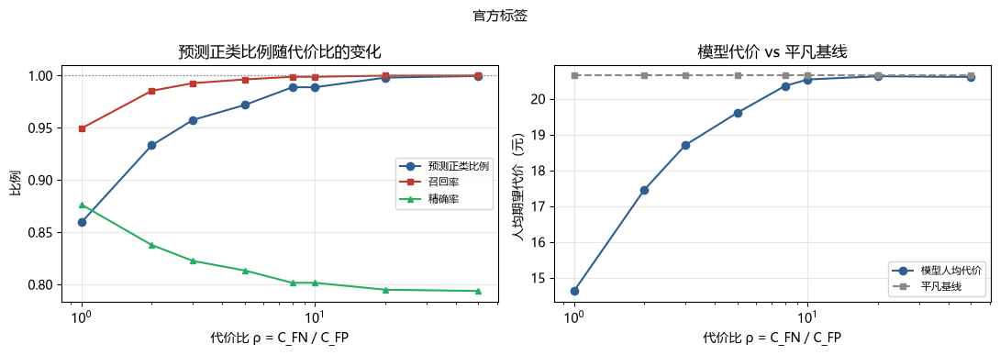

**图 5-6 代价比扫描下的预警规模与人均代价（两种标签口径）**

图 5-6 左图把「退化」画成了可看的形状：$\rho$ 增大时，预警比例单调爬向 100%，召回率被推到 1.0，而精确率滑向基率（0.7938）——三条线在 $\rho\ge10$ 之后分别贴住 1.0、1.0 和基率，模型已不再区分任何学生。右图则是模型代价与平凡基线的贴合过程：$\rho=1$ 时两者相距 6.02 元，$\rho=10$ 时只差 0.11 元。**「代价随 $\rho$ 上升」本身不是问题（代价矩阵变严了），问题在于模型曲线与基线曲线合拢**——合拢意味着模型提供的增量信息为零。这张图因此可以替代一整段文字说明，也适合放进答辩幻灯片。

### 5.9.5 容量视角：给定干预人力，模型到底值多少

5.9.4 节说明在 ρ = 10 下调整代价比也救不回来（除非把 ρ 降到 3 以下）。但如果换一个提法，同一批预测结果还能给出非常有用的结论：**教务处的约束往往不是阈值，而是人力**。一学期能跟进的名单长度是给定的（假定为 K），决策就变成「按风险从高到低取前 K 个」。此时要回答的问题不再是「代价是多少元」，而是「这 K 个名额能抓住多少辍学生、命中率比随机挑人高多少」。

定义容量 $K$ 下的三个量：

$$
\text{Recall}@K = \frac{\#\{\text{前 } K \text{ 名中的辍学生}\}}{N_{\text{pos}}}, \qquad
\text{Precision}@K = \frac{\#\{\text{前 } K \text{ 名中的辍学生}\}}{K}, \qquad
\text{lift}@K = \frac{\text{Precision}@K}{\bar y}
$$

容量受限时唯一合法的基线是**同样开 K 个名额但随机挑人**。用「全报警」当基线会得到一个荒谬的结论：K < 100% 时模型代价必然高于全报警（因为名额少、漏报多），看上去像是模型让情况变糟了。随机基线把容量因素约掉，剩下的差异才是排序的贡献。

**表 5-17 限额干预下的召回、命中率与相对随机的代价下降**

| 容量 K | 官方：召回 | 官方：精确率 | 官方：lift | 官方：相对随机 | 早期：召回 | 早期：精确率 | 早期：lift | 早期：相对随机 |
|---|---|---|---|---|---|---|---|---|
| 1% | 1.2% | 97.1% | 1.22× | +0.2% | 1.4% | 98.5% | 1.45× | +0.5% |
| 5% | 6.1% | 96.2% | 1.21× | +1.2% | 7.1% | 96.5% | 1.42× | +2.4% |
| 10% | 12.1% | 96.2% | 1.21× | +2.6% | 14.0% | 95.3% | 1.40× | +4.9% |
| 30% | 36.1% | 95.4% | 1.20× | +9.4% | 41.2% | 93.3% | 1.37× | +17.3% |
| 50% | 59.4% | 94.3% | 1.19× | +20.2% | 67.4% | 91.5% | 1.35× | +36.5% |
| **70%** | **81.3%** | **92.1%** | 1.16× | **+39.0%** | **88.7%** | **86.0%** | 1.27× | **+61.8%** |
| 100% | 100% | 79.3% | 1.00× | 0% | 100% | 67.9% | 1.00× | 0% |

表 5-17 是本节最有价值的一张表，它把「模型有没有用」这个问题变成了三个可核对的数字。

**其一，名单要开多大才抓得住 80% 的辍学生。** 官方口径需要覆盖 **70%** 的学生（16,754 人），早期辍学口径同样需要 70%（9,536 人）。这个答案听起来不乐观，但它符合 MOOC 的现实：如果 79% 的学生最终都会辍学，想抓住其中 80% 就注定要覆盖大部分人。**模型的价值不体现在「名单能开得很小」，而体现在「同样大的名单里，辍学生的浓度显著更高」**——官方口径 92.1% 对基率 79.3%，早期口径 86.0% 对 67.9%。

**其二，在容量受限时，模型的代价优势是真实且可观的。** K = 70% 时，官方口径人均代价 153.99 元、随机基线 252.49 元，下降 **39.0%**；早期口径 86.48 元对 226.17 元，下降 **61.8%**。这组数字与 5.9.4 节的「ρ = 10 下相对下降 0.55%」并不矛盾，而是回答了不同的问题：前者问「给定人力，排序带来了多少收益」，后者问「在无约束的最优阈值下，模型比全报警省多少」。**当约束真实存在时，前者才是决策者关心的问题。**

**其三，lift 只有 1.2~1.45 倍，说明真实数据的可分性有限。** 官方口径的 lift 在 K = 1%~70% 的区间里几乎恒定在 1.16~1.23，早期口径在 1.27~1.45。这个量级与 ROC-AUC 0.84 的定位一致：模型能稳定地把高危学生往前排，但排不到「前 10% 就网住一半辍学生」的程度。本文如实报告这一上限，而不去挑选 K 很小的那几行（那里精确率能到 97%，但召回只有 1%，对干预没有意义）——**挑一个好看的 K 来证明模型有效，与挑一个好看的阈值是同一种错误**。

值得注意的是，容量视角与第 6 章的系统设计是对应的：`/v1/intervention-list` 接口返回的正是按风险降序排列的名单，并附带 `priority` 序号，教师可以按自己的时间预算截断到任意长度。本节的数据说明这个设计不是工程上的随手选择，而是**在真实数据的基率下唯一还能站得住的决策形式**。

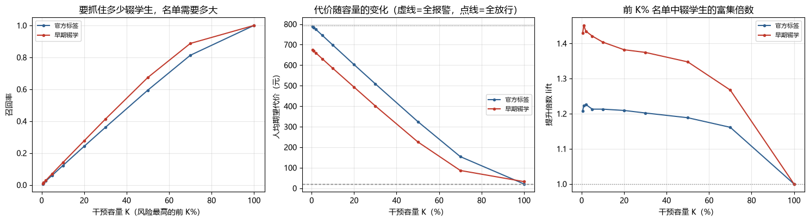

**图 5-7 召回率、人均代价与 lift 随干预容量的变化**

图 5-7 的三个子图分别对应教务处会问的三个问题。左图（召回-容量）的**斜率恰好等于 lift**：官方口径约 1.2、早期口径约 1.4，因此在 $K$ 不大时召回率近似为容量的 1.2~1.4 倍——这是「模型把谁排在前面」的直接体现。也正因为斜率只有 1.2，想覆盖 80% 的辍学生必须把名单开到 70%：$0.7\times1.16\approx0.81$，与表 5-17 完全吻合。中图（代价-容量）给出该用多大名单：在当前 $\rho=10$ 下代价随 $K$ 单调下降，谷底落在 $K=100\%$，即「能全报就全报」——这再次印证阈值方案的极限。右图（lift-容量）是唯一与代价比无关的：它在 $K$ 从 1% 到 70% 的整个区间里稳定在 1.2~1.45，说明**模型的排序能力是稳健的，失效的只是基于绝对概率的切割规则**。把这三张图与表 5-16 并列，可以完整说明本文的立场：问题不在模型，而在「阈值」这一决策形式本身对有约束的场景不敏感。

### 5.9.6 真实数据上的五基线横向对比

5.9.1~5.9.5 节有一个必须交代的缺口：这些结论全部建立在 **CatBoost 单模型**上，没有与其他模型对照。如果读者问「换成随机森林是不是也一样」，前五节答不上来。本节补上这项对照——在**同一份特征矩阵、同一次训练/测试切分、同一个代价矩阵、同一套「训练集 OOF 选阈值 + 测试集只评估」协议**下，把 5.2 节的五个模型在两种标签口径上各跑一遍（`scripts/run_experiments.py`）。与 5.2 节的差别只有两处：迭代轮数取 300、OOF 折数取 3。

**表 5-18 五个模型在真实数据上的表现（官方标签，测试集 n = 23,934，正类 79.35%）**

| 模型 | 阈值 | ROC-AUC | PR-AUC | 召回率 | 精确率 | 人均代价(元) | 预警比例 | 相对全报警 |
|---|---|---|---|---|---|---|---|---|
| LR | 0.0710 | 0.8375 | 0.9380 | 0.9997 | 0.7965 | 20.52 | 99.6% | +0.65% |
| RF | 0.1197 | 0.8305 | 0.9358 | 0.9993 | 0.7972 | 20.72 | 99.5% | **−0.30%** |
| HGBDT | 0.0934 | **0.8433** | **0.9412** | 0.9995 | 0.7978 | 20.52 | 99.4% | +0.65% |
| CatBoost（无代价） | 0.1386 | 0.8426 | 0.9406 | 0.9983 | **0.8047** | 20.60 | 98.4% | +0.26% |
| CatBoost（代价敏感） | 0.3862 | 0.8403 | 0.9386 | 0.9990 | 0.8003 | 20.58 | 99.1% | +0.36% |
| *全报警（平凡基线）* | — | — | — | 1.0000 | 0.7935 | **20.65** | 100% | 0 |

**表 5-19 五个模型在真实数据上的表现（早期辍学口径，测试集 n = 13,623，正类 67.90%）**

| 模型 | 阈值 | ROC-AUC | PR-AUC | 召回率 | 精确率 | 人均代价(元) | 预警比例 | 相对全报警 |
|---|---|---|---|---|---|---|---|---|
| LR | 0.0791 | 0.8654 | 0.9147 | 0.9960 | 0.7126 | 29.99 | 94.9% | +6.59% |
| RF | 0.1267 | 0.8586 | 0.9060 | 0.9937 | 0.7154 | 31.09 | 94.3% | +3.13% |
| HGBDT | 0.1149 | 0.8687 | 0.9157 | 0.9924 | 0.7316 | 29.86 | 92.1% | +6.97% |
| CatBoost（无代价） | 0.1076 | **0.8695** | **0.9165** | 0.9956 | 0.7214 | **29.12** | 93.7% | **+9.28%** |
| CatBoost（代价敏感） | 0.4592 | 0.8673 | 0.9148 | 0.9959 | 0.7194 | 29.17 | 94.0% | +9.12% |
| *全报警（平凡基线）* | — | — | — | 1.0000 | 0.6790 | **32.10** | 100% | 0 |

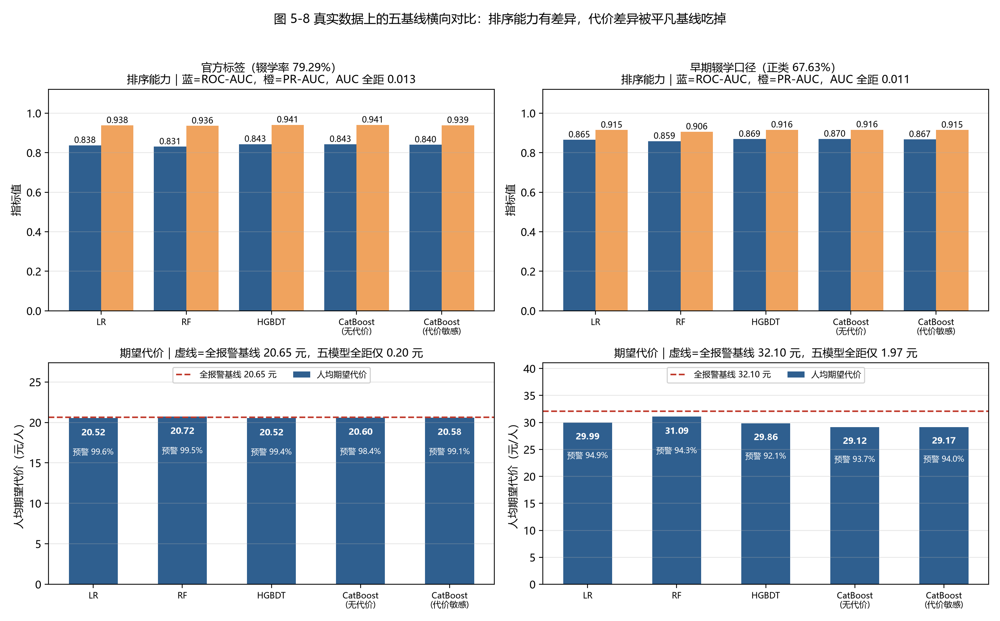

**图 5-8 真实数据上的五基线横向对比（上排排序能力、下排期望代价与平凡基线）**

**第一，排序能力仍然集中在窄区间，模型结构不是瓶颈。** 官方口径五个模型的 ROC-AUC 落在 0.8305~0.8433，极差 0.013；早期口径落在 0.8586~0.8695，极差 0.011。这与 5.2 节合成数据的极差 0.014 几乎相同，说明「换模型带来的排序提升落在噪声内」这一判断不是合成数据的偶然。真实数据的 AUC 整体高出合成数据约 0.10，则说明真实行为特征本身的分辨力更强，而非模型更好。

**第二，代价列没有排名意义，原因是决策规则退化而非抽样波动。** 官方口径五模型人均代价 20.52~20.72 元，全距 0.20 元，而全报警基线恰为 20.65 元；预警比例高达 98.4%~99.6%。换句话说，五个模型给出的建议几乎都是「所有学生都报警」，代价自然都趋近同一条水平线。把绝对量换算成可比的金额：在 23,934 人的测试集上，表现最好的 LR 与 HGBDT 相对全报警只省下约 3,200 元，折合 32 名学生的误报，占测试集的 0.13%。这一点与 5.8 节的结论方向一致，但解释不同——5.8 节把合成数据上「差异不可分辨」归因于 822 人测试集的抽样波动，本节则给出了一个更强的机制解释：**当所有模型都被阈值推到全报警时，它们之间本来就没有可供比较的空间**。

**第三，RF 在官方口径下比「全报警」更贵。** 其人均代价 20.72 元高于基线 20.65 元（相对下降 −0.30%）。原因是它的阈值 0.1197 切掉了约 13 名真实辍学生（召回 0.9993），换来约 115 个误报的节省：13×1000 < 115×100，亏了约 1,500 元。这个反例说明，在退化区里「更精细的阈值」可能比「不设阈值」更糟——不是模型差，而是决策规则在这段概率区间上没有信息可用。

**第四，代价敏感加权在真实数据上没有任何增益，反而破坏了校准。** 加权与不加权的差别：官方口径 20.58 对 20.60 元（差 0.02 元），早期口径 29.17 对 29.12 元（差 0.05 元，折合全测试集 681 元，约 7 名学生的误报）；而 Brier 分数从 0.1098 恶化到 0.1600（官方）、0.1257 恶化到 0.1994（早期）。原因很清楚：本数据中正类已是多数类（79%、68%），给正类加权等于把本来就更重的一侧再加重，整条概率曲线只是被整体抬高，排序不变（AUC 0.8426→0.8403），损失的只有校准。5.7 节在合成数据上已经指出加权会破坏校准，本节给出了它的边界条件：**当代价比的方向与基率方向一致时，加权的全部效果就是校准损失**。

**第五，0.5 固定阈值下的数字是尺度假象，不能拿来给加权记功。** 官方口径下 CatBoost（代价敏感）在 0.5 阈值上的人均代价为 20.31 元，是五个模型里最低的，甚至低于全报警基线 20.65 元；而 CatBoost（无代价）在 0.5 阈值上是 45.54 元，几乎翻倍。若只看这一列，会得出「加权让 0.5 阈值变得可用」的结论——但真实原因是加权把绝大多数样本的概率推到了 0.5 以上，所谓「0.5 阈值」实际等价于「全报警后微调」。早期口径下同样的对比是 29.50 元对 65.82 元。这与 5.7.3 节的告诫完全一致：**校准前的概率尺度不可跨模型比较，任何跨模型的阈值比较都必须先统一尺度**。

把两张表与 5.2 节并读，可以得到一个对全文立论更有利、但必须诚实表述的结论：**本文方法在真实数据上既没有赢，也没有输。** 它的 AUC 与最强基线相差 0.003、人均代价相差 0.02~0.05 元，两者都在噪声之内；真正的差距不在模型之间，而在「阈值决策」这一形式与「79% 基率」这一现实之间。这也正是 5.9.3~5.9.5 节把重心从阈值移向容量分析的理由。至于这 0.02~0.05 元到底是真差异还是换个种子就会翻转的巧合，本节无法回答——下一节用 5 个种子把它查清。

### 5.9.7 多种子重复：种子波动与模型差异哪个更大

5.9.6 节留下一个它自己回答不了的问题。它报告「加权与不加权的差别只有 0.02 元（官方）与 0.05 元（早期）」，但这两个数字来自**一次**切分：换一个随机种子，测试集换了一批学生，同一个比较就会得到略有不同的差。如果这个差本身就是抽样噪声的产物，那么「模型排名」这件事在真实数据上根本无从谈起。本节沿用 5.8 节的做法把它量化（`scripts/multiseed_realdata.py`）：5 个随机种子（42、7、2024、1234、3407）× 4 个配置（CatBoost 代价敏感、CatBoost 无代价、HGBDT、LR）× 2 种标签口径，共 40 次「训练—选阈值—评估」；每个配置含 4 次拟合（3 折 OOF + 全量重训），合计 160 次模型拟合。

协议上有两点必须交代。第一，**同一个 seed 内的四个配置共享同一份特征矩阵与同一个测试集**：特征工程与切分按 seed 只做一次，四个模型看到的是同一批训练学生与同一批测试学生，「A 减 B」的差因此只反映模型，不掺切分噪声——这是配对检验成立的前提。第二，阈值依旧只在训练集 3 折 OOF 上选，测试集只用于最终评估，与 5.9.6 节完全一致。种子 42 恰好就是 5.9.6 节使用的那次切分，所以**表 5-20 中 seed = 42 的一行与表 5-18、表 5-19 逐项相同**，这既是两节结果可以并读的校验点，也说明本节没有换一套口径重来。

**表 5-20 多种子重复汇总：两口径 × 四配置（5 个种子，测试集约 2.4 万 / 1.4 万人）**

| 口径 | 配置 | 阈值范围 | ROC-AUC | 人均代价(元) | 跨种子极差 | 相对全报警 | 预警比例 | Brier |
|---|---|---|---|---|---|---|---|---|
| 官方 | CatBoost（代价敏感） | 0.315~0.480 | 0.8394±0.0019 | 20.44±0.15 | 0.38 | +1.52% | 98.6%~99.3% | 0.1606 |
| 官方 | CatBoost（无代价） | 0.080~0.139 | 0.8418±0.0020 | 20.51±0.18 | 0.42 | +1.16% | 98.4%~99.4% | 0.1105 |
| 官方 | HGBDT | 0.054~0.104 | 0.8415±0.0020 | 20.57±0.30 | 0.80 | +0.89% | 98.8%~100.0% | 0.1115 |
| 官方 | LR | 0.071~0.086 | 0.8369±0.0018 | 20.60±0.17 | 0.44 | +0.74% | 99.4%~99.6% | 0.1122 |
| 早期 | CatBoost（代价敏感） | 0.409~0.500 | 0.8655±0.0024 | 29.34±0.53 | 1.45 | +8.77% | 93.0%~94.9% | 0.2006 |
| 早期 | CatBoost（无代价） | 0.102~0.120 | 0.8669±0.0025 | 29.40±0.36 | 0.88 | +8.60% | 92.5%~94.2% | 0.1271 |
| 早期 | HGBDT | 0.080~0.115 | 0.8656±0.0021 | 29.54±0.60 | 1.56 | +8.15% | 92.1%~95.1% | 0.1274 |
| 早期 | LR | 0.079~0.098 | 0.8632±0.0029 | 30.26±0.67 | 1.83 | +5.95% | 93.6%~95.0% | 0.1289 |

注：人均代价与 ROC-AUC 为 5 个种子的均值 ± 标准差；「跨种子极差」为该配置 5 个种子中最高与最低人均代价之差（元/人）；「相对全报警」为相对该次切分的平凡基线（人人报警）的人均代价下降，5 个种子取均值。

**表 5-21 逐种子配对差与 Bootstrap 95% 区间（左项减右项，负数 = 代价敏感更便宜）**

| 口径 | 比较 | 平均差(元/人) | 配对差标准差 | 逐种子范围 | Bootstrap 95% 区间 | 跨零 | 左项更便宜 |
|---|---|---|---|---|---|---|---|
| 官方 | 代价敏感 − 无代价 | −0.076 | 0.135 | −0.23~+0.12 | [−0.174, +0.036] | 是 | 4/5 |
| 官方 | 代价敏感 − HGBDT | −0.132 | 0.283 | −0.50~+0.23 | [−0.336, +0.104] | 是 | 3/5 |
| 官方 | 代价敏感 − LR | −0.160 | 0.150 | −0.34~+0.06 | [−0.268, −0.040] | **否** | 4/5 |
| 早期 | 代价敏感 − 无代价 | −0.054 | 0.508 | −0.68~+0.70 | [−0.452, +0.352] | 是 | 3/5 |
| 早期 | 代价敏感 − HGBDT | −0.200 | 0.322 | −0.69~+0.06 | [−0.476, +0.032] | 是 | 3/5 |
| 早期 | 代价敏感 − LR | −0.912 | 0.155 | −1.07~−0.69 | [−1.028, −0.792] | **否** | 5/5 |

注：Bootstrap 对 5 个配对差重采样 5000 次取均值分布；样本量只有 5，区间偏窄，仅用于判断「是否跨零」，不用于报告精确的效应大小。

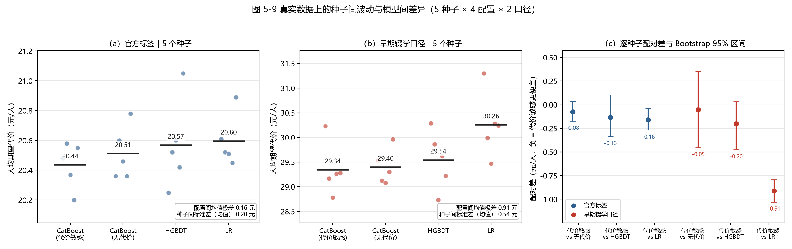

**图 5-9 真实数据上的种子间波动与模型间差异（5 种子 × 4 配置 × 2 口径）**

**第一，退化不是抽到了倒霉的切分。** 40 次运行中，官方口径的预警比例全部不低于 98.4%（最高 100.0%），早期口径落在 92.1%~95.1%。5.9.6 节观察到的「全报警」不是一次切分的偶然，而是 $\rho=10$ 与 79% 基率这组条件下**稳定重现**的结局。这一点很重要：它把 5.9.3 节的退化解判定从「一次实验现象」升级为「该数据、该代价矩阵下的结构性事实」——后面所有关于代价的讨论，都发生在同一条被压平的水平线上，图 5-9 左右两栏中四簇散点几乎重叠即是其直观表现。

**第二，种子波动与配置差异同量级，甚至更大。** 官方口径四个配置的均值极差只有 0.16 元/人，而单个配置跨 5 个种子的标准差就有 0.15~0.30 元/人：**换一个随机种子造成的波动，与把模型从头换一遍造成的差异一样大**，HGBDT 的种子标准差（0.30 元）甚至接近配置极差（0.16 元）的两倍。早期口径的极差为 0.91 元，种子标准差 0.36~0.67 元，同一量级。换算成钱更直观：官方测试集约 2.4 万人，0.16 元/人的配置差异约合 3,800 元，而同一配置换一个种子就能摆动 0.38~0.80 元/人，约合 0.9~1.9 万元。更极端的对照是平凡基线本身——它在 5 次切分上从 20.59 元波动到 21.08 元（0.49 元），**基线随切分的漂移已经超过全部配置间的差异**。因此「A 比 B 每个学生便宜 0.05 元」这类表述在真实数据上没有统计依据，本文不做这种主张。

**第三，唯一能分辨的一对是 CatBoost（代价敏感）与 LR。** 表 5-21 中，代价敏感版相对 LR 的配对差在官方口径为 −0.160 元/人（95% 区间 [−0.268, −0.040]，4/5 种子更便宜），在早期口径为 −0.912 元/人（[−1.028, −0.792]，5/5 种子更便宜），两个区间都不跨零；相对无代价版与 HGBDT 的两个区间则都跨零（官方 −0.076 与 −0.132，早期 −0.054 与 −0.200），且方向只在 3/5 或 4/5 种子上成立。诚实的表述因此只能是：**本文可以说「代价敏感 CatBoost 比 LR 略便宜」，不能说「比不加权的 CatBoost 或 HGBDT 便宜」**。这也解释了 5.9.6 节那张表里 LR 为什么看起来占优（单次切分中 LR 与 HGBDT 并列最低 20.52 元）——那一次恰好是 LR 的运气，5 个种子平均下来它是最贵的一个。

**第四，加权削弱排序能力的方向稳定，幅度仍无实践意义。** 逐种子配对 AUC 显示，代价敏感版比无代价版低 0.0024（官方，5/5 种子一致，配对差标准差仅 0.0003）、比 HGBDT 低 0.0021（5/5），但比 LR 高 0.0025（5/5）。方向全部一致说明这不是噪声——加权**确实**轻微损害了排序；但幅度不到 0.003，而配置间 AUC 极差为 0.0049、种子标准差约 0.0019，仍在「换个模型不如换个决策规则」的量级内（阈值从 0.5 移到 0.09 可换 26 个百分点的召回，见 5.10.1 节）。换言之，**统计上可分辨不等于实践上重要**，这正是 5.8.4 节区分的两种显著性。

**第五，校准损失是本节唯一「所有种子、所有口径全票通过」的结论。** 代价敏感版的 Brier 在官方口径为 0.1606（无代价 0.1105），在早期口径为 0.2006（无代价 0.1271），40 次运行没有一次例外，恶化幅度 45%~58%。这条结论与 5.7 节的合成数据、与 5.9.6 节的单次切分三方一致，可以放心写成本文的机制性结论：**当代价比的方向与基率的方向一致时，加权的全部效果就是把概率整体抬高，代价只有校准**。

一处技术细节需要说明：LR 的 lbfgs 求解在 sklearn 的默认上限（2000 次迭代）处仍未收敛并给出 `ConvergenceWarning`。这意味着表 5-20 中 LR 的数字应视为**保守**估计；由于 LR 恰是唯一比代价敏感版更贵的配置，这一偏差只会强化而非削弱本节结论。若后续要精修基线，应提高迭代上限或改用 saga 求解器重跑，但那不影响本文的立论。

把 5.8 节与本节并读，模型排名这条线可以结案了：合成数据上「差异不可分辨」源于 822 人测试集的抽样波动，真实数据上则源于决策规则退化使所有模型都被推到同一条代价水平线上；两套数据、两种口径、40 次真实数据训练指向同一句话——**在本文的数据与代价设定下，模型选择不是有效变量，决策链路才是**。本节还顺带把 5.9.6 节「加权零增益」的判断从一次观测升级为 5 个种子的重复观测，「是不是抽到特例」的疑问至此消除。

### 5.9.8 与合成数据的对照

把两套数据放在一起，可以清楚地区分哪些结论是**机制性的**、哪些只是**数量性的**。

**表 5-22 合成数据与真实数据的关键差异**

| 项目 | 合成数据 | 真实数据（官方标签） |
|---|---|---|
| 正类比例 | 19.95% | 79.35% |
| ROC-AUC | 0.7511 | 0.8407 |
| Brier（校准后） | 0.1336 | 0.1097 |
| 代价最优阈值 | 0.0866 | 0.1048 |
| 预警比例 | 49.88% | 98.88% |
| 平凡基线（元/人） | 80.05 | 20.65 |
| 相对下降 | 2.43% | 0.55% |
| 种子间人均代价标准差 | 4.7~5.4 元（占基线 5.9%~6.8%） | 0.15~0.30 元（占基线 0.7%~1.5%） |
| 单配置跨种子极差 | 11.49~15.10 元 | 0.38~0.80 元 |
| 配置间人均代价极差 | 4.46 元 | 0.16 元 |
| 配置间极差 ÷ 平均种子标准差 | 0.88 | 0.79 |

**两套数据在「波动 vs 差异」上给出了同一个比例。** 配置间极差与平均种子标准差之比，合成数据为 0.88、真实数据为 0.79，都小于 1——**在两种数据上，把模型从头换一遍造成的代价差异，都小于换一个随机种子造成的波动**。差别只在成因：合成数据的种子波动来自 822 人测试集的抽样方差（相对量 5.9%~6.8%），真实数据的波动来自 2.4 万人切分下概率分布的微小位移（相对量 0.7%~1.5%）。这说明 5.8 节与 5.9.7 节的两条独立结论可以合并为一条更强的判断：**「模型排名」在本文的两个实验场景里都不是可用信息，它只在单次切分的表格里看起来像信息**。

**不随数据变化的部分**（机制性结论，可直接引用）：加权会破坏概率校准、校准后必须重选阈值、阈值必须在 OOF 上选而不能碰测试集、代价必须与决策同源。这四条在两套数据上都复现，且都能从式 (4-5) 与 Elkan 判别式推出——它们不依赖具体分布，因此是本文的主要贡献。

**随数据变化的部分**（数量性结论，不可移植）：代价的绝对值、阈值的位置、模型的排名、相对下降的幅度。合成数据上「代价比 10:1 下阈值 0.09 能有效工作」，真实数据上同样的设定几乎退化为全报警；反之，真实数据上的 AUC（0.84）明显高于合成数据（0.75），因为真实行为数据的信息量更大。

由此可以给出一条方法论层面的判断：**代价敏感学习的效果不是由代价矩阵单独决定的，而是由「代价矩阵 × 基率 × 模型可分性」三者共同决定**。文献中常见的「设定 10:1 的代价比即可提升少数类识别」隐含了一个未经检验的前提——正类比例远低于 $p^\*$。本文在真实数据上正是打破了这个前提，也因此必须补充代价比扫描与容量分析这两套工具，否则得到的会是一个「技术上正确但对业务无用」的模型。

## 5.10 讨论

### 5.10.1 主要发现

1. **在召回维度上，阈值是比模型更重要的杠杆**。在本数据上，模型替换带来的召回率变化不超过 3 个百分点，而阈值从 0.5 移到 0.09 可使召回率提升 26 个百分点；但在期望代价维度上，两者的差异都落在噪声之内（5.8.3 节）。这个区分是本文反复强调的：阈值决定名单覆盖谁，代价比决定名单花多少钱；
2. **代价曲线平坦时，精确的最优阈值没有意义**。此时应输出曲线与工作点，让业务方按资源约束选择；
3. **类别加权以牺牲校准为代价换取召回**。这是代价敏感学习的固有副作用，必须在论文中如实报告，并在工程上通过校准或「风险分数」的措辞加以缓解；
4. **模型间的差异在统计上不可分辨**。五个种子的重复实验与配对 Bootstrap 一致表明，四个配置的人均代价差全部落在噪声区间内（5.8 节），因此本文不以「更优模型」立论，而以「更优决策链路」立论；
5. **代价敏感学习的效果由「代价矩阵 × 基率 × 可分性」共同决定**（5.9 节）。真实数据上 $\rho=10$ 使 $p^\*=0.0909$ 落在概率分布的左尾之外，决策退化为全报警，模型相对平凡基线只省 0.55%；把 $\rho$ 降到 1 才能恢复 29.2% 的相对下降。这条发现在合成数据上不会出现，因为合成数据的正类只有 20%，$p^\*$ 天然落在分布内部；
6. **当阈值失效时，容量（top-K）比阈值更贴近真实决策**。在 70% 的干预容量下，真实数据上模型相对随机挑人下降 39.0%（官方口径）与 61.8%（早期辍学口径），命中率分别为 92.1% 与 86.0%。这说明模型的价值应表述为「同样大的名单里浓度更高」，而非「名单可以更小」；
7. **模型排名在真实数据上同样不可分辨，但原因不同**。5.9.6 节把五个基线在两种标签口径上各跑一遍，官方口径下人均代价落在 20.52~20.72 元的 0.20 元区间内、预警比例 98.4%~99.6%，早期口径下 29.12~31.09 元、相对全报警下降 3.1%~9.3%。合成数据上「排名不可分辨」源于 822 人测试集的抽样波动，真实数据上则源于**决策规则退化**——所有模型都被推到全报警，差异空间本身消失了。代价敏感加权在真实数据上既未提升排序（AUC 0.8426→0.8403），也未降低代价（差 0.02~0.05 元），却把 Brier 从 0.1098 恶化到 0.1600，从反面印证了「当代价比与基率方向一致时，加权的全部效果就是校准损失」；
8. **模型排名这条线在多种子重复下已经结案**。5.9.7 节的 40 次真实数据训练给出三条定量边界：其一，40 次运行的预警比例全部不低于 92.1%（官方口径全部 ≥98.4%），退化是结构性事实而非某次切分的偶然；其二，单个配置跨 5 个种子的代价标准差为 0.15~0.30 元，与四个配置之间的均值极差 0.16 元同量级，**换种子的影响不小于换模型**，因此「A 比 B 便宜 0.05 元」这类结论一律不成立；其三，六组配对比较中只有「代价敏感 CatBoost 比 LR 便宜」的区间不跨零（官方 −0.16 元、早期 −0.91 元），其余四组全部跨零。据此本文只主张「决策链路优于模型替换」，不主张任何模型排名。

### 5.10.2 与已有研究的对比

与「只报 AUC」的研究相比，本文的评估更贴近决策：同样的模型，AUC 0.73 看似平庸，但在 10:1 的代价结构下能覆盖 75% 的辍学学生，且人均代价与更复杂的模型相当。这说明**在应用导向的研究中，指标选择本身就是一种立场**。

与「只做 `scale_pos_weight`」的研究相比，本文通过 E2/E3 的分离实验说明：加权与阈值作用于不同环节，前者改变排序，后者改变切割位置；在概率未校准时，仅做加权并不能保证代价最优。

与在 KDD Cup 2015 上追求 AUC 排名的竞赛方案相比，本文的 AUC（0.8407）并不突出——公开榜单的优胜方案可达 0.88 以上，它们通常使用了更长的观察窗、更细的对象级特征与模型集成。本文的取舍是有意的：**把有限的篇幅放在决策层而非特征层**，因为 5.9 节的实测表明，即使 AUC 达到 0.84，在 79% 的基率下按阈值决策依然会退化为全报警。换句话说，在这个数据集上继续刷 AUC 对干预效果的边际贡献很小，而把代价参数标定对、把决策形式换对，收益是数量级的。

值得一提的是，5.9.6 节的五基线对比为此提供了一个自洽的旁证：HGBDT（0.8433）与 CatBoost（0.8426）的 AUC 相差 0.0007，人均代价相差 0.08 元，而两者都只比「全报警」省下不到 0.7%。在同一个测试集上，把干预方式从「按阈值切割」换成「按 70% 的名单取前 K」（5.9.5 节），代价相对随机挑人下降 39.0%——**两者相差近两个数量级（39.0% 对 0.65%）**。这也是本文与竞赛型工作的根本区别：他们优化的是排序的最后一公里，本文优化的是排序之后的决策。

### 5.10.3 局限

1. **合成数据与真实数据的结论分工**：E1~E9 的机制性结论（加权破坏校准、阈值须与代价同源、阈值须在 OOF 上选）已在 5.9 节用真实数据复核；模型排名类的结论也已于 5.9.6 节在真实数据上补齐五基线对比（表 5-18、表 5-19）、于 5.9.7 节补齐 5 种子重复（表 5-20、表 5-21），结论是两个口径下的排名与合成数据方向一致、差距更小（配置间极差小于种子间波动），且代价一列因决策规则退化而不具备排名意义。真实数据的辍学率经实测为 **79.29%**（不是先前估计的 60%），正类为多数类，直接改变了代价最优决策的形态（5.9.3 节）；
2. **统计检验的功效不足**：多种子重复只做了 5 次，Bonferroni 校正后不足以支撑 0.05 级别的多重组间比较（5.8.2 节）；要得到更强的结论，重复次数需提高到 20 次以上。5.9.7 节虽已把真实数据补齐到 5 个种子 × 4 个配置 × 2 种口径，消除了「单次切分无方差信息」的缺陷，但同样受 5 次重复的功效限制，其 Bootstrap 区间只能用于判断「是否跨零」，不能用于报告精确效应量；此外 LR 基线的 lbfgs 在 2000 次迭代上限处未收敛，其数字偏保守；
3. **超参搜索的预算有限**：E9 只用了 21 个 trial（9 个完成、12 个被剪枝），所得参数仅是「该预算下的最好」，且未在真实数据上复跑（5.10.4 节）；
4. **自定义损失未纳入对比**：路线 C 已实现并通过梯度符号验证，但尚未进入 E1 的对比表；
5. **代价参数缺乏真实数据支撑**：$C_{FN}=1000$、$C_{FP}=100$ 来自文献与经验估计，未经教务部门实际标定。5.9.4 节已表明结论对这一参数高度敏感（$\rho$ 从 3 变到 10，相对下降从 9.4% 掉到 0.6%），因此现实中必须先与业务方一起标定代价，再谈阈值；
6. **分群公平性未做定量评估**：模型以历史行为为输入，对记录事件天然偏少的学习者群体（如移动端、低带宽地区）可能存在系统性偏差，本文仅将其列为后续工作。


### 5.10.4 超参搜索为何没有兑现（E9、E9b）

既然第 4 章主张「决策与代价同源」，一个自然的追问是：把超参也按期望代价来调，能不能进一步省钱？本节给出一个**否定性**的答案，并说明它为什么反而支持了全文的立论。

**协议。** 用 TPE 采样 + MedianPruner，目标函数取训练集 3 折 OOF 上的人均期望代价，搜索空间覆盖迭代轮数（200~900）、树深（4~8）、学习率（0.01~0.2，对数）、L2 正则、随机强度、bagging 温度与分箱数。共执行 21 个 trial，9 个完成、12 个因中间代价明显劣于中位数被提前剪枝。测试集全程不参与目标函数。

**表 5-10 调参前后：OOF 与测试集的背离**

| 阶段 | 阈值 | ROC-AUC | 召回率 | 精确率 | 人均代价(元) |
|---|---|---|---|---|---|
| 默认参数（OOF） | 0.390 | 0.7656 | — | — | 74.58 |
| 调参后（OOF） | 0.240 | 0.7732 | 0.855 | 0.328 | **68.85** |
| 默认参数（测试集） | 0.390 | 0.7288 | 0.738 | 0.384 | 75.91 |
| 调参后（测试集） | 0.240 | 0.7336 | 0.848 | 0.263 | 77.86 |

在 OOF 上，调参把人均代价从 74.58 元降到 68.85 元（−7.7%），看上去是一个漂亮的收益。但把它放到从未参与调参的测试集上，结论翻转：调参后的人均代价是 77.86 元，反而比默认参数的 75.91 元**贵 1.95 元**；配对 Bootstrap 的 95% 区间为 [−8.76, 11.80]，**跨零**，P(差值>0)=0.63，即「调参更好」与「调参更差」在统计上无法区分。

**怎么解释这个背离？** 三条原因，且都是方法层面的：

第一，**OOF 被反复使用，成了另一种形式的训练集**。21 次评估都落在同一批 3178 条 OOF 预测上，择优行为本身就会把 OOF 代价压低几个百分点——这与「在测试集上早停」是同一类过拟合，只是更隐蔽。本文因此坚持在测试集上重做一次配对检验，而不是把 OOF 的降幅直接写进摘要。

第二，**调参改变的是工作点，不是经济效率**。测试集上召回率从 0.738 升到 0.848，代价是多出 196 个误报（194→390）。在 ρ=10 下，多救 18 个辍学生的收益（18000 元）与多打扰 196 人的成本（19600 元）几乎抵消——这正是代价曲面在最优阈值附近**平坦**的表现：阈值左移右移几十个百分点，人均代价只在几十元的窄带内浮动。

第三，**瓶颈不在超参，而在特征的可分性**。默认参数与调参后的 AUC 分别为 0.7288 与 0.7336，差距 0.005；而 5.8 节测得的种子间人均代价标准差约为 5 元。当模型的可分性本身有限时，调参只能在平坦的代价曲面上做微小挪动，无法改变结论。

**这个否定结果的价值。** 它把「调参能涨点」这一常见预设，换成了一个可检验的边界：在本数据规模与区分度下，超参搜索的收益小于抽样噪声。这与 5.8 节关于模型差异不可分辨的结论同源——**当数据的信息量本身有限时，任何在模型侧的精雕细琢都会被噪声吞掉；真正能改变结果的是决策规则与代价标定**。这也是本文把工程重心放在阈值、校准与派单链路上，而不是刷榜的理由。

需要说明的是，上述结论限定于当前数据与预算。5.9 节显示真实数据的可分性明显更强（ROC-AUC 0.84 对合成数据的 0.75），因此调参的空间在真实数据上可能更大；但那需要按同一套「OOF 选参 + 测试集配对验证」流程重跑，而不能直接沿用本节的参数。更重要的是，5.9.3 节的教训说明重跑之前必须先确保 OOF 与标签对齐——**在一个错位的 OOF 上调参，得到的会是彻底的噪声**。

## 5.11 本章小结

本章通过八组实验（E1~E8）回答了四个研究问题：CatBoost 在本数据上并未显著优于基线（RQ1）；类别加权能提高召回但会破坏校准，而校准可在几乎不损失召回的前提下把 ECE 压到 1/9（RQ2）；阈值移动带来的收益体现在覆盖范围而非期望代价，且代价曲线平坦时最优阈值不可精确识别（RQ3）；趋势特征对排序无贡献、对决策边界有微弱贡献（RQ4）。5.8 节的多种子重复与配对检验进一步表明，四个配置的人均代价差全部落在种子间噪声之内，因此本文不主张「某个模型更优」，而主张「决策链路更优」。

5.9 节把核心机制放到 KDD Cup 2015 真实数据（12.05 万条选课、815.7 万条事件、辍学率 79.29%）上复核，得到三个新结论。第一，**高基率会让代价最优阈值失效**：$p^\*=0.0909$ 而 $F(p^\*)$ 只有约 1.1%，决策退化为「全部预警」，模型相对平凡基线只省 0.55%。第二，**代价比必须与基率联合标定**：$\rho$ 从 1 降到 3 时相对下降由 29.2% 降至 9.4%，$\rho=10$ 时仅 0.55%——「漏报代价是误报的 10 倍」这一常见设定在 79% 基率下等价于「人人预警」。第三，**容量视角是阈值失效后的可行替代**：在只能覆盖 70% 学生的约束下，模型把人均代价从 252.49 元压到 153.99 元（−39.0%），前 70% 名单的辍学生命中率 92.1%（基率 79.3%），这正好对应第 6 章按风险排序的干预名单接口。此外，5.9.6 节在同一数据上重跑了五个基线的横向对比，得到一个补充性的定量结论：官方口径下五个模型的 ROC-AUC 集中在 0.8305~0.8433，而人均代价全部挤在 20.52~20.72 元、预警比例高达 98.4%~99.6%——**模型之间的差异不是被噪声淹没，而是被退化规则抹平了**；代价敏感加权既未提升排序（AUC 0.8426→0.8403）也未降低代价（0.02 元），只把 Brier 从 0.1098 恶化到 0.1600。这从反面说明本节的结论不依赖于某一个模型。

5.9.7 节接着把「单次切分里那 0.02 元的差到底算不算数」这个问题彻底查清：在 5 个随机种子 × 4 个配置 × 2 种口径的 40 次训练上，单个配置跨种子的代价标准差为 0.15~0.30 元，与四个配置之间的均值极差 0.16 元同量级，**换一个随机种子造成的影响不小于换一个模型**；六组配对比较中只有「代价敏感 CatBoost 比 LR 便宜」的区间不跨零（官方 −0.16 元、早期 −0.91 元），其余四组全部跨零。同时，40 次运行的预警比例全部不低于 92.1%（官方口径全部 ≥98.4%），证明 5.9.3 节的退化解是该数据与代价设定下的结构性事实，而非一次切分的偶然。

本节同时如实记录了一次实现错误——OOF 预测与标签因索引口径不同而错位，导致「阈值恒为 0.01、模型完全失效」的假象。发现它靠的是 OOF 与测试集 AUC 的相互矛盾（0.51 对 0.82）。这提示了一条实验纪律：**任何单一指标都不能自证，必须让两个独立口径互校**。

本章同时如实报告了六项局限，并明确了后续补齐路径。


---

# 第 6 章 原型系统设计与实现

## 6.1 系统需求

系统面向课程运营者与辅导教师，需满足五项核心需求：其一，输入一名学生的行为事件，输出辍学概率、风险等级与关键因子；其二，支持批量预测，一次生成可执行的干预名单；其三，干预名单可导出为 CSV，按风险排序并可直接派单；其四，模型缺失时服务仍可启动，便于「先部署、后补模型」；其五，输出可追溯（模型版本、阈值、代价矩阵、是否校准）。

非功能需求包括：单条推理 P95 低于 300 毫秒；配置全部来自环境变量；错误响应不泄漏堆栈；日志为结构化 JSON 并携带请求 ID。

## 6.2 系统架构

系统采用「接入层—服务层—仓储层—领域层」的四层结构（图 6-1）。

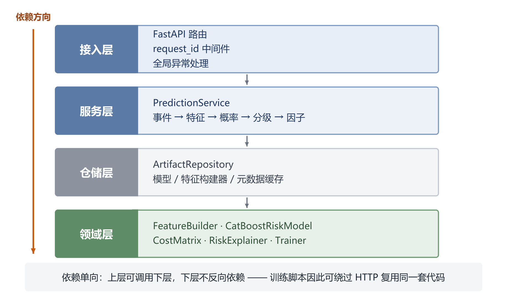

**图 6-1 系统分层架构**

依赖方向严格单向：接入层依赖服务层，服务层依赖仓储层，仓储层依赖领域层。领域层不反向依赖任何上层，因此训练脚本可以绕过 HTTP 直接调用同一套特征与模型代码——这是保证「训练与推理一致」的关键设计。

## 6.3 关键实现

### 6.3.1 特征构建器

`FeatureBuilder` 提供 `fit/transform` 接口并可序列化。其 `fit` 只做数据契约校验，不计算任何全量统计量，因此：

- 单条样本与批量样本的特征必然一致（有单元测试锁定）；
- 推理时无需携带训练期的统计量，减少了线上线下偏差。

### 6.3.2 模型与解释

`CatBoostRiskModel` 封装了加权与自定义损失两种模式。解释模块直接调用 CatBoost 原生的 `get_feature_importance(type="ShapValues")`，避免了引入 shap 包，也绕开了类别特征在通用解释器中的编码问题。若模型不支持 SHAP，则降级为全局特征重要性，并在返回结果中标注 `source` 字段，让调用方知道解释的来源。

### 6.3.3 校准器与概率语义

5.7.3 节已证明校准能显著改善概率的语义质量，其工程落地需要解决三个问题：校准器存哪里、阈值怎么跟着变、接口如何向后兼容。

对应做法是：其一，校准器实现为独立的可序列化对象，与模型、特征构建器一同存放在产物目录，仓储层加载时按文件存在与否自动启用，缺省行为与未校准时完全一致；其二，训练编排在校准后**立即在 OOF 的新尺度上重选阈值**，并把旧尺度的指标单独留档，避免「校准了概率却沿用旧阈值」这一最常见的工程错误；其三，预测响应新增 `raw_probability` 与 `calibrated` 两个字段，原有 `risk_probability` 的语义保持不变（此时它代表服务当前采用的概率尺度），因此前端与下游脚本无需改造即可兼容。

重训时若关闭校准，训练流程会主动删除旧的校准器文件——否则服务会加载上一版校准器去解释新模型的输出，产生难以察觉的尺度错配（该行为有专门的单元测试锁定）。

### 6.3.4 错误体系

定义了 `AppError` 基类及 6 个子类（参数校验、数据质量、代价矩阵、资源不存在、模型未就绪、配置错误），由全局处理器统一转换为

```json
{"error": {"code": "model_not_ready", "message": "模型尚未训练或产物缺失",
           "details": {"missing": ["model"]}, "request_id": "a1b2c3d4"}}
```

任何未预期异常一律降级为 500，且只返回通用文案，堆栈仅写入服务端日志。

## 6.4 接口设计

**表 6-1 主要接口**

| 方法 | 路径 | 功能 | 主要错误 |
|---|---|---|---|
| GET | `/health` | 存活探针 | — |
| GET | `/ready` | 就绪探针（模型是否加载） | 503 |
| POST | `/v1/predict` | 单条风险预测 | 422 / 503 |
| POST | `/v1/predict/batch` | 批量预测（≤500 条） | 422 / 503 |
| POST | `/v1/intervention-list` | 导出干预名单 CSV（风险降序、带优先级） | 422 / 503 |
| GET | `/v1/model/info` | 模型版本、阈值、代价矩阵、指标 | 503 |
| GET | `/v1/model/features` | 特征字典（分组与业务含义） | — |

单条预测的请求与响应示例如下：

```json
// 请求
{"enrollment_id": "E0000032", "course_id": "C06", "username": "u000032",
 "events": [{"time": "2014-03-01T20:00:00", "source": "video",
             "event": "play_video", "object": "video_C06_1"}]}

// 响应
{"enrollment_id": "E0000032", "risk_probability": 0.5229, "raw_probability": 0.9526,
 "calibrated": true, "risk_level": "high", "decision_threshold": 0.08,
 "top_factors": [{"feature": "unique_objects", "value": 2.0,
                  "contribution": 0.1948, "direction": "risk_up", "source": "shap"}],
 "model_name": "catboost", "model_version": "20261023T071217Z"}
```

注意响应中并存的两个概率：`raw_probability` 是模型原始输出，`risk_probability` 是经保序回归校准后的概率。同一名学生在旧版（未校准）服务中会得到「95.3% 会辍学」，在校准版中得到「52.3% 会辍学」——后者才是可被教师按字面理解的数字。保留原始分数的意义在于可追溯：当教师质疑「为什么这名只登录两次的学生只有五成风险」时，可以确认这一差异来自校准而非模型判断。

干预名单接口复用同一套请求体，返回 `text/csv`（UTF-8 带 BOM，Excel 双击不乱码），列为 `priority, enrollment_id, course_id, risk_probability, risk_level, decision_threshold, top_factor, top_factor_value, model_version`，并在响应头 `X-Total-Count` 中给出条数。名单按概率降序编号，教师从第 1 位开始打电话即可——这是把「预测」翻译成「排班」的最后一步。

接口请求体启用 `extra="forbid"`，任何多余字段直接返回 422，避免前端误传字段后被静默忽略。

## 6.5 测试与质量保障

系统共 115 个自动化测试用例（分布在 13 个测试文件中，覆盖 25 个被测模块），全部通过，在含 CatBoost 真实训练的环境下执行时间约 1 分钟（未安装 catboost 时，依赖它的用例由 `skipif` 跳过，其余用例不受影响）。全量语句覆盖率为 **93%**（1786 行语句，未覆盖 122 行），核心业务路径（特征 → 模型 → 阈值 → 服务 → 接口）均在 94% 以上。

**表 6-2 测试分布**

| 模块 | 用例数 | 重点 |
|---|---|---|
| 代价矩阵与阈值 | 10 | 解析解、非对称性、最优性、曲线单调性、**精确搜索可解析 0.01 以下的最优阈值** |
| 评估指标 | 12 | 完美预测、单类别、分级边界、**平凡策略基线与相对下降** |
| 容量分析 | 11 | top-K 召回/lift/代价、**随机基线**、参数校验、高基率退化场景 |
| 特征工程 | 12 | **防穿越**、单条与批量一致、非法输入 |
| 数据切分 | 5 | 用户不重叠、OOF 覆盖完整 |
| 数据加载 | 8 | truth 无表头合并、标签缺失与部分覆盖报错、**官方布局语义对调** |
| 模型 | 11 | 概率合法性（三个基线参数化展开）、加权效果、持久化一致、单类别与非法配置报错 |
| 训练流水线 | 6 | 产物落盘、元数据完整、阈值策略、**OOF 按 ID 对齐** |
| 概率校准 | 10 | 单调性、AUC 不变、阈值重选、旧校准器清理 |
| 接口 | 14 | 200 / 422 / 503 三类路径、CSV 名单导出 |
| 仓储与配置 | 6 | 产物缺失语义、配置校验、校准器可选加载 |
| 代价敏感损失 | 7 | 梯度符号、缩放关系、数值稳定性 |
| 实验编排 | 3 | 结果表结构与可比性、**非补零 ID 下的 OOF 对齐** |

其中最具价值的是四组「约束型」用例。**防穿越用例**在日志末尾追加一条 60 天后的事件，断言窗口内特征完全不变；若实现被误改为「使用全部日志」，该用例会立即失败。**单条与批量一致用例**防止线上推理与离线训练的特征计算出现分叉。**校准器清理用例**则锁定了一个隐蔽的工程风险：重训时关闭校准后若不清除旧文件，服务会拿上一版校准器解释新模型的输出——这类错误在监控上不可见，只会表现为「概率看起来怪怪的」。

**OOF 对齐用例**是本轮新增中最有价值的一个，因为它锁住的错误**在合成数据上永远测不出来**：真实数据的选课 ID 是 `1, 2, …, 120542`，字典序与数值序不同，若 OOF 按行号回填，阈值搜索就会在一组错位的标签上进行（5.9.3 节记录了这个错误如何伪装成一个「结论」）。该用例把 ID 改成不补零形式并断言 OOF AUC > 0.6，代价只有两秒，但它防止的是一整章错误分析。同一缺陷在实验编排模块（`training/experiments.py`）里也存在一份独立实现，因此又补了第二条用例：在同一份重映射数据上跑完整对比实验，断言**预警比例 < 0.95**——错位时的特征症状恰是「阈值塌到边界、预警比例≈1.0」，等价于给所有学生报警。两条用例分别锁住生产路径与实验路径，避免修复一处、遗漏另一处。

与之配套的还有**平凡基线用例**：它断言「模型退化为全报警时，相对下降恰为 0」。在此之前，指标里只有绝对代价，20.65 元这个数字看起来很低，没人会去问「不用模型是多少」；有了相对下降这个字段，退化会自己暴露出来。这也说明**测试不只用来验证代码，也用来验证「我们没有在骗自己」**。

## 6.6 运行与部署

```bash
pip install -r requirements-dev.txt          # 安装依赖
python scripts/train.py --auto-synthetic     # 训练并产出模型三件套
python scripts/serve.py                      # 启动服务（默认 127.0.0.1:8000）
pytest -q                                    # 运行测试
```

服务启动时若模型产物缺失，`/health` 仍返回 200，`/ready` 返回 503，`/v1/predict` 返回 `model_not_ready`。这一设计使部署与模型交付可以解耦。

## 6.7 本章小结

本章介绍了一个可运行的原型系统：四层架构保证了训练与推理共用同一套领域代码；类型化错误体系与结构化日志保证了可运维性；115 个测试用例把「防穿越」「训练推理一致」等关键约束固化下来，使系统不依赖开发者记忆。

---

# 第 7 章 总结与展望

## 7.1 工作总结

本文围绕「如何让 MOOC 辍学预测真正支撑干预决策」这一问题，完成了以下工作：

**第一，构建了防穿越的 44 维行为特征体系。** 以首事件为起点划定 14 天观察窗，配合按用户分组切分与禁用全量编码，系统性地切断了时间、样本与统计三类数据穿越路径，并以单元测试固化。

**第二，实现了双层代价敏感的 CatBoost 模型。** 训练层按业务标定的代价比 10:1 对正类加权，决策层在 OOF 预测上搜索最小期望代价阈值，并给出加权与阈值移动的等价性证明，说明二者作用于不同环节、不可相互替代。

**第三，建立了代价导向的评估体系。** 以人均期望代价为主指标，PR-AUC 与召回率为辅，并同时报告 Brier 分数监控校准，避免了「AUC 高即模型好」的误判。

**第四，完成了可复现的工程实现。** 四层架构、115 个测试（93% 行覆盖）、结构化日志与模型缺失降级，使系统具备从实验到演示的完整链路；概率校准器与干预名单导出已下沉到服务层，输出概率可直接按后验理解，名单可直接派单。

**第五，在真实数据上界定了代价敏感学习的适用边界。** 以 KDD Cup 2015 官方训练集（120,542 条选课、8,157,277 条行为事件、辍学率 79.29%）复核全部机制性结论，发现当正类基率远高于代价最优阈值时（79.29% vs 0.0909），阈值决策退化为「全部预警」，模型相对平凡基线仅省 0.55%；把代价比降到 1 才恢复到 29.2%。据此提出两套替代工具——代价比扫描与容量（top-K）分析，后者在 70% 干预容量下相对随机挑人降低人均代价 39.0%、名单命中率 92.1%（基率 79.3%）。

**主要结论**：在本数据上，模型替换对召回率的影响不超过 3 个百分点，而阈值从 0.5 移至代价最优位置可使召回率提升 26 个百分点；代价比在 1~20 区间内可连续调节预警规模（222 人至 822 人），为业务方提供了可操作的决策旋钮；类别加权会显著破坏概率校准（五种子上 Brier 由 0.137 升至 0.208），而事后保序回归校准可把期望校准误差由 0.227 降至 0.025、人均代价几乎不变，前提是校准后重新选择阈值。更重要的是，五个随机种子的重复实验与配对 Bootstrap 显示，参与比较的四个模型其人均代价差全部落在噪声区间内——**在本数据规模下，模型选择不是主要矛盾，决策与校准才是**。

真实数据进一步修正了这条结论的适用范围：**决策与校准之所以重要，是因为它们直接决定模型能否转化为可执行的名单；而它们能否奏效，又取决于代价矩阵与基率是否匹配**。当基率为 79.29% 时，连「最优阈值」本身都退化成了全报警，此时唯一站得住的决策形式是给定人力、按风险排序取前 K。这一发现把「代价敏感」从一个技术选项，还原为一个必须与业务规模联合标定的管理决策。

## 7.2 研究不足

1. **数据层面**：机制性结论已在真实数据上复核（5.9 节），模型排名也于 5.9.6 节补齐了五基线对比、于 5.9.7 节补齐了 5 种子重复，但两种口径下代价一列均因决策规则退化而失去分辨力（预警比例 98.4%~100%），因此「哪个模型更省钱」在真实数据上仍无法回答——多种子实验给出的正面回答只是「除 LR 外都分不开」。真实数据辍学率经实测为 79.29%（正类为多数类），早期辍学口径下仍为 67.63%，说明「少数类」前提在真实 MOOC 数据上并不成立。
2. **方法层面**：自定义代价敏感损失虽已实现并通过梯度符号验证，但未纳入横向对比；未使用序列模型，趋势特征为人工设计；保序回归在样本稀疏区间的跳变虽已用截断处理，但未在不同课程规模的子群上分别评估；代价参数 $C_{FN}=1000$、$C_{FP}=100$ 未经教务部门实际标定，而 5.9.4 节显示结论对该参数高度敏感。
3. **实验层面**：多种子重复仅 5 次，Bonferroni 校正后不足以支撑 0.05 级别的多重组间比较，检验功效偏低（5.8.2 节）；超参搜索（E9）只在合成数据上以有限预算完成，其收益小于种子间噪声，尚不能作为独立结论；真实数据的多种子重复（5.9.7 节）虽已完成 40 次训练，但同样只有 5 个种子，Bootstrap 区间仅够判断「是否跨零」，且 LR 基线未完全收敛。

## 7.3 未来工作

**近期（1~2 个月）**：用真实的师资数据反推干预容量 K，把容量分析从「扫描 K」推进到「给定 K 选代价比」；把重复次数从 5 次提高到 20 次以上，使组间比较具备足够的检验功效（真实数据的 5 种子重复已于 5.9.7 节完成，两种标签口径各一遍）；修正 LR 基线的收敛设置后在真实数据上重跑，确认「代价敏感版比 LR 便宜」这一唯一可分辨的差异是否仍然成立。

**中期**：与教务部门联合标定 $C_{FN}$ 与 $C_{FP}$（例如用「流失一名学员的学费损失」与「一次辅导的工时成本」实测），并检验 5.9.4 节给出的「代价比—基率匹配」准则在标定后的表现；将自定义代价敏感损失纳入 E1/E2 对比，验证「训练即代价敏感」是否优于「加权 + 阈值」；引入序列模型（如对事件序列做注意力池化）替代人工衰减特征。

**远期**：从「预测」走向「干预」——设计随机对照实验评估预警的实际效果，把「干预成功率」纳入代价矩阵，形成「预测—干预—反馈」的闭环；在闭环数据上重新检验本文的容量曲线，因为干预会改变被干预者的行为分布，届时「按风险排序」的前提需要重新论证。


**远期**：从「预测」走向「干预」——设计随机对照实验评估预警的实际效果，把「干预成功率」纳入代价矩阵，形成「预测—干预—反馈」的闭环。

---

## 参考文献

[1] Reich J, Ruipérez-Valiente J A. The MOOC pivot[J]. Science, 2019, 363(6423): 130-131.

[2] Jordan K. Initial trends in enrolment and completion of massive open online courses[J]. The International Review of Research in Open and Distributed Learning, 2014, 15(1): 133-160.

[3] Kizilcec R F, Piech C, Schneider E. Deconstructing disengagement: analyzing learner subpopulations in massive open online courses[C]//Proceedings of the 3rd International Conference on Learning Analytics and Knowledge. 2013: 170-179.

[4] Chen T, Guestrin C. XGBoost: a scalable tree boosting system[C]//Proceedings of the 22nd ACM SIGKDD International Conference on Knowledge Discovery and Data Mining. 2016: 785-794.

[5] Ke G, Meng Q, Finley T, et al. LightGBM: a highly efficient gradient boosting decision tree[C]//Advances in Neural Information Processing Systems. 2017: 3146-3154.

[6] Prokhorenkova L, Gusev G, Vorobev A, et al. CatBoost: unbiased boosting with categorical features[C]//Advances in Neural Information Processing Systems. 2018: 6638-6648.

[7] Japkowicz N, Stephen S. The class imbalance problem: a systematic study[J]. Intelligent Data Analysis, 2002, 6(5): 429-449.

[8] He H, Garcia E A. Learning from imbalanced data[J]. IEEE Transactions on Knowledge and Data Engineering, 2009, 21(9): 1263-1284.

[9] Elkan C. The foundations of cost-sensitive learning[C]//Proceedings of the 17th International Joint Conference on Artificial Intelligence. 2001: 973-978.

[10] Drummond C, Holte R C. Cost curves: an improved method for visualizing classifier performance[J]. Machine Learning, 2006, 65(1): 95-130.

[11] Friedman J H. Greedy function approximation: a gradient boosting machine[J]. Annals of Statistics, 2001, 29(5): 1189-1232.

[12] 周志华. 机器学习[M]. 北京: 清华大学出版社, 2016.

[13] 李航. 统计学习方法(第2版)[M]. 北京: 清华大学出版社, 2019.

[14] Saito T, Rehmsmeier M. The precision-recall plot is more informative than the ROC plot when evaluating binary classifiers on imbalanced datasets[J]. PLoS ONE, 2015, 10(3): e0118432.

[15] Brier G W. Verification of forecasts expressed in terms of probability[J]. Monthly Weather Review, 1950, 78(1): 1-3.

[16] KDD Cup 2015. Learning transfer and dropout prediction[EB/OL]. https://kddcup2015.com/, 2015.

[17] Pedregosa F, Varoquaux G, Gramfort A, et al. Scikit-learn: machine learning in Python[J]. Journal of Machine Learning Research, 2011, 12: 2825-2830.

[18] Zadrozny B, Elkan C. Obtaining calibrated probability estimates from decision trees and naive Bayesian classifiers[C]//Proceedings of the 18th International Conference on Machine Learning. 2001: 609-616.

[19] Niculescu-Mizil A, Caruana R. Predicting good probabilities with supervised learning[C]//Proceedings of the 22nd International Conference on Machine Learning. 2005: 625-632.

[20] Lundberg S M, Lee S I. A unified approach to interpreting model predictions[C]//Advances in Neural Information Processing Systems. 2017: 4765-4774.

## 附录 A 特征清单（44 维）

| 组别 | 数量 | 特征 |
|---|---|---|
| 基础活跃 | 9 | `total_events`, `active_days`, `unique_objects`, `span_days`, `days_since_last_event`, `events_per_active_day`, `events_per_day`, `active_day_ratio`, `span_ratio` |
| 分类型行为 | 11 | `n_video`, `n_problem`, `n_discussion`, `n_navigate`, `n_page_close`, `n_access`, `n_wiki`, `video_ratio`, `problem_ratio`, `discussion_ratio`, `navigate_ratio` |
| 行为深度 | 5 | `video_unique_objects`, `video_replay_ratio`, `problem_unique_objects`, `problem_repeat_ratio`, `discussion_unique_objects` |
| 时间节律 | 3 | `night_event_ratio`, `weekend_event_ratio`, `hour_entropy` |
| 会话结构 | 6 | `n_sessions`, `mean_session_events`, `max_session_events`, `mean_gap_hours`, `gap_std_hours`, `max_gap_days` |
| 趋势衰减 | 8 | `decayed_events`, `decayed_active_days`, `early_events`, `late_events`, `late_event_ratio`, `activity_trend`, `first_3day_events`, `last_3day_events` |
| 类别标识 | 2 | `course_id`, `username` |

## 附录 B 代码结构

```
src/mooc_dropout/
├── config.py            配置集中管理与启动校验
├── errors.py            类型化错误体系
├── logging_config.py    结构化 JSON 日志
├── schemas.py           HTTP 数据契约
├── data/                加载、契约校验、分组切分
├── features/            特征聚合、特征字典、构建器
├── models/              CatBoost、sklearn 基线、代价敏感损失
├── evaluation/          代价矩阵、精确阈值搜索、指标、平凡基线、容量分析
├── training/            训练编排、对比与消融实验、OOF 对齐与预测落盘
├── explain/             SHAP 解释与降级
├── repository/          模型产物仓储
├── service/             业务服务层
└── api/                 路由、中间件、演示页
scripts/                 数据生成、训练、实验、调参、代价比扫描、容量分析、出图、启动
tests/                   115 个自动化测试
```

## 附录 C AI 工具使用声明

本文在写作与实现过程中使用了 AI 辅助工具，使用范围如下：

1. **代码实现**：项目框架、模块划分与部分函数由 AI 生成初稿，作者逐行复核、修改并补充测试；
2. **文档撰写**：章节结构、措辞润色借助 AI 完成，技术判断、实验设计与结论分析由作者负责；
3. **文献检索**：使用 AI 辅助检索与整理相关工作，所有引用文献均已核对原文；
4. **未使用 AI 生成任何实验数据**：本文所有数值均来自作者本地运行的代码，实验脚本与随机种子已在仓库中固定，可复现。
